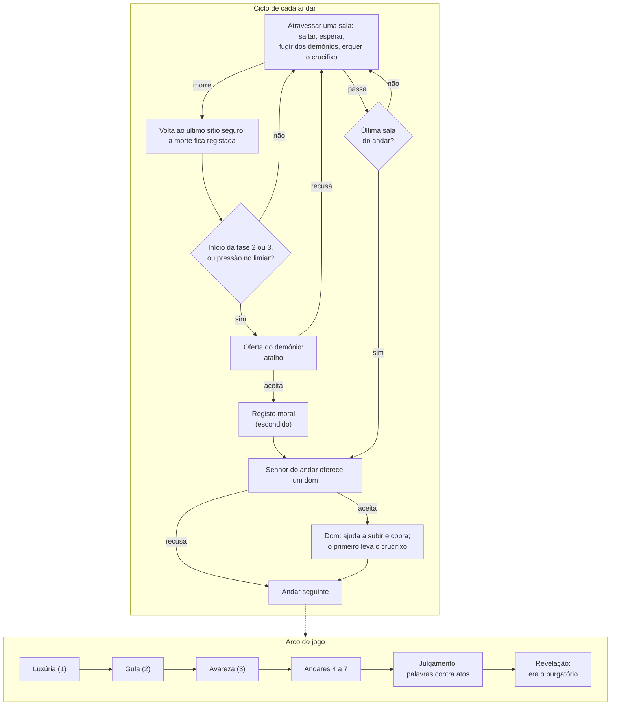

# 0. Visão geral

O jogo numa página: o que é, para que plataforma, os pilares, o ciclo de jogo, o âmbito e o calendário.

Dono: [por decidir pelo grupo] · Revisto: 2026-11-23 · Estado: a meio

## Identificação

| | |
|---|---|
| Título | **O Deus!** (latim, "Oh, Deus!"). Usado nos pitches; o README ainda diz «Título por decidir». [por decidir pelo grupo: confirmar] |
| Logline | "You wake up in hell with nothing but your name. Every demon offers you a way out. The game is keeping score." |
| Hook | "Who said that hell was easy?" |
| Género | Plataformas 2D sem combate, com história linear |
| Plataforma e input | PC, com teclado ou comando; o rato não entra nos controlos predefinidos ([bloco 5](5_flow_interface_controls.md)) |
| Motor | Godot 4.7, GDScript tipado, renderer Compatibility |
| Tema da cadeira | "Destroy Yourself": cada dom facilita a subida e destrói a salvação |

## Sinopse

A alma acorda no inferno só com o nome, que o jogador escreve. Para sair, sobe sete andares, um por pecado capital. Em cada andar, um demónio oferece uma saída mais fácil: um atalho durante a subida e um dom à saída. O primeiro dom aceite leva o crucifixo, a única defesa da alma. No fim, o julgamento compara o que a alma disse com o que fez, e percebe-se que o sítio era o purgatório e a subida, o teste.

Fantasia do jogador: subir o inferno sem se vender, por mais difícil que seja.

## Pilares

| Pilar | O que obriga |
|---|---|
| Cada nível é um pecado | O espaço, os demónios e a ameaça de cada nível saem do pecado. Na luxúria, os cães agarram a alma e puxam-na para baixo, e subir é resistir. |
| Tentação em vez de combate | A alma não ataca. Foge, sobe, espera ou ergue o crucifixo. A ajuda vem dos demónios, e tem um preço. |
| Julgado sem saber | O registo moral é escondido: o jogador não vê pontos. O jogo regista as ofertas aceites e o tom das respostas. |

## Ciclo de jogo e arco

O ciclo esconde o que muda entre voltas: as ofertas só começam na fase 2 e chegam mais cedo a quem morre mais no mesmo sítio, e a partir do estádio 1 do registo moral a recusa humilde desaparece dos dons. As regras estão no [bloco 2](2_gameplay_and_rules.md).

## Âmbito

- MVP: níveis 1 a 3 (luxúria, gula, avareza), sem final. O âmbito acordado com o docente é de 2 a 3 níveis completos e bem feitos.
- Hoje: o nível 1 é jogável, com três fases; os níveis 2 e 3 estão por desenhar ([bloco 3](3_progression_and_levels.md)).
- Corta-se primeiro: o nível 3, antes de baixar a qualidade dos níveis 1 e 2, porque o acordo com o docente admite dois níveis. [proposta, por decidir pelo grupo]

## Calendário

| Momento | Data |
|---|---|
| Game Concept (PJ2D) | 6 out 2026 |
| Pitch do GDD (CDJ) | 23 nov 2026 |
| Alpha (PJ2D) | 21 dez 2026 |
| Versão final (PJ2D) | época de exames |

Sprints, milestones e riscos: [bloco 7](7_technical_and_production.md).
