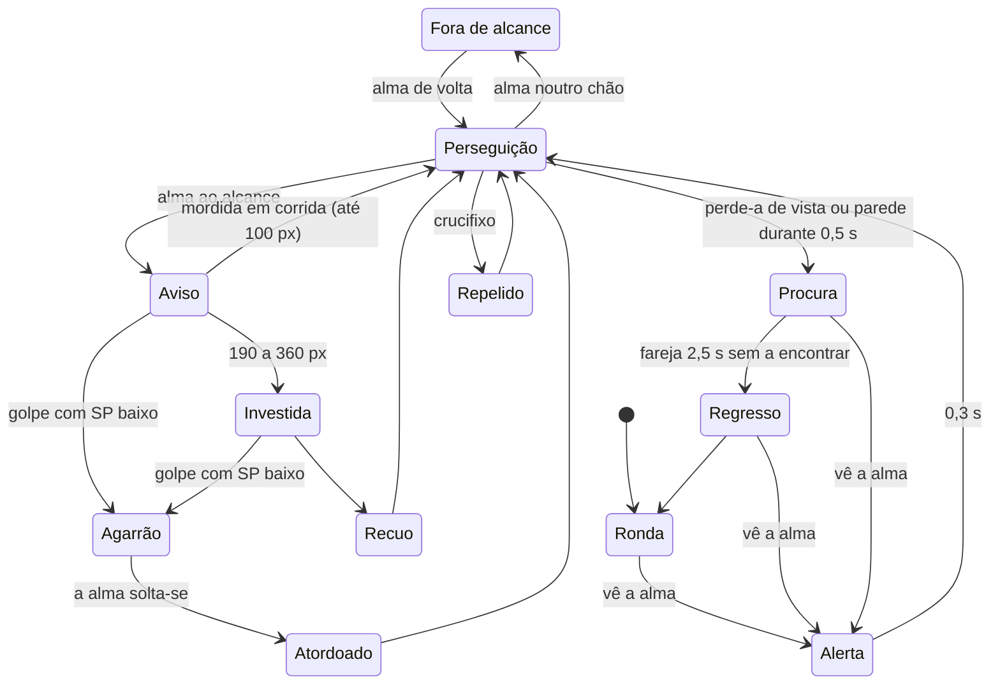
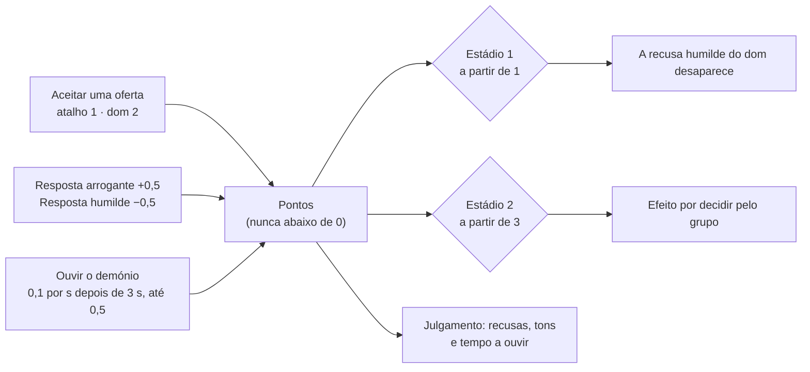

# 2. Jogabilidade e regras

As regras do nível 1 como estão no jogo: o que a alma faz, os recursos, os demónios, os perigos, a morte, as ofertas e o registo moral. Valores do código a 23/11/2026; o detalhe e as medidas estão no [README](../../README.md), secção "Mecânicas implementadas".

Dono: [por decidir pelo grupo] · Revisto: 2026-11-23 · Estado: a meio (nível 1; níveis 2 e 3 por desenhar)

## Vitória e derrota

| | Condição | O que acontece |
|---|---|---|
| Vitória no andar | Atravessar as três fases e ouvir o senhor do andar | Dom à saída; o jogo grava. Hoje volta ao menu; no jogo completo, segue para o andar seguinte |
| Morte | Picos ou silvas (um toque); agarrão não resolvido em 3 s; golpe do cão maior | Volta ao último ponto de gravação da fase. Não há game over |
| Fim do jogo | Julgamento depois do sétimo andar | [por decidir pelo grupo] |

## Ações da alma

A alma é pesada: arranca devagar, sobe o salto com calma e cai depressa. Não tem botão de ataque.

| Ação | Regra | Valor |
|---|---|---|
| Andar | Uma só velocidade, sem corrida | 600 px/s; atinge-a em 0,18 s e trava em 0,15 s |
| Saltar | Altura variável: largar o botão corta o salto | 240 px (5 tiles), mínimo ~86 px; subida em 0,45 s |
| Ajudas ao salto | Coyote Time, Jump Buffer, ajuda nos degraus | 0,1 s, 0,1 s, 16 px |
| Wall Slide | Começa ao tocar na parede, sem empurrar | 350 px/s |
| Wall Jump | Salto completo para longe da parede; uma parede isolada não se sobe, uma chaminé sim | bloqueio de 0,2 s depois do salto |
| Crucifixo | Erguer, só no chão; ver Recursos | |
| Interagir | Estátuas que abrem portões | |

## Recursos

| Recurso | Regra | Valores |
|---|---|---|
| Soul Points (SP) | A vida da alma. Os golpes tiram SP; a regeneração começa depois de um intervalo sem golpes. Com SP baixo, um cão agarra em vez de tirar SP | Máximo 100; baixo a partir de 25; regenera 3 s depois do golpe, de 0,5 a 3 SP/s em 10 s |
| Crucifixo | Erguido, repele os demónios no raio e abranda a alma. Funciona como uma bateria: esvaziá-lo bloqueia-o até encher. Perde-se no primeiro dom aceite | Raio 200 px; alma a 150 px/s; cura 5 SP/s enquanto erguido; carga de 5 s, recupera 1 s a cada 3 s; bloqueio de 15 s se esvaziar |

## Demónios da luxúria: os cães

Três tamanhos com as mesmas regras base. O cão normal ensina, o médio aperta, o maior é a ameaça final da fase 3.

No código há 16 estados (`demon.gd`); o diagrama junta os de ronda e de ataque e deixa de fora o salto e a descida do cão maior.

| Limiar | Normal | Médio | Maior |
|---|---|---|---|
| Tamanho | 112 × 56 px | 140 × 70 px | 168 × 84 px |
| Vê à frente / atrás / perde a | 1100 / 220 / 1600 px | igual | 1130 / 249 / 1630 px |
| Só persegue com a alma no ecrã | margem de 160 px | igual | igual |
| Perseguição | 510 px/s, ±10 % na matilha | igual | 550 px/s, ±8 % |
| Mordida | 100 px, aviso 0,1 s, 10 SP | 12,5 SP | 130 px, aviso 0,35 s, mata |
| Investida | até 360 px, aviso 0,35 s, 20 SP | 25 SP | 390 px, salta para outro chão, mata |
| Desiste | perde-a de vista, procura e regressa | igual | nunca; segue o rasto |
| Sobe e desce | não sai do seu chão | igual | salta 240 px e desce poços |
| Crucifixo | atira-o ~200 px | igual | não o afeta |
| Atordoado depois do agarrão | 1,2 s | igual | igual |

Regras da matilha: um atacante de cada lado da alma; quem está por cima de um cão leva mordidas nas costas a cada 0,4 s.

## Agarrão

| | Regra |
|---|---|
| Quando | Um golpe com SP a 25 ou menos, ou que deixaria o SP a 0 |
| Fugir | 8 toques no salto, mais 6 com um segundo cão (agarram no máximo dois); com Hold to escape, manter 1,2 s, mais 0,9 s com o segundo cão |
| Falhar | A alma afunda e morre ao fim de 3 s |
| Soltar-se | Os cães são atirados 200 px e ficam 1,2 s atordoados; a alma fica 1 s invulnerável |

## Perigos e peças do nível

| Peça | Regra |
|---|---|
| Picos e silvas | Matam com um toque, com qualquer SP |
| Portão e estátua | A estátua usa-se uma vez, com interagir; a câmara mostra o portão que abre, e o portão desliza em 0,8 s |
| Plataforma que desaba | Estala e desaparece em 0,6 s depois de pisada; volta ao fim de 3 s |

## Morte e recomeço

- Depois de 0,7 s (o salto encurta a espera), o ecrã fecha e o nível recomeça no último ponto de gravação da fase.
- Repõe-se o estado gravado: dons, crucifixo e registo moral. Os SP, os cães e a câmara recomeçam.
- As estatísticas da partida não se repõem: mortes por fase, por zona e por causa, e o tempo. Os demónios usam-nas nas falas.

## Ofertas

| Oferta | Quando | O que faz |
|---|---|---|
| Atalho | No início das fases 2 e 3, e quando a pressão das mortes chega ao limiar | Leva a alma à tenda da Asmodeus. Aceitar acaba com as ofertas do andar |
| Dom | No fim do andar, pelo senhor | Ajuda a subir e cobra; o primeiro leva o crucifixo |

Ritmo do atalho pela pressão: cada morte soma 1, mais 0,5 por cada morte anterior no mesmo sítio. O primeiro limiar é sorteado entre 4 e 7, e cada limiar seguinte desce para 70 %, até um mínimo de 1,5, com ±15 % de variação. No sorteio mais curto, com uma morte em cada zona, as ofertas chegam às 4, 3, 2 e 2 mortes; morrendo sempre no mesmo sítio, a primeira chega à 3.ª morte.

Cada oferta tem quatro respostas, numa roda: recusar ou aceitar, em tom humilde ou arrogante.

## Registo moral

- O jogador nunca vê os pontos.
- Uma recusa fica registada, sem pontos. Cada tentação conta uma vez.
- A recusa humilde também desaparece quando há mais respostas arrogantes do que humildes.

## Câmara

- O nível 1 usa a câmara `Fixed` (zoom fixo): segue a alma com uma zona morta de 96 px e zoom 1,4, um pouco abaixo do centro. Foi escolhida por defeito por causar menos enjoo.
- Nas conversas, a câmara aproxima-se e aparecem barras de cinema.
- O tremor do ecrã e a vibração do comando regulam-se de 0 a 100 % nas opções.
