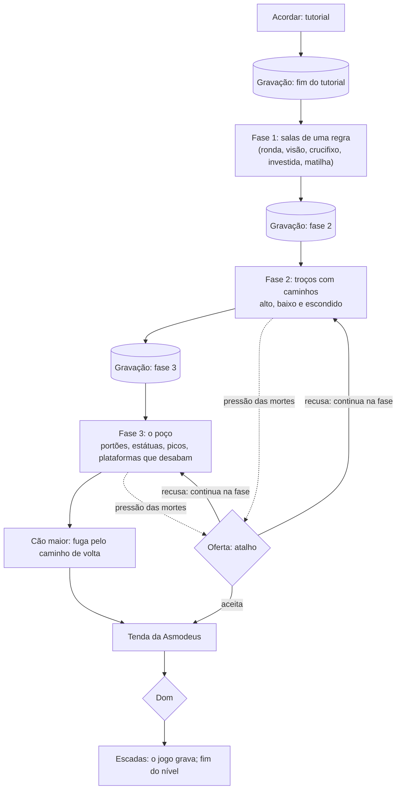

# 3. Progressão e níveis

Como o jogador progride dentro do nível 1 e entre níveis: os escalões de perícia, a regra do nível, as áreas e a dificuldade. O desenho original está no [desenho do nível 1](../nivel1_desenho.md); onde o jogo mudou depois dele, este bloco segue o jogo.

Dono: [por decidir pelo grupo] · Revisto: 2026-11-23 · Estado: a meio (nível 1 tem; níveis 2 e 3 vazios)

## A regra do nível 1

**O chão é dos cães, a altura é da alma, e cada fase retira-lhe mais chão.**

Os cães normais e médios não saem do chão onde estão. A alma salta 5 tiles e sobe paredes e chaminés. O nível desenha-se em dois andares: em baixo, os chãos dos cães; em cima, poleiros e passagens a que só a alma chega. Na fase 3, o cão maior quebra a regra: salta, desce poços e segue o rasto da alma.

## Escalões de perícia

| Escalão | Fase | O que o jogador faz | O que aprende | Ofertas |
|---|---|---|---|---|
| Newbie | 1, apresentar | Uma regra dos cães por sala; nas salas 1.2 a 1.5, a primeira metade mostra a regra sem risco | Os controlos e cada regra dos cães em separado | Nenhuma |
| Intermediate | 2, desenvolver | Escolhe entre caminhos que se separam e voltam a juntar, com o risco à vista antes de entrar | A escolher o caminho em função dos cães | O atalho começa a aparecer |
| Master | 3, combinar | Sobe um poço onde as paredes deixam de chegar: tem de descer ao chão dos cães com o crucifixo; picos, portões, plataformas que desabam e o cão maior | Que a altura deixa de bastar | Segunda oferta; recusar tudo e guardar o crucifixo é a subida mais difícil |

## Áreas do nível 1

O diagrama mostra a ordem das áreas, não as distâncias nem os saltos. As medidas para desenhar salas estão no [README](../../README.md), secção "Medidas para o desenho de níveis": grelha de 48 px; salto de 240 px (5 tiles); um vão até 440 px passa sempre e a partir de 595 px nunca passa; uma chaminé até 163 px sobe-se sempre; um degrau de 48 px trava um cão.

Hoje as três fases estão numa só cena (`level1.tscn`), com três pontos de gravação. [por confirmar no jogo: os três caminhos da fase 2]

## Dificuldade

- O jogo é difícil de propósito e não tem modo fácil. O atalho dos demónios é a única forma de aliviar, e fica registado no julgamento.
- Alavancas que já existem: a fase 1 mostra cada regra sem risco antes de a exigir; as ofertas chegam mais cedo a quem morre mais no mesmo sítio; Coyote Time e Jump Buffer; o Hold to escape no agarrão.
- Problema em aberto (22/11/2026): os novatos passam a fase 1 e ficam presos depois dela. A progressão pode estar a servir só jogadores muito bons. [por decidir pelo grupo]
- Hipótese para o próximo playtest: um jogador sem experiência no género chega ao fim da fase 2, com ou sem atalho. Observar onde morre, quantas vezes e se percebe porquê. [critério de sucesso por decidir pelo grupo]

## Níveis 2 e 3

| Nível | Pecado | Estado |
|---|---|---|
| 2 | Gula | Por desenhar: mecânica, demónios e fases ([issue #45](https://github.com/P2D2627/P2D/issues/45)). Há falas e ofertas de uma versão anterior da história |
| 3 | Avareza | Por desenhar ([issue #46](https://github.com/P2D2627/P2D/issues/46)). Há falas e ofertas de uma versão anterior da história |
| 4 a 7 | Preguiça, ira, inveja, soberba | Fora do MVP. Ordem e desenho [por decidir pelo grupo] |

Cada nível segue o mesmo molde do nível 1: uma regra do pecado, apresentada, desenvolvida e combinada em três fases, com ofertas entre elas e o senhor do andar no fim.
