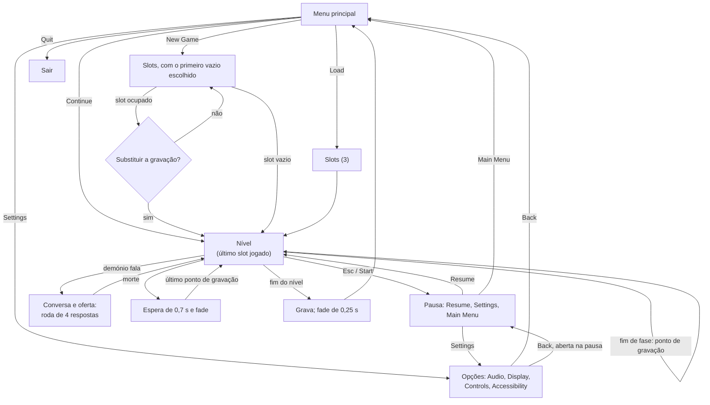

# 5. Fluxo, interface e controlos

Os ecrãs e a passagem entre eles, o HUD, os controlos e a acessibilidade. O detalhe está no [README](../../README.md), secções "Menus, pausa e opções", "Controlos: perfis e remapeamento" e "Gravação do jogo".

Dono: [por decidir pelo grupo] · Revisto: 2026-11-23 · Estado: a meio

## Flowboard

- Sem nenhuma gravação, o New Game começa logo no slot 1, e o Continue e o Load não aparecem.
- Perder o foco da janela pausa o jogo. Ao gravar, aparece "Saving...".
- O ecrã onde o jogador escreve o nome está escrito no guião, mas ainda não existe no jogo. [por fazer]

## HUD

| Elemento | Onde e como |
|---|---|
| Barra de SP | Canto superior esquerdo, 440 px de largura |
| Crucifixo | Dourado quando está pronto; azul, com os segundos que faltam, quando bloqueia depois de esvaziar; um marcador no lugar dele depois do primeiro dom |
| Nas conversas | O HUD esconde-se; entram barras de cinema (2,39:1), o balão com o retrato de quem fala e a roda das 4 respostas |
| Avisos do tutorial | Faixa em baixo, com os ícones do último aparelho usado |
| O que não mostra | Tempo e registo moral (o julgamento é escondido) |

## Controlos

PC, com teclado ou comando. O rato não entra nos perfis predefinidos.

| Ação | Teclado (perfil WASD) | Comando |
|---|---|---|
| Mover | WASD ou setas | Stick esquerdo ou D-pad |
| Saltar | Space | A |
| Crucifixo (planeado: depois do primeiro dom, o poder ativo) | Shift | RT |
| Interagir | E | X |
| Pausa | Esc | Start |
| Separadores das opções | | LB / RB |

- Perfis de teclado: WASD (predefinido), Arrows (setas, com Q, W, E, A, S, D) e Custom, que aceita o rato.
- O teclado remapeia-se por tecla física; num conflito, as duas teclas trocam. O Esc e as teclas de depuração estão reservados.
- O comando ainda não se remapeia ([issue #249](https://github.com/P2D2627/P2D/issues/249)).
- Os avisos do tutorial mostram os botões do último aparelho usado.
- Os menus respondem a mover, escolher, voltar e recusar com um som e uma vibração próprios.

## Acessibilidade

As opções estão no menu principal, antes de jogar, e guardam-se entre sessões.

| Já existe | Falta |
|---|---|
| Separador Accessibility: tremor do ecrã e vibração de 0 a 100 %; vibração contínua (liga e desliga); Hold to escape no agarrão; Show hidden dangers | Alternar o crucifixo em vez de o manter ([issue #250](https://github.com/P2D2627/P2D/issues/250)) |
| Remapeamento do teclado | Remapear o comando ([issue #249](https://github.com/P2D2627/P2D/issues/249)) |
| Câmara `Fixed` por defeito, para reduzir o enjoo | Opção de tamanho do texto |
| Agarrão sem obrigar a carregar depressa, com Hold to escape | Reduzir movimento nas opções (hoje só existe para a câmara das conversas, no Inspector) |
| Coyote Time, Jump Buffer e ajuda nos degraus; o Wall Slide não obriga a manter a direção | |
| Forma e luz como pista, nunca só a cor; contraste medido de 16:1 nos textos de ajuda | |
| Clarões dentro dos limites de fotossensibilidade | |
| Volume por canal: geral, música, efeitos, ambiente e interface | |
| Nada de essencial só pelo som: o alerta do cão leva um "!" por cima da cabeça, e cada ataque tem um aviso de forma | |
| Respostas sem tempo limite; salto das falas sem escolher pelo jogador | |

O jogo é difícil de propósito e não tem assistências que mudem o risco, como mais tempo, menos dano ou saltos guiados (decisão de 20/11/2026). A saída prevista para quem não passa é o atalho do demónio, que conta para o julgamento. As ajudas de controlo da tabela valem para todos e não mudam o risco. O Show hidden dangers é diferente: mostra o que a linha de vista esconde, e por isso muda a informação disponível. [por decidir pelo grupo: se conta como assistência]

O custo desta decisão: quem precisa de ajuda motora só a encontra no atalho, e paga-a no registo moral. Na fase 1 não há ofertas, e aceitar o atalho acaba com as ofertas do andar, pelo que nem o atalho serve quem fica preso no tutorial.
