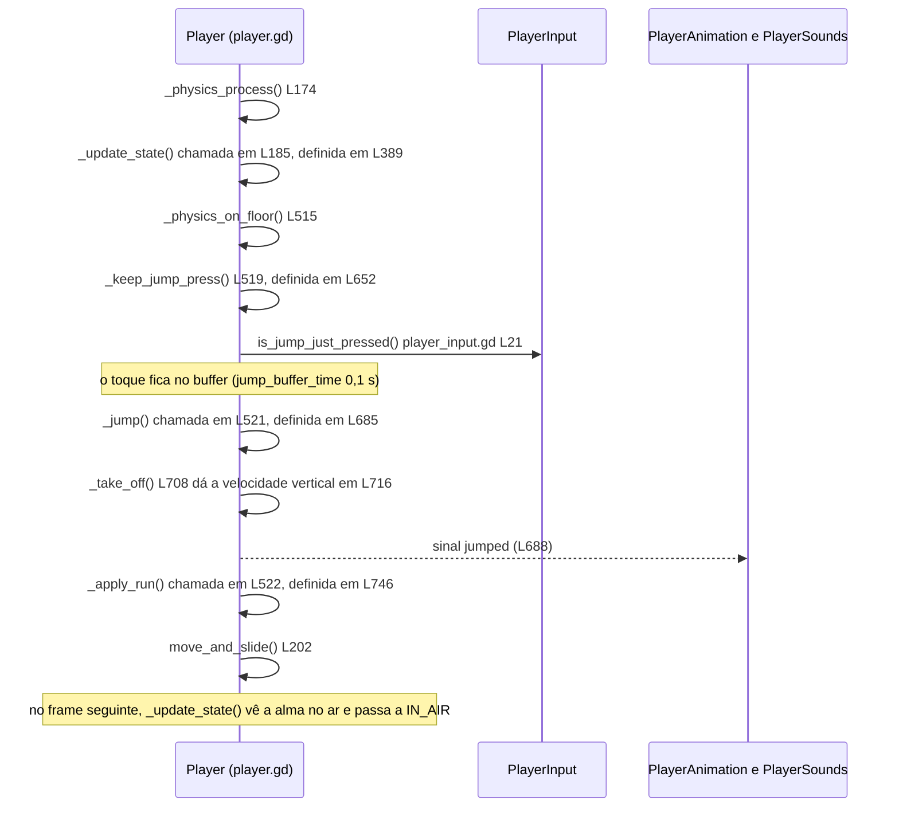
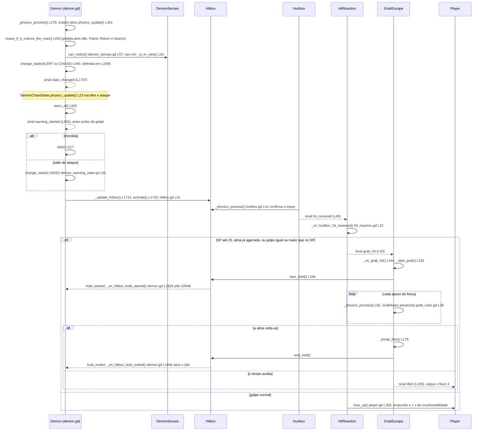
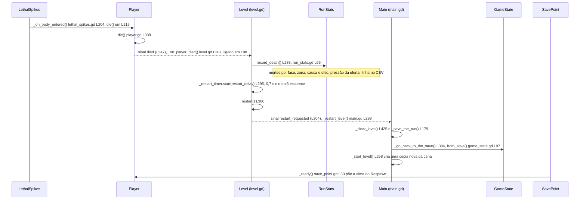
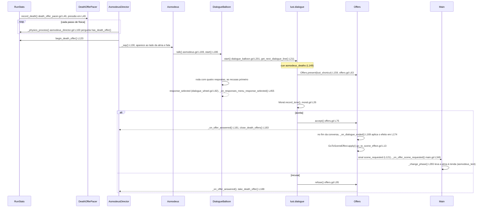
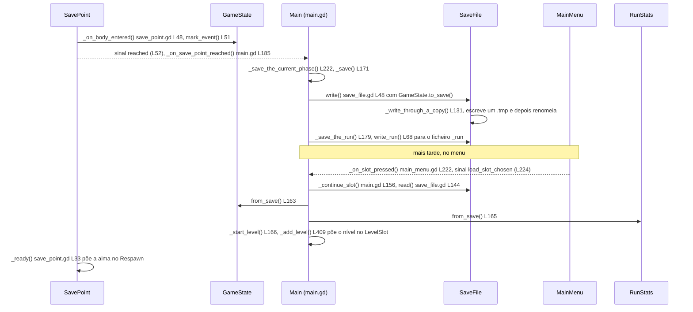
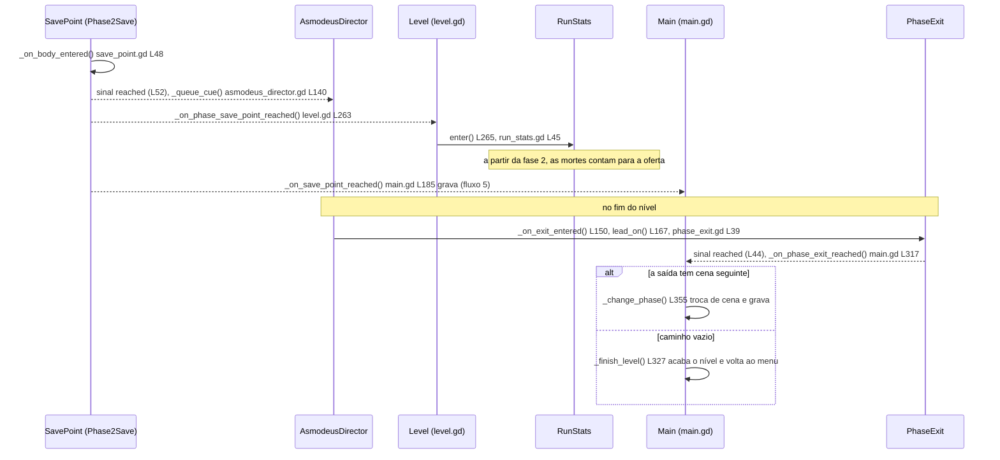

# Arquitetura

Os padrões do projeto numa página, seis fluxos de ponta a ponta com a função e a linha de cada passo, as decisões de arquitetura com a alternativa rejeitada e os limites conhecidos, com números medidos. Descreve o `dev` no commit `cd14afe` (23/11/2026). Os caminhos são relativos a `Projeto/`.

## Os padrões numa página

| Padrão | Onde está | O que resolve |
|---|---|---|
| Cena principal fixa, níveis trocáveis | `main.gd`: o `Main` fica carregado e troca o nível dentro do `LevelSlot`; os menus só emitem sinais | O que vive entre níveis não depende de nenhum nível; recomeçar é trocar uma instância |
| Máquina de estados da alma | `characters/player/player.gd`: `enum State` com 4 estados; só `_update_state()` os muda (ADR 0009) | As transições ficam num só sítio, decididas a partir do último `move_and_slide()` |
| Máquina de estados dos cães (padrão State) | `characters/demon/states/`: 16 estados, cada um um objeto `RefCounted` criado em `_make_states()`; só `Demon.change_state()` os troca (ADR 0034) | Cada estado guarda os seus contadores e a sua lógica num ficheiro; o `demon.gd` é o contexto |
| Strategy na câmara | `others/camera/camera_brain.gd` (`@abstract`: `begin`, `advance`, `get_centre`, `get_zoom`); `FixedFraming` é um modo, `Zones` é o do próprio `GameCamera` (ADR 0075) | Um modo novo de enquadrar não toca na câmara nem nos seus filhos (tremor, vibração, desfocagem) |
| Dados em `Resource` | `*_stats.gd` + `.tres` (movimento, SP, crucifixo, agarrão, câmara), `DemonStats` + `DemonAttack`, `OfferData` + `OfferEffect`, `MovementModifier` | Um tipo novo de cão ou uma oferta nova é um `.tres`, sem código; os valores afinam-se no Inspector |
| Sinais para cima, chamadas para baixo | A alma emite `died` e o `Level` ouve; o cão emite `state_changed` e `warning_started`, e o desenho, a marca, os sons e a linha de vista ouvem | A lógica não conhece a apresentação; quem ouve pode mudar sem mexer em quem emite |
| Autoloads | `autoload/`: 7 autoloads (`Settings`, `DialogueManager`, `Moral`, `GameState`, `Offers`, `RunStats`, `LastDevice`); os scripts chegam a eles por `get_node(^"/root/<Nome>")` com o tipo da classe. O `Moral` e o `RunStats` são camadas finas sobre classes puras; os outros guardam o estado no próprio nó | Guardam só o que sobrevive à troca de nível; os scripts compilam sem eles |
| Componentes | `characters/components/` (`Hitbox`, `Hurtbox`, `Repellable`, `SinkingDrawing`) e os filhos da alma (`SoulPoints`, `HitReaction`, `GrabEscape`, `Crucifix`); só o `PlayerInput` lê o Input Map (ADR 0014) | Cada tarefa num nó com o seu script; os mesmos componentes servem a alma e os cães |
| Classes puras testáveis | `RefCounted` sem nós: `MoralRecord`, `RunRecord`, `DeathOfferPacer`, `GrabRules`, `SaveFile`, `DemonTarget`, `DemonPath`, `DemonTrail`, `TalkShot`, `RockMap`, `KnockOff` | As regras testam-se sem árvore de cena; os nós ficam com a ligação ao motor |
| Testes sem framework | `tests/`: cada teste estende `SceneTree`, corre sem janela a 60 fps fixos e termina com código 0 ou 1; o `support/base_test.gd` põe as opções em memória e desliga a gravação e os CSV (ADR 0004) | Corre com o executável do Godot, sem dependências; o mesmo resultado em qualquer computador |

O movimento da alma não se escreve de fora: quem precisa de a abrandar ou de lhe bloquear o salto (crucifixo, silvas, cenas de câmara, demónios que falam) regista um `MovementModifier` com a sua chave. A física corre a 60 passos por segundo com a interpolação ligada (`project.godot`, linha 211; ADR 0013).

## Fluxos de ponta a ponta

Cada passo cita a função e a linha onde está, conferidas no disco no `cd14afe` a 23/11/2026. As setas cheias são chamadas e as tracejadas são sinais. Os números das linhas mudam com cada commit; a função procura-se pelo nome.

### 1. Comando → movimento

No chão, o `_physics_on_floor()` guarda o toque (`_keep_jump_press()`), salta se o buffer ainda tiver frames e aplica a corrida com controlo total. No ar, o `_physics_in_air()` (L530) aplica a gravidade (`_apply_gravity()`, L635), que é mais forte quando se larga o botão, e por isso o salto tem altura variável. O coyote time e o buffer são contadores de frames. A animação e o som não leem o teclado: ouvem `jumped`, `wall_jumped` e `landed`.

### 2. Cão vê → ataca → agarra

A visão é uma área mais um raio contra a camada `world`. O cão só persegue quando o próprio corpo está no ecrã (`chases_only_on_screen`). O aviso vem sempre antes do golpe e revela o cão na linha de vista da alma (`SightReveal` ouve `warning_started`). O `HitReaction` decide entre dano e agarrão; as regras do agarrão (toques, tempo, até 2 cães) estão na classe pura `GrabRules`, com os valores no `grab_stats.tres`. Com a opção Hold to escape, segurar o salto substitui os toques.

### 3. Morte → recomeço

A morte pode vir das silvas e dos picos (como no diagrama), de um golpe que mata (`HitReaction`, L36) ou de um agarrão que acaba (fluxo 2). Recomeçar é instanciar o nível inteiro de novo (ADR 0026): a cópia nova repõe a câmara, os SP, os cães e os contadores do movimento. O `GameState` (com o `Moral`) volta ao que está gravado, mas o `RunStats` não: as mortes, o tempo e a pressão da oferta continuam. Corrida sozinha com F6, a cena recarrega-se a si própria (`level.gd`, L305 e L306).

### 4. Oferta (o atalho depois das mortes)

A pressão só conta a partir da fase 2. Cada morte soma 1, mais 0,5 por cada morte anterior no mesmo sítio (a mesma zona e a mesma origem, como uma faixa de picos, ou, sem origem, a mesma causa). A primeira oferta chega com uma pressão entre 4 e 7, e cada intervalo seguinte encolhe para 70 % até 1,5. Os valores estão no `death_offer_stats.gd`. O diretor não espera por um sinal: pergunta em cada passo de física e só faz aparecer a Asmodeus com a alma viva, no chão e com espaço ao lado. Cada resposta do `.dialogue` regista o tom no `Moral` e chama `Offers.accept` ou `Offers.refuse`. Nos dois casos, a oferta dessa zona deixa de esperar (`take_death_offer()`); aceitar fecha também as ofertas por mortes no resto do nível.

### 5. Gravar e carregar

Cada espaço é um `ConfigFile` (`user://save.cfg`, `save_2.cfg`, `save_3.cfg`) com `version` (`FILE_VERSION = 2`; a versão 1 ainda se lê), a cena, o estado e a fase. As estatísticas vão para um ficheiro `_run` à parte, para uma morte contar sem reescrever a gravação. A escrita passa por uma cópia `.tmp` e só depois substitui o ficheiro, para uma falha a meio não deixar uma gravação partida. O `MOVED_SCENES` traduz os caminhos de cenas que mudaram de sítio (ADR 0069).

### 6. Troca de fase

No nível 1, as três fases estão na mesma cena. Passar de fase é atravessar um `SavePoint` com `starts_phase`: muda a fase no `RunStats`, o diretor põe na fila a fala dessa fase e o `Main` grava, sem escurecer nem trocar de cena. A troca de cena com escurecimento só acontece num `PhaseExit` com caminho ou no atalho da oferta. A saída do nível 1 tem `walk_in_leads_on = false`, e é o diretor que a manda avançar.

## Decisões e alternativas rejeitadas

| Decisão | Alternativa rejeitada e porquê | ADR |
|---|---|---|
| Testes como scripts que estendem `SceneTree`, sem framework | Instalar já o GUT ou o gdUnit4 como addon: uma dependência nova no repositório do grupo. Em troca, não há descoberta automática nem relatório | 0004 |
| A alma com um `enum` de estados e as transições só em `_update_state()` | Nós de estado com um script por estado: os estados partilham a gravidade, a corrida e os contadores, que ficariam no `player.gd` na mesma. Sem máquina, mais condições nas funções que já havia: as transições não ficavam num sítio só | 0009 |
| Uma câmara própria ao lado da alma, com a interpolação da física ligada | Uma `Camera2D` filha da alma, configurada no Inspector: não antecipa e dava a câmara à personagem. A mesma com um script nas margens: as margens do Godot não sabem quando a alma aterra | 0013 |
| O `PlayerInput` como único leitor do Input Map, e pastas por sistema | Deixar a leitura no `player.gd`, que lia o teclado em 4 sítios, ou partir já o movimento todo em nós: a gravidade e a corrida só saem da alma quando houver um segundo uso | 0014 |
| Uma só cena de demónio, com os valores num `DemonStats` | Uma máquina por nós, que pagava já por estados ainda sem design, ou uma classe-mãe `NPC` para quem persegue e quem fala | 0019 |
| Recomeçar com uma instância nova do nível | Reaparecer no sítio e repor à mão o coyote, o buffer, a câmara, os SP e os cães. O `reload_current_scene()` sozinho voltava ao menu | 0026 |
| Dialogue Manager como plugin, na versão fixa 4.1.0 | Um plugin com editor visual, ainda em alpha a dois meses da alpha do jogo, ou um parser próprio, que refazia o parser, a escrita letra a letra e a tradução sem ganho | 0030 |
| Os estados dos cães como objetos `RefCounted`, com o `enum` como contrato, em vez do `match` de 12 estados e 27 campos partilhados no `demon.gd` (825 linhas) | Um nó por estado na cena: mexia na cena, dava 600 nós com 50 cães e punha os valores no Inspector, contra o ADR 0019. Componentes para a perseguição e o ataque, por agora: fronteiras desenhadas antes de se saber que dados pediam. Com 50 cães, o custo ficou igual (0,87 ms antes, 0,86 ms depois, medianas) | 0034 |
| O custo dos cães medido em relação ao `dev`: um ramo não soma mais de 25 % | Um orçamento absoluto: o mesmo commit passou a medir cerca de 1,8 vezes mais devagar no mesmo computador, sem causa encontrada | 0048 |
| A linha de vista como componente em cada objeto, com raios contra a camada `world` | Uma máscara recortada pelo polígono de visibilidade: dava o recorte exato ao píxel, mas pedia a geometria toda e mexia na estrutura das cenas dos níveis | 0064 |
| Os modos da câmara dentro do `GameCamera`, por Strategy, e a câmara fixa | Câmaras separadas por modo: duplicavam o tremor, a vibração, o feedback e a desfocagem, que são filhos da câmara. Ficou de fora o zoom escolhido pelo espaço à volta da alma, para medir antes se a queixa do playtest voltava | 0075 |

## Limites conhecidos

| Limite | Número | Fonte |
|---|---|---|
| Custo dos cães a subir | Na medida de 10/11, com a mordida nas costas: 10 cães a perseguir, 0,44 ms por passo em média; 50, 3,07 ms; 200, 35,2 ms, mais do que um passo inteiro. Os ataques novos somaram +47 a +65 % ao `dev`, acima da regra dos +25 %, e foram aceites. O nível limita-se a 8 cães ativos no ecrã; a resposta preparada é repartir a linha de vista por passos | `tests/measures/measure_demon.gd`; README, secção dos custos dos demónios; ADR 0048 |
| Recomeço caro, escondido pelo escurecer | Cerca de 0,5 s no nível 1: 41 ms a instanciar, 43 ms a juntar à árvore e um frame de cerca de 410 ms, a maior parte nos tiles | `tests/measures/measure_restart.gd`; README, secção do recomeço |
| Nível 1 numa só cena | `level1.tscn` com 1810 nós e cerca de 2,2 MB, para as três fases; duas pessoas que mexam no nível ao mesmo tempo juntam alterações no mesmo ficheiro | [05_niveis.md](05_niveis.md) |
| Script dos cães grande | `demon.gd` com 1868 linhas (668 depois do ADR 0034) | `wc -l` a 23/11/2026 |
| Testes vermelhos e sem automatização | 153 de 168 passaram a 22/11; a suite corre-se num ciclo da shell, em cerca de 9 minutos, sem CI. O ADR 0004 previa passar a um framework quando houvesse regras de jogo, o que não aconteceu | [13_testes.md](13_testes.md); ADR 0004 |
| Medidas sem o custo de desenhar | Quase todas correm sem janela, num só computador; a máquina chegou a medir 1,8 vezes mais devagar sem causa | [13_testes.md](13_testes.md); ADR 0048 |
| Ponto de reaparecimento dependente da ordem da cena | Cada `SavePoint` já alcançado põe a alma no seu `Respawn` no `_ready`; ganha o último na ordem da cena | `levels/save_point.gd`, L39 e L40 |
| Sinais sem ouvintes | `death_recorded`, `phase_changed` e `death_offer_due` do `RunStats` não têm ouvintes no jogo (só o `death_offer_due` é ouvido, num teste); o `AsmodeusDirector` pergunta em cada passo de física | `autoload/run_stats.gd`, L52, L74 e L80 |

## Ver também

- [README.md](README.md) deste documento, com o mapa geral e um ficheiro por sistema.
- README, [Decisões técnicas](../../README.md#decisões-técnicas) e [Testes e medidas](../../README.md#testes-e-medidas).
