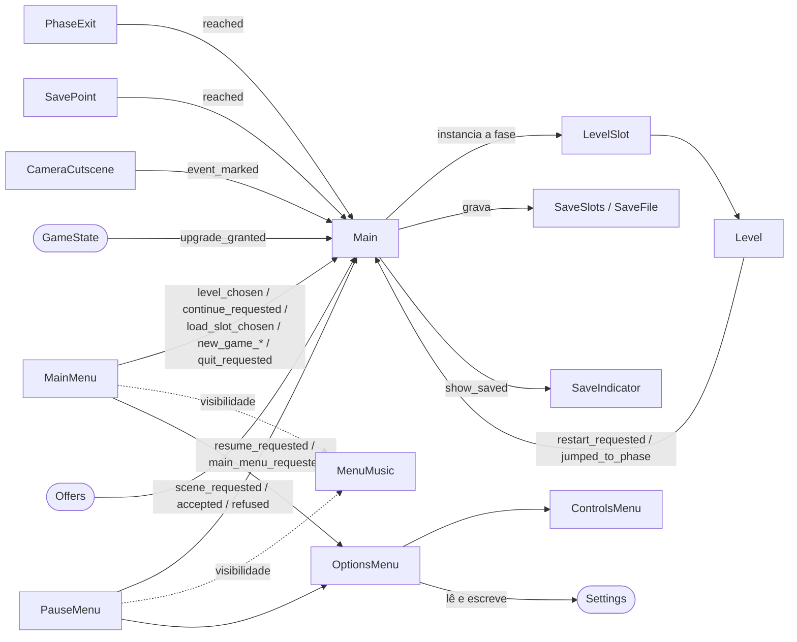

# Fluxo do jogo e menus

Como o jogo arranca, passa do menu ao nível, muda de fase, grava e pausa, e que ecrãs o jogador vê fora do nível. Descreve o `dev` no commit `cd14afe` (23/11/2026). Os caminhos são relativos a `Projeto/`.

## O que faz no jogo

Ao abrir, o jogo mostra o menu principal: Continuar, Carregar, Novo jogo, Definições e Sair. O novo jogo grava num de três espaços. Se o espaço escolhido já tiver uma gravação, o jogo pergunta antes de a substituir. Durante o nível, Esc ou Start abrem a pausa (Continuar, Definições, Menu principal). O jogo também pausa quando a janela perde o foco.

No nível 1, as três fases estão na mesma cena: ao passar de fase, o jogo grava e um aviso no canto confirma a gravação, sem escurecer o ecrã. O ecrã só escurece quando entra outra cena: num `PhaseExit` com caminho ou no atalho da oferta. Quando a personagem morre, o nível recomeça numa cópia nova, com o estado da última gravação (`main.gd:299`). A barra de SP, no canto superior esquerdo, também vive na pasta dos ecrãs e está descrita aqui.

## Como se liga

`main.tscn` é a cena raiz do projeto. O nó `Main` corre sempre, mesmo em pausa, e decide tudo: os menus só emitem sinais. O nível entra como filho de `LevelSlot`, que pára quando o jogo pausa.

Os nós entre parênteses curvos são autoloads (ver [02_servicos_globais.md](02_servicos_globais.md)). `Main` encontra os `PhaseExit`, `SavePoint` e `CameraCutscene` de cada fase pelos grupos de cada classe, quando a fase entra (`main.gd`, `_add_level`).

**Quando grava.** No novo jogo, em cada mudança de fase, em cada `SavePoint`, quando `GameState` concede um dom, quando uma oferta é respondida e quando uma cena de câmara de uma só vez termina. As estatísticas da partida (`RunStats`) gravam-se junto, e também na morte, no regresso ao menu, em Sair e ao fechar a janela. Os níveis com `starts_game` desligado (as salas de desenvolvimento) não gravam nada (`main.gd`, `_save`).

**Mudança de fase.** A fase seguinte carrega noutra thread enquanto o ecrã escurece (`fade_time`, 0,25 s). O nível fica congelado durante a troca, para a personagem não se mexer sem ser vista. Se o caminho não carregar, a personagem fica na fase atual e o erro vai para a consola (`main.gd`, `_change_phase`).

**Ecrãs e camadas.** Cada ecrã é um `CanvasLayer`. A ordem de desenho, de baixo para cima: `SoulHud` (5), balão de diálogo (8), `PauseMenu` (10), `FadeLayer` (100), `SaveIndicator` (101). O aviso de gravação fica assim por cima do escurecimento.

## Ficheiros

### Raiz

| Ficheiro | O que é | Quem o usa | Onde se afina |
|---|---|---|---|
| `main.gd` + `main.tscn` | Cena raiz: menu, `LevelSlot`, pausa, mudança de fase, gravações, sair | `project.godot` (`run/main_scene`) | `@export levels` (lista de `LevelEntry`), `pause_on_focus_loss` (ligado), `fade_time` 0,25 s, `quit_fade_time` 0,25 s |
| `scenes/levels/level_entry.gd` | `LevelEntry` (Resource): uma entrada da lista de níveis | `main.gd` | `title`, `scene`, `starts_game`, `in_menu` |

A lista `levels` do `main.tscn` tem quatro entradas, por esta ordem: «Test room» (`test_room/test_room.tscn`), «Level 1: Lust (old blockout)» (`lust/LustLevel_Phase1_Cave.tscn`), «Level 1: Lust» (`lust/level1_lit.tscn`, o único com `starts_game`) e «Gym (training room)» (`gym/gym.tscn`). Só o nível 1 aparece no menu, por isso Novo jogo começa-o logo.

### `scenes/screens/`

| Ficheiro | O que é | Quem o usa | Onde se afina |
|---|---|---|---|
| `main_menu.gd` + `.tscn` | `MainMenu` (`CanvasLayer`): botões, painel dos níveis, painel dos 3 espaços, pergunta de substituir | `main.tscn` | Textos em constantes; estilos `MenuFirstOption`, `MenuOption` e `MenuSlot` em `themes/ui_theme.tres` |
| `pause_menu.gd` + `.tscn` | `PauseMenu` (`CanvasLayer`, camada 10, corre em pausa) | `main.tscn` | `themes/ui_theme.tres` |
| `options_menu.gd` + `.tscn` | `OptionsMenu`: separadores Audio, Display, Controls e Accessibility; cada alteração vai logo para `Settings` | `main_menu.tscn`, `pause_menu.tscn` | `highlight_sharpness`, `highlight_margin`; constantes `BUS_TITLES`, `VOLUME_STEP` (0,05), `SCREEN_SHAKE_STEP` e `VIBRATION_STEP` (0,1) |
| `controls_menu.gd` + `.tscn` | `ControlsMenu`: perfis de entrada, troca de teclas por ação, estilo dos ícones do comando | `options_menu.tscn` | Os dados vivem em `Settings`; aqui só textos e medidas |
| `menu_backdrop.gd` + `.tscn` | `MenuBackdrop` (`@tool`): fundo animado do menu (personagem, raios, fogo, fumo, brasas); escurece quando um painel abre | `main_menu.tscn`, `pause_menu.tscn` | Grupos `Idle`, `Fire`, `Recede`, `Depth` e `Rays` do Inspector |
| `menu_embers.gd` | `MenuEmbers`: brasas, cinza ou bokeh num só desenho | `menu_backdrop.tscn` (4 nós) | `look`, `count`, grupos `Air`, `Bursts`, `Glow`, `Ash` |
| `menu_crosses.gd` | `MenuCrosses`: as duas cruzes que deslizam até ao botão com foco | `main_menu.tscn` (2), `pause_menu.tscn` | `height_share`, `gap`, `glide_sharpness` |
| `menu_feedback.gd` + `.tscn` | `MenuFeedback`: sons de mover, confirmar, voltar, trocar, marcar e recusar, no bus `UI`, e pulsos do comando | `main_menu.tscn`, `pause_menu.tscn`, balão de diálogo | Os volumes que valem estão no `.tscn` (todos a 0 dB), não nos valores do script |
| `menu_music.gd` | `MenuMusic` (`AudioStreamPlayer`): música do menu enquanto o menu ou a pausa estão visíveis | `main.tscn` (bus `Music`) | `fade_in_time` e `fade_out_time` 1,5 s, `fade_curve` |
| `menu_sound_synth.gd` | `MenuSoundSynth`: sons sintetizados para quando falta um ficheiro | `menu_feedback.gd` | Hoje não toca: todos os sons têm ficheiro |
| `save_indicator.gd` + `.tscn` | `SaveIndicator` (camada 101): aviso de gravação no canto | `main.tscn` | `fade_time` 0,25 s, `hold_time` 1,5 s |
| `soul_hud/soul_hud.gd` + `.tscn` | `SoulHud` (camada 5, grupo `hidden_during_dialogue`): barra de SP com aura e ícone do crucifixo pronto ou a recarregar | `scenes/levels/lust/level1.tscn` | `width` 440 px, `margin`, `fill_color`, `aura_fps` 12, texturas em `assets/sprites/hud/` |
| `builders/build_menu_art.gd` | Script de linha de comandos que recorta os desenhos de 3840×2160 em `menu_cross.png` e `menu_character.png` | Só o README | Comando no topo do script; código de saída 0 quando grava tudo |

O balão e a roda das respostas (`dialogue_balloon`, `dialogue_wheel`) também estão nesta pasta, mas estão descritos em [11_dialogo_e_ofertas.md](11_dialogo_e_ofertas.md).

### `themes/`

| Ficheiro | O que é | Quem o usa | Onde se afina |
|---|---|---|---|
| `main_font.tres` | Fonte do sistema (Times New Roman ou serif), com `assets/fonts/Tinos-Regular.ttf` de recurso | `project.godot` (`gui/theme/custom_font`), `ui_theme.tres`, sala de som | — |
| `ui_theme.tres` | Tema dos botões, menus, opções e avisos (`Menu*`, `Options*`, `Prompt*`) | Menus, `SaveIndicator`, `SoulHud`, avisos do tutorial, aviso do agarrão | Variações do tema no editor de temas |

## Desligado por defeito

| O quê | Valor | Porquê |
|---|---|---|
| Sala de teste, blockout antigo do nível 1 e ginásio no menu | `in_menu = false` no `main.tscn` | Salas de desenvolvimento: a entrada fica na lista e cada cena corre sozinha com F6 (ADR 0036, ADR 0050) |
| `MenuSoundSynth` | Só toca se faltar um ficheiro de som | Os sons gravados substituíram-no |

## Ver também

- README, [Estrutura](../../README.md#estrutura) e [Decisões técnicas](../../README.md#decisões-técnicas).
- ADR 0015 (menus, pausa e opções), ADR 0069 (três espaços de gravação).
- [02_servicos_globais.md](02_servicos_globais.md) para `Settings`, `GameState`, `SaveSlots` e `SaveFile`; [15_configuracao.md](15_configuracao.md) para as teclas, os buses e os ficheiros em `user://`.
