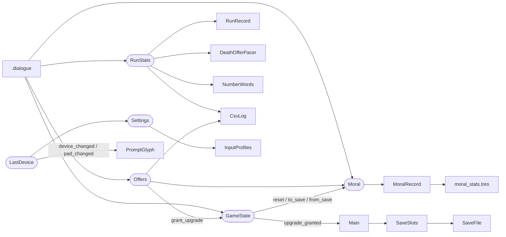

# Serviços globais (autoloads)

Os sete autoloads do projeto e as classes de apoio que vivem com eles em `scenes/autoload/`: opções, progresso gravado, registo moral, estatísticas da partida, último dispositivo usado e gravações. Descreve o `dev` no commit `cd14afe` (23/11/2026). Os caminhos são relativos a `Projeto/`.

## O que faz no jogo

Estes serviços existem durante toda a partida, em qualquer nível. Guardam as opções do jogador, o que a gravação leva (nome, crucifixo, dons, acontecimentos já vistos), o registo moral escondido que muda a forma como a alma fala, as mortes e o tempo de cada fase, e se o jogador está a usar teclado ou comando, para os avisos mostrarem o botão certo. O jogador não os vê diretamente: vê os efeitos, nas falas, nos avisos e no ecrã das opções.

## Como se liga

Os autoloads carregam por esta ordem (`project.godot`, secção `[autoload]`): `Settings`, `DialogueManager` (do plugin), `Moral`, `GameState`, `Offers`, `RunStats`, `LastDevice`. Todos são scripts, nenhum é cena.

Cada autoload tem uma `class_name` diferente do nome do nó (por exemplo, o nó `GameState` corre a classe `GameProgress`). Os scripts do jogo chegam a eles por `get_node(^"/root/<Nome>")`, com o tipo da classe, e não pelo nome global: assim os scripts compilam antes de os autoloads existirem. Os ficheiros `.dialogue` usam os nomes globais.

**Regras fora dos nós.** Cada autoload é uma camada fina sobre uma classe `RefCounted` com as regras (`MoralRecord`, `RunRecord`, `DeathOfferPacer`). Os testes usam essas classes sozinhas, sem árvore de cena. Os valores de afinação estão em recursos `Stats` (`.tres`), que se podem mudar ao vivo no separador Remote.

**Gravação.** `SaveFile` escreve o estado de `GameState` (com o de `Moral` lá dentro) num `ConfigFile`, e as estatísticas de `RunStats` num ficheiro à parte, com o sufixo `_run`. Assim uma morte conta sem reescrever a gravação. A escrita vai primeiro para uma cópia. `SaveSlots` gere os três espaços (`COUNT = 3`), em `user://save.cfg`, `save_2.cfg` e `save_3.cfg`, cada um com o seu `_run` (`save_run.cfg`, `save_2_run.cfg`, `save_3_run.cfg`; `save_slots.gd:38`, `save_file.gd:64`): resumo de cada um, o último jogado, o primeiro vazio. Quem decide quando gravar é o `main.gd` (ver [01_fluxo_e_menus.md](01_fluxo_e_menus.md)).

**Registos para playtests.** `RunStats` acrescenta uma linha a `user://deaths_log.csv` em cada morte, e `Offers` a `user://offers_log.csv` em cada oferta, pelo `CsvLog`. Os dois estão ligados por defeito.

## Ficheiros

### Autoloads (`scenes/autoload/`)

| Ficheiro | O que é | Quem o usa | Onde se afina |
|---|---|---|---|
| `settings.gd` | `Settings`, classe `GameSettings` (`Node`): volumes por bus, ecrã inteiro, vsync, limite de FPS, tremor, vibração, acessibilidade, controlos; grava em `user://settings.cfg` (`FILE_VERSION = 1`) | `options_menu.gd`, `controls_menu.gd`, `camera_shake.gd`, `controller_rumble.gd`, `grab_escape.gd`, `sight_reveal.gd`, `last_device.gd` | Constantes `DEFAULT_*`; mistura dos buses em `default_bus_layout.tres` |
| `game_state.gd` | `GameState`, classe `GameProgress`: nome da alma, crucifixo, dons, acontecimentos de uma só vez, ponto de chegada; sinal `upgrade_granted` | `main.gd`, `level.gd`, `save_point.gd`, demónios das falas, cenas de câmara, balão, depuração, `Offers`, os 3 `.dialogue` | `DEFAULT_PLAYER_NAME` |
| `moral.gd` | `Moral`, classe `GameMoral`: registo moral escondido e estádio da fala (#169); sinal `stage_changed` | `Offers`, `GameState`, depuração, os 3 `.dialogue` | `moral_stats.tres` e o `moral_weight` de cada oferta |
| `run_stats.gd` | `RunStats`, classe `GameRunStats`: nível e fase atuais, mortes, tempo, linhas saltadas, ofertas depois de mortes; sinais `death_recorded`, `phase_changed`, `death_offer_due`, sem ouvintes no jogo (o `AsmodeusDirector` pergunta `has_death_offer()` em cada passo de física) | `main.gd`, `level.gd`, `asmodeus_director.gd`, cenas de câmara, balão, depuração, `lust.dialogue` | `offers/death_offer_stats.tres` |
| `last_device.gd` | `LastDevice`, classe `GameLastDevice`: teclado ou comando usado por último e a família do comando; sinais `device_changed`, `pad_changed` | `prompt_glyph.gd` | Lê `Settings.get_pad_buttons()` |
| `offers/offers.gd` | `Offers`, classe `GameOffers`: as tentações | Ver [11_dialogo_e_ofertas.md](11_dialogo_e_ofertas.md) | — |

O `DialogueManager` vem do plugin (`addons/dialogue_manager/`) e está em [11_dialogo_e_ofertas.md](11_dialogo_e_ofertas.md).

### Classes de apoio (`scenes/autoload/`)

| Ficheiro | O que é | Quem o usa | Onde se afina |
|---|---|---|---|
| `moral_record.gd` | `MoralRecord` (`RefCounted`): regras dos pontos e dos estádios, gravação como dicionário | `moral.gd` | Recebe `MoralStats` e `OfferCatalog` |
| `moral_stats.gd` + `moral_stats.tres` | `MoralStats` (`Resource`): pontos por tentação, tom e tempo a ouvir; limites dos estádios | `moral.gd` (carrega o `.tres`), `moral_record.gd` | `unknown_temptation_points` 1,0; `arrogant_answer_points` e `humble_answer_points` 0,5; `listening_grace` 3 s; `listening_points_per_second` 0,1; `most_listening_points` 0,5; `stage_1_points` 1,0; `stage_2_points` 3,0. O `.tres` não muda nenhum: valem os do script |
| `run_record.gd` | `RunRecord` (`RefCounted`): contadores sem nós (mortes por fase, zona, causa e sítio; tempo por fase e zona; linhas saltadas) | `run_stats.gd`, `save_slots.gd` | — |
| `input_profiles.gd` | `InputProfiles` (estática): perfis de teclado (WASD, setas com QWEASD, personalizado) e texto das teclas | `settings.gd`, `controls_menu.gd`, `prompt_glyph.gd`, depuração | `PROFILES`, `ACTIONS`, `RESERVED_KEYS`. O perfil por defeito não usa o rato (ADR 0063) |
| `save_file.gd` | `SaveFile` (`RefCounted`): uma gravação, mais o ficheiro `_run`; lê gravações da versão 1 | `main.gd`, `save_slots.gd` | `FILE_VERSION = 2`, `MOVED_SCENES` (cenas que mudaram de caminho), `DEFAULT_PATH = user://save.cfg` |
| `save_slots.gd` | `SaveSlots` (estática): os 3 espaços para o menu | `main.gd`, `main_menu.gd` | `COUNT = 3` |
| `csv_log.gd` | `CsvLog` (estática): acrescenta uma linha a um CSV, com cabeçalho se o ficheiro for novo | `run_stats.gd`, `offers.gd` | — |
| `number_words.gd` | `NumberWords` (estática): números de 0 a 999 por extenso, em inglês, para as falas (#284) | `run_stats.gd` (`opening_words`) | `MOST_IN_WORDS = 999` |

A pasta `offers/` (catálogo, dados, efeitos e ritmo das ofertas depois de mortes) está em [11_dialogo_e_ofertas.md](11_dialogo_e_ofertas.md).

## Desligado por defeito

| O quê | Valor | Porquê |
|---|---|---|
| Segurar Saltar para fugir de um agarrão | `DEFAULT_HOLD_TO_ESCAPE = false` | Carregar várias vezes é o agarrão como foi desenhado; a opção existe para quem não consegue carregar depressa (comentário em `settings.gd`) |
| Mostrar demónios e picos fora da vista | `DEFAULT_SHOW_HIDDEN = false` | Não os ver é o jogo como foi desenhado; a opção existe para quem não consegue jogar assim (comentário em `settings.gd`; ADR 0064) |
| Ecrã inteiro | `DEFAULT_FULLSCREEN = false` | O código não diz porquê |
| Ignorar o ficheiro de opções do jogador | `static var ignore_player_file = false` | Só os testes a ligam, para darem o mesmo resultado em qualquer computador |

Ligados por defeito, para quem procure: vsync, tremor e vibração no máximo (1,0), vibração contínua durante um agarrão ou com o crucifixo erguido, botões do comando em automático e os dois registos CSV.

## Ver também

- README, [Estrutura](../../README.md#estrutura) e [Decisões técnicas](../../README.md#decisões-técnicas).
- ADR 0063 (teclado ou comando), ADR 0064 (linha de vista), ADR 0069 (três espaços de gravação).
- [15_configuracao.md](15_configuracao.md) para os ficheiros em `user://` e o Input Map.
