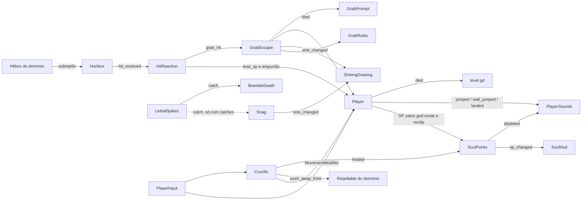

# Personagem, crucifixo e componentes

A alma que o jogador controla: movimento, estados, pontos de alma (SP), golpes e agarrões dos demónios, silvas, crucifixo, e os componentes que a personagem partilha com os demónios. Descreve o `dev` no commit `cd14afe` (23/11/2026). Os caminhos são relativos a `Projeto/scenes/characters/`.

## O que faz no jogo

A alma corre, salta (mais alto quanto mais tempo se segura o botão), desliza nas paredes e salta delas. Os SP descem com os golpes dos demónios e recuperam devagar depois de uns segundos sem dano. Chegar a zero não mata: com poucos SP, o golpe seguinte agarra a alma. Um demónio pode agarrar a alma: o jogador carrega várias vezes em Saltar para se soltar, e se o tempo acabar a alma afunda-se e morre. As silvas matam ao primeiro toque (a versão que prende e tira SP existe, mas está desligada). O crucifixo, erguido, abranda a alma, empurra os demónios para longe e cura. Gasta-se como uma bateria e depois tem de recarregar.

## Como se liga

A personagem faz-se por composição: `player.gd` trata do movimento e dos estados, e cada outra tarefa vive num nó filho com o seu script e, quando tem números, o seu recurso `Stats` (`.tres`).

Estados (`player.gd`, `enum State`): `ON_FLOOR`, `IN_AIR`, `ON_WALL`, `GRABBED`. Só a função `_update_state()` os muda (ADR 0009). Outros sistemas mexem na velocidade e no salto através de um `MovementModifier`, guardado por origem (o crucifixo, as silvas, a morte, as cenas de câmara, os demónios das falas). Assim nenhum sistema escreve diretamente na velocidade da personagem.

**Dano.** O `Hitbox` de um demónio toca no `Hurtbox` da alma. O `HitReaction` decide (`hit_reaction.gd:32`): um golpe que mata (`kills`, o do cão maior) mata logo. Os outros viram agarrão se a alma já estiver agarrada, tiver 25 SP ou menos, ou se o golpe for igual ou maior do que os SP que lhe restam. Se não, o `HitReaction` pede ao `Player` que tire os SP (`lose_sp()`, `player.gd:356`, que não tira nada em god mode nem em noclip), empurra e dá invulnerabilidade (ADR 0021, ADR 0055). No agarrão, o `GrabEscape` conta as carregadas (as regras puras estão em `GrabRules`, até 2 demónios ao mesmo tempo) e o `SinkingDrawing` afunda o desenho. Se o tempo acabar, a alma morre e o nível recomeça (ADR 0026). Os SP a zero não matam: o sinal `depleted` do `SoulPoints` só o ouve o `PlayerSounds`, que cala o aviso de SP baixos.

**Silvas.** As `LethalSpikes` (ver [06_objetos.md](06_objetos.md)) matam ao toque. Só com a opção `catches` ligada, que está desligada por defeito, chamam o `Snag`, que prende, abranda, bloqueia o salto e tira SP (ADR 0067). Quando matam, o `BrambleDeath` faz a morte: paragem curta, clarão branco e o corpo puxado para dentro das silvas (#263).

**Crucifixo.** É filho da personagem. Lê o `PlayerInput`, abranda a alma com um `MovementModifier`, empurra os `Repellable` (os demónios) que estejam no raio e cura os SP. Gasta-se enquanto está erguido e recarrega depois (ADR 0066). O som, a vibração e o ícone da barra de SP seguem os seus sinais.

**Leitura das teclas.** O `PlayerInput` é o único sítio que lê o Input Map para a personagem (ADR 0014).

## Ficheiros

### `player/`

| Ficheiro | O que é | Quem o usa | Onde se afina |
|---|---|---|---|
| `player.gd` + `player.tscn` | `Player` (`CharacterBody2D`, camada 2, máscara 1 + 3 + 9): movimento, estados, morte, agarrão, modificadores; sinais `jumped`, `wall_jumped`, `landed`, `head_bumped`, `got_on_wall`, `died` | Todos os níveis e salas, `main.gd`, `level.gd`, câmara, objetos, demónios das falas, HUD, depuração | `@export stats`, `input`, `soul_points`, `knock_off_layers` (valor 4 na cena, que é a camada 3, `enemy`: ADR 0022) |
| `player_movement_stats.gd` + `.tres` | `PlayerMovementStats`: corrida, gravidade, salto, parede, empurrão | `player.gd` | `max_run_speed` 600 px/s; `time_to_max_speed` 0,18 s; `time_to_stop` 0,15 s; `air_control` 0,7; `fall_gravity` 6600; `max_fall_speed` 1400 px/s; `grabbed_fall_speed` 250 px/s; `jump_height` 240 px; `time_to_peak` 0,45 s; `min_jump_height` 80 px; `coyote_time` e `jump_buffer_time` 0,1 s; `ledge_assist_height` 16 px; `wall_slide_speed` 350 px/s; `wall_jump_lock_time` 0,2 s; `knockback_max_time` 0,4 s; `knock_off_speed` 720 px/s |
| `player_input.gd` | `PlayerInput`: lê as ações de movimento (esquerda, direita, cima, baixo), saltar e crucifixo | `player.gd`, `crucifix.gd` | — |
| `player_animation.gd` | `PlayerAnimation`: escolhe a animação pelo estado; passo ao ritmo do chão; quadros do salto pelo arco | `player.tscn` | Grupos `Walk cycle`, `Jump frames`, `Escape` |
| `player_sounds.gd` | `PlayerSounds`: salto (também o da parede), aterragem, deslize, SP baixos | `player.tscn`; ouvido por `impact_feedback` e peças do protótipo de luz | Grupos `Jump and landing`, `Low SP` |
| `footsteps.gd` | `Footsteps` (`AudioStreamPlayer`): passos nos quadros 3 e 9 da corrida, ficheiro e tom ao acaso | `player.tscn` | `step_frames`; `double_layer` ligado na cena; volume no nó |
| `soul_points.gd` | `SoulPoints`: SP, dano, cura, recuperação com atraso e rampa; sinais `sp_changed`, `damaged`, `low_changed`, `depleted` | `player.gd`, `hit_reaction.gd`, `crucifix.gd`, `player_sounds.gd`, `soul_hud.gd`, depuração | `soul_points_stats.tres` |
| `soul_points_stats.gd` + `.tres` | `SoulPointsStats` | `soul_points.gd` | `max_sp` 100; `low_threshold` 25; `regen_delay` 3 s; `regen_start_per_second` 0,5; `regen_top_per_second` 3; `regen_ramp_time` 10 s |
| `hit_reaction.gd` | `HitReaction`: dano, empurrão e invulnerabilidade, ou agarrão; sinal `grab_hit` | `player.tscn`, `grab_escape.gd` | `invulnerable_time` 1 s |
| `invulnerability_blink.gd` | `InvulnerabilityBlink`: pisca o desenho durante a invulnerabilidade, abaixo de 3 Hz | `player.tscn` | `blink_rate` 2,5 Hz, `dim_alpha` 0,3 |
| `grab_escape.gd` | `GrabEscape`: fugir do agarrão, afundar, morrer; sinais `grabbed`, `sink_changed`, `broke_free`, `struggled`, `died` | `player.tscn`, `grab_prompt.gd`, `player_animation.gd`, `impact_feedback`, ginásio | `grab_stats.tres`; `Settings` (segurar em vez de carregar) |
| `grab_rules.gd` | `GrabRules` (`RefCounted`): regras puras do agarrão; `MAX_DEMONS = 2` | `grab_escape.gd` | `GrabStats` |
| `grab_stats.gd` + `.tres` | `GrabStats` | `grab_escape.gd`, `grab_rules.gd` | `time_to_die` 3 s; `presses_to_escape` 8 e mais 6 por demónio; `hold_time_to_escape` 1,2 s e mais 0,9 s por demónio; `drain_delay` 0,25 s; `drain_per_second` 0,5 |
| `grab_prompt.gd` + `.tscn` | `GrabPrompt`: aviso provisório do agarrão (ícone da tecla, texto, barra) | `player.tscn` | Textos em constantes no script |
| `movement_modifier.gd` | `MovementModifier` (`Resource`): multiplicadores de velocidade e de salto, e bloqueio do salto | `player.gd`, `crucifix.gd`, `snag.gd`, `asmodeus.gd`, `tutorial_demon.gd`, `camera_cutscene.gd` | `speed_multiplier`, `jump_height_multiplier`, `blocks_jump` |
| `snag.gd` | Sem `class_name` (de propósito): silvas que prendem; sinais `caught`, `freed`, `sink_changed` | `player.tscn` (nó `Snag`), `player.gd` (preload); o `lethal_spikes.gd` chega-lhe por `player.snag` | `speed_multiplier` 0,1; `sp_per_second` 150 |
| `bramble_death.gd` | Sem `class_name`: morte nas silvas | `player.tscn` (nó `BrambleDeath`), `player.gd` (preload); o `lethal_spikes.gd` chega-lhe por `player.bramble_death` | `bramble_death_stats.tres` |
| `bramble_cut.gd`, `bramble_pull.gd`, `bramble_death_pose.gd` | Matemática pura da morte nas silvas (cortar, puxar, pose) | `bramble_death.gd` | `BrambleDeathStats` |
| `bramble_death_stats.gd` + `.tres` | Todos os valores da morte nas silvas | `bramble_death.gd` e os três acima | `hitstop` 0,1 s a escala 0,02; `pulled_in` ligado; `cut_apart` desligado; `vines` 0 |

Os scripts sem `class_name` carregam-se por `preload`, para os testes correrem sem o índice do editor.

### `crucifix/`

| Ficheiro | O que é | Quem o usa | Onde se afina |
|---|---|---|---|
| `crucifix.gd` + `crucifix.tscn` | `Crucifix` (`Node2D`): erguer, gastar, recarregar, abrandar, empurrar, curar; fases `READY`, `RAISED`, `COOLDOWN`; sinais `raised`, `lowered`, `ran_out`, `refused`, `cooldown_started`, `cooldown_finished`, `lost`, `healed`, `struck` | Só `player.tscn` o instancia; `level.gd`, `soul_hud.gd`, `impact_feedback`, demónios das falas, cenas de câmara, sons dos demónios | `crucifix_stats.tres`. A `PointLight2D` e o polígono provisório só aparecem com o crucifixo erguido (`_show`) |
| `crucifix_sounds.gd` | `CrucifixSounds`: sons a partir dos sinais do crucifixo | `crucifix.tscn` | `pitch_variation`, grupo `Sounds` |
| `crucifix_stats.gd` + `.tres` | `CrucifixStats` | `crucifix.gd` | `speed_multiplier` 0,25; `raise_buffer_time` 0,1 s; `max_use_time` 5 s; `cooldown_time` 15 s; `min_down_time` 0,35 s; `warning_time` 1,5 s; `warning_pulse_rate` 2; `warning_dim_depth` 0,6; `repel_radius` 200 px; `repel_speed` 1500 px/s; `heal_per_second` 5 |

### `components/`

| Ficheiro | O que é | Quem o usa | Onde se afina |
|---|---|---|---|
| `hitbox.gd` + `.tscn` | `Hitbox` (`Area2D`, camada 5 `enemy_hitbox`, sem monitorizar): fonte de dano, acerta uma vez por ativação, pode agarrar; sinais `hit_landed`, `hold_started`, `hold_sink_changed`, `hold_ended` | `demon.tscn` (e os herdeiros); lido por `hurtbox.gd`, `hit_reaction.gd`, `grab_escape.gd` | `@export cause`; o dano é dado pelo dono, em código |
| `hurtbox.gd` + `.tscn` | `Hurtbox` (`Area2D`, camada 6 `player_hurtbox`, máscara 5): recebe dano, invulnerabilidade que certos golpes atravessam (ADR 0055, ADR 0056), pode fechar-se (ADR 0029); sinal `hit_received` | Só `player.tscn` | — |
| `knock_off.gd` | `KnockOff` (`RefCounted`): empurra um corpo de cima de outro (ADR 0022, ADR 0047, ADR 0056) | `player.gd`, `demon.gd`, `demon_back_bite.gd` | Velocidade em `knock_off_speed` da personagem |
| `repellable.gd` + `.tscn` | `Repellable` (`Area2D`, camada 11 `repellable`): marca o que o crucifixo empurra e move o alvo; sinal `repelled` | `demon.tscn` (e os herdeiros) | `target`, `along_floor` (ligado nos cães) |
| `sinking_drawing.gd` | `SinkingDrawing`: afunda e recorta um desenho no chão e pisca a branco (ADR 0026, #263); usa `others/shaders/sink.gdshader` | `player.tscn`, `bramble_death.gd`, os 3 cães, luz do protótipo | `drawing`, `depth` 96 px |
| `crucifix_sensor.gd` | `CrucifixSensor` (`Repellable` que não se move, só avisa) | Nenhuma cena, script ou teste | — |

O `SoulHud`, a barra de SP no ecrã, está em [01_fluxo_e_menus.md](01_fluxo_e_menus.md).

## Desligado por defeito

| O quê | Valor | Porquê |
|---|---|---|
| Modos de depuração (`god_mode`, `noclip`) | `false` | Só se ligam com F1 e F2 numa build de depuração (#273; ver [12_depuracao.md](12_depuracao.md)) |
| Morte nas silvas que corta a alma aos bocados | `cut_apart = false` | Experimentada e recusada (comentário em `bramble_death_stats.gd`) |
| Vinhas na morte nas silvas | `vines = 0` | Experimentadas e recusadas (comentário em `bramble_death_stats.gd`) |
| `along_floor` do `Repellable` | `false` no script, ligado em `demon.tscn` | Desligado para o que voa; os cães andam no chão |
| Segurar para fugir do agarrão | `Settings.DEFAULT_HOLD_TO_ESCAPE = false` | Ver [02_servicos_globais.md](02_servicos_globais.md) |

Todos os `.tres` desta pasta só apontam para o script: os valores que valem são os do script, listados acima.

## Ver também

- README, [Mecânicas implementadas](../../README.md#mecânicas-implementadas), [A personagem por dentro](../../README.md#a-personagem-por-dentro) e [Afinação do movimento](../../README.md#afinação-do-movimento).
- ADR 0003, 0005, 0006, 0008, 0010 e 0057 a 0059 (movimento); 0009 (máquina de estados); 0017 e 0066 (crucifixo); 0018 (SP); 0021 e 0029 (golpe e agarrão); 0026 (afundar e recomeçar); 0067 (silvas).
- [04_demonios.md](04_demonios.md) para o lado dos demónios no golpe e no agarrão; [08_impactos.md](08_impactos.md) para o tremor, a vibração e a paragem de impacto.
