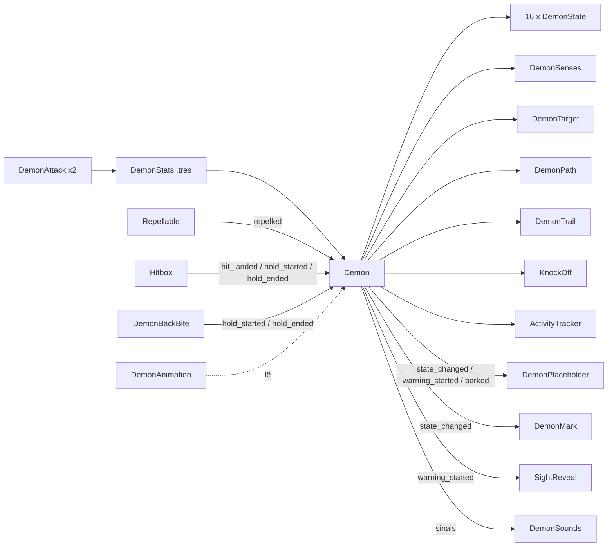

# Demónios (cães)

Os inimigos do nível 1: os cães da luxúria, a máquina de 16 estados que os comanda, os dados de cada tipo de cão e as peças que os desenham e lhes dão voz. Descreve o `dev` no commit `cd14afe` (23/11/2026). Os caminhos são relativos a `Projeto/scenes/characters/demon/`.

## O que faz no jogo

Os cães guardam um posto. Quando veem a alma e eles próprios estão no ecrã, dão sinal («!»), perseguem-na e atacam com uma mordida curta ou um salto longo, ambos anunciados antes. Andam em matilha, com espaço entre si e, por defeito, só um ataca de cada lado de cada vez. Quem lhes cai nas costas é mordido. Se a alma fica fora de alcance, andam de um lado para o outro e ladram. Se a perdem de vista, procuram-na e voltam ao posto. O crucifixo atira-os para longe. Há três tamanhos: o cão normal, o médio (1,25 vezes, verde pálido) e o maior (1,5 vezes), que no fim da fase 3 segue o rasto da alma, mata num golpe e não liga ao crucifixo.

Os dois demónios que falam, a Velvet e o Asmodeus, também vivem nesta pasta, mas não são cães nem atacam: estão em [11_dialogo_e_ofertas.md](11_dialogo_e_ofertas.md).

## Como se liga

Há uma só cena de cão, `demon.tscn`, que recebe um recurso `DemonStats` com os ataques (`DemonAttack`) lá dentro (ADR 0019). Um tipo novo de cão é quase sempre um `.tres` novo, ou uma cena herdada com outro tamanho.

**Estados.** Cada estado é um objeto `RefCounted` (ADR 0034), criado em `_ready` pelo `demon.gd`, e só `Demon.change_state` troca de um para outro. A apresentação está separada: o desenho provisório, a marca «!» (o «?» da procura está desligado), os sons e a revelação na linha de vista ouvem os sinais do cão; a animação lê o estado em cada frame.

| Estado | Quando entra | ADR citadas no script |
|---|---|---|
| `IDLE` | Estado inicial; parado no posto | — |
| `PATROL` | Com `patrol_width` acima de 0: anda no posto e vira nas pontas, nas paredes e nos outros cães | 0033, 0043, 0046 |
| `ALERT` | Viu a alma, com `alert_time` acima de 0; persegue no fim | 0035, 0040 |
| `CHASE` | Persegue; daqui escolhe atacar, saltar, descer, recuar ou esperar | 0042, 0051, 0052 |
| `WARNING` | O ataque está ao alcance e a sorte saiu: aviso antes do golpe | — |
| `LUNGE` | Salto de ataque, depois do aviso | 0021 |
| `RETREAT` | Com `retreat_distance` acima de 0 e a alma demasiado perto | 0023 |
| `GRAB` | Agarrou a alma (mordida ou costas) | 0028 |
| `THROWN` | Atirado, quando a alma se solta ou pelo crucifixo | 0028 |
| `REPELLED` | Aterrou depois de o crucifixo o atirar | 0021 |
| `STUNNED` | Aterrou depois de a alma se soltar, com `stunned_time` acima de 0 | 0028 |
| `OUT_OF_REACH` | A alma está onde ele não chega: anda e ladra | 0033, 0039, 0044, 0046 |
| `SEARCH` | Perdeu a alma de vista, com `search_time` acima de 0 | 0035, 0042 |
| `RETURN` | Volta ao posto pelo caminho que fez | 0042, 0043, 0046 |
| `JUMP` | Salta para um degrau até `jump_height` | 0042 |
| `DROP` | Desce de uma beira para um chão até `max_drop` abaixo | 0042 |

**Matilha.** Os cães não se sobrepõem, guardam `pack_spacing` entre si e esperam a vez de atacar (`attackers_per_side`). A velocidade de cada cão varia ao acaso à volta da do tipo (`pack_variation`) (ADR 0024, 0029, 0038, 0046, 0053).

**Sentidos.** O `DemonSenses` junta a área de visão e o raio da linha de vista. Um cão só começa a perseguir quando o seu próprio corpo está no ecrã (`chases_only_on_screen`, ADR 0032; `demon.gd:463`, `demon_senses.gd:64`).

## Ficheiros

### Cenas e scripts

| Ficheiro | O que é | Quem o usa | Onde se afina |
|---|---|---|---|
| `demon.gd` + `demon.tscn` | `Demon` (`CharacterBody2D`): o cão normal e base de todos; sinais `state_changed`, `warning_started`, `attack_landed`, `barked`, `took_off`, `landed`, `repelled`. `demon.gd` tem 1868 linhas | `level1.tscn`, `lust_phase_2.tscn`, blockout antigo, sala de teste, ginásio, protótipo de luz, construtores do nível, vista de depuração | `@export stats` (por defeito `lust_demon_stats.tres`), `faces_left`, `knock_off_layers`, `activity_reach` |
| `big_demon.tscn` | Cena herdada: cão médio, corpo 140×70 contra 112×56, verde pálido | `level1.tscn`, `lust_phase_2.tscn`, `build_lust_phase_2.gd` | `big_demon_stats.tres`; formas e escala na cena |
| `biggest_demon.gd` + `.tscn` | `BiggestDemon` (herda `Demon`): cão maior, corpo 168×84, com um `GateRing` (`ProximityUnlocker`) que abre portões | `level1.tscn` (1), `add_level1_phase3.gd` | `biggest_demon_stats.tres`; `@export opens` (portões) |
| `demon_stats.gd` | `DemonStats` (`Resource`): sentidos, posto, perseguição, salto, ataques, costas, recuo, matilha, crucifixo, ser atirado | Os 5 `.tres`, `demon.gd` | Grupos `Senses`, `Post`, `Chase`, `Jump`, `Attacks`, `Back Bite`, `Retreat`, `Pack`, `Crucifix`, `Thrown` |
| `demon_attack.gd` | `DemonAttack` (`Resource`): um ataque (alcance, aviso, arco do salto, recuperação, sorte, dano) | Sub-recursos dos 5 `.tres` | `attack_range` 360 px, `warning_time` 0,35 s, `chance_per_second` 1, `damage` 10, `kills` desligado (valores do script) |
| `demon_animation.gd` | `DemonAnimation`: pose do cão pelo estado e pela velocidade | `demon.tscn` (os herdeiros mudam as passadas) | `run_min_speed`, `walk_max_speed`, `stride_length` |
| `demon_back_bite.gd` | `DemonBackBite` (`Area2D`): morde quem está nas costas (ADR 0056, ADR 0072) | Nó `BackBite` do `demon.tscn` | Grupo `Back Bite` do `DemonStats` |
| `demon_mark.gd` | `DemonMark`: «!» no alerta; o «?» da procura existe, mas está desligado (`shows_search`, ver abaixo) (ADR 0040) | `demon.tscn` | Textos e tempos |
| `demon_senses.gd` | `DemonSenses`: área de visão e raio da linha de vista | `demon.tscn`, `sight_reveal.gd` | Distâncias no `DemonStats` |
| `demon_sounds.gd` | `DemonSounds`: sons do cão por `SoundEmitter`, a partir dos sinais | `demon.tscn` | `voice_spread`, `pitch_variation`; grupos `Dog`, `Beeps` |
| `demon_placeholder.gd` | `DemonPlaceholder` (`Polygon2D`): tinge, achata e faz saltar o desenho no aviso, no atordoamento, no ladrar e no salto | `demon.tscn` | Grupo `Tints` |
| `demon_target.gd` | `DemonTarget` (`RefCounted`): memória da alma perseguida (ADR 0037) | `demon.gd` | `SEEN_FRAMES` |
| `demon_path.gd` | `DemonPath` (`RefCounted`): chãos por onde o cão veio, para voltar (ADR 0042) | `demon.gd`, vista de depuração | `MAX_STEPS` |
| `demon_trail.gd` | `DemonTrail` (`RefCounted`): rasto da alma de chão em chão (#271, ADR 0074) | `demon.gd`, só com `follows_trail` | `MAX_STEPS` |
| `states/` (17 scripts) | `DemonState`, a base, e os 16 estados da tabela acima | `demon.gd` | Valores no `DemonStats` |

### Os 5 tipos de cão (`.tres`)

| Ficheiro | Cão | Quem o usa | O que muda em relação ao script |
|---|---|---|---|
| `lust_demon_stats.tres` | Normal | `demon.tscn` (por defeito) | Mordida (100 px, aviso 0,1 s) e salto de ataque (20 SP); visão 1100 px; alerta 0,3 s; procura 2,5 s; só no ecrã; morde nas costas; `pack_spacing` 24 px; `pack_variation` 0,1; 1 atacante por lado |
| `big_demon_stats.tres` | Médio | `big_demon.tscn` | Como o normal, com dano 12,5 e 25 |
| `biggest_demon_stats.tres` | Maior | `biggest_demon.tscn` | Os dois ataques matam (ADR 0076); 550 px/s; nunca desiste; segue o rasto; desce poços; salto 240 px; descida 1536 px; ignora o crucifixo; visão 1130 px; `pack_variation` 0,08 |
| `jumping_demon_stats.tres` | Que salta | Ginásio e sala de teste | Como o normal, com salto 96 px e descida 240 px |
| `tutorial_blocker_stats.tres` | O que bloqueia o tutorial | `level1.tscn`, blockout antigo | Sem dano, visão 360 px, 300 px/s, só salto de ataque |

A velocidade de perseguição do script é 510 px/s (`chase_speed`); com `pack_variation` 0,1, cada cão normal corre entre 459 e 561 px/s.

## Desligado por defeito

Nos interruptores do `DemonStats`, o script deixa todos desligados e cada `.tres` liga os seus (tabela acima).

| O quê | Valor | Porquê |
|---|---|---|
| `never_gives_up`, `follows_trail`, `drops_down_shafts`, `ignores_crucifix` | `false` no script | Só o cão maior os liga (ADR 0073, 0074, 0076) |
| `chases_only_on_screen`, `bites_who_lands_on_it`, `attacks_invulnerable_man` | `false` no script | Ligados nos cães do jogo (ADR 0032, 0056, 0055) |
| `waits_at_retreat_distance` | `false` no script | Ligado nos quatro cães do jogo: normal, médio, maior e o que salta (ADR 0051) |
| Valores a 0 que desligam um comportamento | `patrol_width`, `return_speed`, `jump_height`, `max_drop`, `retreat_distance`, `stunned_time` e outros | Um 0 desliga o estado correspondente; `attackers_per_side` a 0 deixa todos atacar ao mesmo tempo |
| `leaps_to_other_floors` e `kills` de um ataque | `false` | Só o cão maior os liga (#284) |
| Bipes provisórios | `play_beeps = false` em `demon_sounds.gd` | Desligados desde que chegaram os sons do cão; os 4 ficheiros continuam carregados na cena |
| «?» da procura | `shows_search = false` em `demon_mark.gd` | Desligado desde a linha de vista (ADR 0064) |
| Área das costas | `process_mode` desativado nos nós `BackBite` da cena | Só corre com `bites_who_lands_on_it` |

## Ver também

- README, [Demónios](../../README.md#demónios) e [Decisões técnicas](../../README.md#decisões-técnicas).
- ADR 0019 a 0056 (quase todos sobre os cães), 0070 a 0074 e 0076.
- [03_personagem.md](03_personagem.md) para o `Hitbox`, o `Repellable`, o `KnockOff` e o agarrão; [09_luz_visao_e_arte.md](09_luz_visao_e_arte.md) para a linha de vista; [12_depuracao.md](12_depuracao.md) para a `DemonDebugView`.
