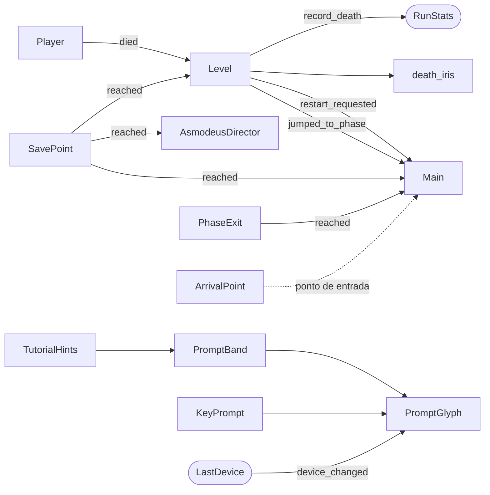

# Níveis, fases e gravação

O que todos os níveis têm em comum (raiz `Level`, morte e recomeço, fases, pontos de gravação, avisos do tutorial), o nível 1 tal como corre no jogo, os construtores a partir de mapas de texto e as salas de desenvolvimento. Descreve o `dev` no commit `cd14afe` (23/11/2026). Os caminhos são relativos a `Projeto/scenes/levels/`.

## O que faz no jogo

O nível 1 (luxúria) começa num tutorial e segue por três fases numa só cena, até à sala do Asmodeus. Ao longo do caminho há três pontos de gravação. Quando a alma morre, o ecrã escurece e o nível inteiro recomeça numa cópia nova da cena, com o estado da última gravação; a alma aparece no último ponto de gravação alcançado. Carregar em Saltar encurta a espera. No tutorial, uma faixa no fundo do ecrã mostra as teclas da próxima ação, com os ícones do teclado ou do comando que o jogador estiver a usar.

## Como se liga

Cada nível jogável tem na raiz o script `Level` (ADR 0026). `Main` põe-no no `LevelSlot` e ouve os seus sinais (ver [01_fluxo_e_menus.md](01_fluxo_e_menus.md)).

**Morte e recomeço.** Quando a personagem emite `died`, o `Level` regista a morte no `RunStats` (zona, posição, causa e origem, como o nome da faixa de silvas; `level.gd:288`), espera `restart_delay` (0,7 s; um Saltar depois de `skip_after`, 0,15 s, encurta), escurece o ecrã e emite `restart_requested`. `Main` troca o nível por uma cópia nova. Se a cena correr sozinha (F6), o `Level` recarrega a cena atual (`level.gd`, `reload_current_scene`). O escurecimento é um fade do ecrã inteiro; a íris sobre o corpo existe, mas está desligada (`death_iris_stats.gd`, `iris`).

**Fases.** Um `SavePoint` marca um acontecimento no `GameState` e tem o ponto de reaparecimento (`respawn`) e a fase que começa ali (`starts_phase`). Ao entrar a cena, cada `SavePoint` já alcançado põe a alma no seu `respawn`, por isso vale o último na ordem da cena, salvo se a alma chegou por um `ArrivalPoint` (`save_point.gd:39`). A fase não vive no `GameState`: vai para o `RunStats` (`level.gd:263`) e para a chave `phase` da gravação. Carregar não lê essa chave; só o resumo do menu a usa (`save_slots.gd:66`). Um `PhaseExit` pede a `Main` a fase seguinte; com o caminho vazio, termina o nível. No nível 1, o `PhaseExit` não tem caminho e não avança ao entrar (`walk_in_leads_on = false`): é o `AsmodeusDirector` que chama `lead_on()` (`asmodeus_director.gd`). Um `ArrivalPoint` é uma entrada com nome, usada pelo atalho da oferta do Asmodeus (`asmodeus_tent`).

**Nível 1 no jogo.** O jogo corre `lust/level1_lit.tscn`: uma instância de `level1.tscn` com o `LightingRig` acrescentado como último filho (ADR 0068). O `level1.tscn` tem 1810 nós e cerca de 2,2 MB. Nasceu dos mapas de texto pelos construtores e hoje edita-se à mão: os mapas já não são a fonte.

## Ficheiros

### Partilhados por todos os níveis (`scenes/levels/`)

| Ficheiro | O que é | Quem o usa | Onde se afina |
|---|---|---|---|
| `level.gd` | `Level` (`Node2D`): raiz de cada nível; morte, recomeço, fase atual; sinais `restart_requested`, `jumped_to_phase` | Todas as cenas de nível; `main.gd`, `GameState`, `RunStats`, depuração, ginásio, `asmodeus_director.gd` | `player`, `restart_delay` 0,7 s, `skip_after` 0,15 s, `iris_stats`, `id`, `first_phase` 1, `death_cell_size` 768 px |
| `death_iris.gd` | `CanvasLayer` criado em jogo: escurece o ecrã no recomeço (camada 5, #263) | `level.gd` (preload) | `DeathIrisStats` |
| `death_iris_plan.gd` | Tempos do escurecimento, sem cena | `level.gd` | — |
| `death_iris_stats.gd` + `.tres` | Sem `class_name`: o `level.gd` carrega-o numa constante `DeathIrisStats` (linha 37). Fechar, abrir, curva, ritmo, ondulação, cor | `level.gd` | `iris` desligado; `close_time` 0,3 s; `open_time` 0,35 s; `fade_ease` 2; `frame_rate` 20; `ink` preto. O `.tres` não muda nenhum |
| `level_entry.gd` | `LevelEntry`: entrada da lista de níveis do menu | `main.tscn`, `main.gd` | Ver [01_fluxo_e_menus.md](01_fluxo_e_menus.md) |
| `phase_exit.gd` | `PhaseExit` (`Area2D`): saída da fase; sinal `reached(next_scene_path)` | `level1.tscn`, cadeia antiga, `lust_phase_2.tscn`; `main.gd`, `asmodeus_director.gd` | `next_scene_path`, `walk_in_leads_on` |
| `save_point.gd` | `SavePoint` (`Area2D`): gravação a meio da fase; sinal `reached` | `level1.tscn` (`TutorialSave`, `Phase2Save`, `Phase3Save`), blockout antigo; `main.gd`, `level.gd`, `asmodeus_director.gd` | `event`, `player`, `respawn`, `starts_phase` |
| `arrival_point.gd` | `ArrivalPoint` (`Marker2D`): entrada com nome | `level1.tscn`, `LustLevel_Phase3.tscn`; `main.gd`, efeito do atalho | `id` |
| `tutorial_hints.gd` | `TutorialHints`: um aviso de cada vez na faixa; esconde os que ficam para trás | `level1.tscn` (`Tutorial`), blockout antigo | `hide_margin` 300 px, `fade_time` 0,4 s, `min_show_time` 2 s, `band` |
| `prompt_band.gd` + `.tscn` | `PromptBand` (`CanvasLayer`): faixa do tutorial no fundo do ecrã | `level1.tscn` | `bottom_gap` 40 px, `fade_time` 0,25 s; tema `Prompt*` |
| `prompt_glyph.gd` + `.tscn` | `PromptGlyph`: ícone da tecla ou do botão de uma ação, conforme o `LastDevice` | `key_prompt.tscn`, `prompt_band.gd`, `grab_prompt.tscn`, `options_menu.tscn` | `action`; ícones em `assets/ui/prompts/` |
| `key_prompt.gd` + `.tscn` | `KeyPrompt`: aviso de tecla no mundo (tutorial, Velvet, estátuas dos portões) | `level1.tscn`, `tutorial_demon.tscn`, `gate_unlocker.tscn`, `LustLevel_Phase1_Cave.tscn` | `action`, `alignment` |
| `rock_map.gd` | `RockMap` (`RefCounted`): que células do tileset são rocha; espaço aberto e chaminés à volta de um ponto | `others/camera/fixed_framing.gd` e a medida da câmara | — |
| `slide.gd` | `Slide` (`StaticBody2D`): rampa que leva a personagem para baixo | Só `LustLevel_Phase3.tscn` | `slide_speed` 900 px/s |

`parallax_sprite.gd`, `stone_rim.gd` e a pasta `background/` estão em [09_luz_visao_e_arte.md](09_luz_visao_e_arte.md); a pasta `prototypes/lighting/` também.

### Nível 1 (`lust/`)

| Ficheiro | O que é | Quem o usa | Onde se afina |
|---|---|---|---|
| `level1_lit.tscn` | O nível 1 do jogo: `level1.tscn` mais o `LightingRig` (ADR 0068), `id = level1` | `main.tscn` («Level 1: Lust», `starts_game`), `save_file.gd`, `lust_shortcut.tres` | Luz em [09_luz_visao_e_arte.md](09_luz_visao_e_arte.md) |
| `level1.tscn` | O conteúdo: tutorial, fases 1 a 3 numa grelha, fim com o Asmodeus | `level1_lit.tscn`, construtores | À mão no editor; as regras de cada sala estão em `docs/nivel1_desenho.md` |
| `lust_ambience.tscn` | Ambiente: base, rajadas de vento, trovões e relâmpagos | `level1.tscn` (nó `Ambience`) | Valores nos nós; ver [10_som.md](10_som.md) |
| `lust_ramp_material.tres` | `ShaderMaterial` com `color_ramp.gdshader` e a rampa de cor da luxúria | `Tiles` do `level1.tscn` | A imagem da rampa |

### Construtores e mapas (`lust/builders/`)

Correm da raiz do repositório, com o editor fechado; código de saída 0 quer dizer que gravaram. O comando de cada um está no topo do script.

| Ficheiro | O que faz | Notas |
|---|---|---|
| `build_lust_phase_2.gd` | `lust_phase_2.txt` → `lust_phase_2.tscn` (reescreve) | Base dos outros construtores |
| `build_level1.gd` | Primeira versão de `level1.tscn` a partir de `level1.txt` e `level1_camera.txt`, com o tutorial copiado do blockout antigo | Recusa se a cena existir (`--force` para reescrever) |
| `add_level1_phase3.gd` | Acrescenta a fase 3 (rocha, cães, cão maior, portões, estátuas, zonas, gravação) | Uma só vez; `--art` e `--reshape <mapa antigo>` |
| `build_stone_rim.gd` | Coze as pedras debaixo de `Art/StoneRim` no `level1.tscn` | Uma só vez (`--force`) |
| `level1.txt` (388 linhas), `level1_camera.txt` (150), `level1_phase3.txt` (283), `lust_phase_2.txt` (342) | Mapas de texto da grelha, com legenda no topo | O `level1_phase3.txt` mantém-se igual à cena, para os testes |

### Salas de desenvolvimento

Nenhuma aparece no menu (`in_menu = false`, ADR 0036 e ADR 0050); cada uma corre sozinha com F6.

| Ficheiro | O que é | Quem o usa |
|---|---|---|
| `gym/gym.tscn` + `gym/stations/` (10 estações) | Ginásio: uma estação por mecânica (introdução, movimento, parede, câmara, zona de câmara, cães, matilha, crucifixo, SP, cães que saltam) | `main.tscn` («Gym», fora do menu) |
| `gym/gym_stations.gd` | `GymStations`: reaparece na estação onde morreu; teclas 1 a 9 e 0 levam a cada estação | `gym.tscn` |
| `gym/gym_hint.gd` + `.tscn` | `GymHint` (`@tool`): placa em português de cada estação, em painel opaco | As 10 estações |
| `test_room/test_room.tscn` + `test_room_background.tscn` | Sala de teste: um cão, um cão que salta, uma zona de câmara, fundo de gruta | `main.tscn` («Test room», fora do menu) |
| `lust/LustLevel_Phase1_Cave.tscn`, `LustLevel_Phase2.tscn`, `LustLevel_Phase3.tscn` | Blockout antigo do nível 1, encadeado por `PhaseExit` | `main.tscn` («old blockout», fora do menu); `build_level1.gd` copia o tutorial da gruta |
| `lust/lust_phase_2.tscn` | Cena gerada pelo `build_lust_phase_2.gd`; a saída leva ao `LustLevel_Phase3` | Só o construtor |
| `lust/LustLevel_Phase1.tscn` | Blockout morto: raiz `Test`, sem script `Level` | Nenhuma cena, script ou teste |

As cenas `LustLevel_*` têm maiúsculas no nome e não se mexem (regra do nível 1, decisão E do `docs/nivel1_desenho.md`).

## Desligado por defeito

| O quê | Valor | Porquê |
|---|---|---|
| Íris sobre o corpo no recomeço | `iris = false` em `death_iris_stats.gd` | O código não diz porquê; por defeito escurece o ecrã inteiro |
| Salas de desenvolvimento no menu | `in_menu = false` | Ver [01_fluxo_e_menus.md](01_fluxo_e_menus.md) |
| Avançar ao entrar na saída do nível 1 | `walk_in_leads_on = false` no `level1.tscn` | A saída espera que o `AsmodeusDirector` a mande avançar |

## Ver também

- README, [Medidas para o desenho de níveis](../../README.md#medidas-para-o-desenho-de-níveis), [Portões, picos letais e plataformas que desabam](../../README.md#portões-picos-letais-e-plataformas-que-desabam) e [Estrutura](../../README.md#estrutura).
- `docs/nivel1_desenho.md` (fases, medidas, lista de verificação de cada sala).
- ADR 0026 (afundar e recomeçar), ADR 0036 (sala de treino), ADR 0041 (desenho do nível 1 no repositório), ADR 0050 (estrutura de pastas), ADR 0068 (luz do protótipo no jogo).
- [06_objetos.md](06_objetos.md) para portões, plataformas e armadilhas; [07_camara.md](07_camara.md) para as zonas e as cenas de câmara.
