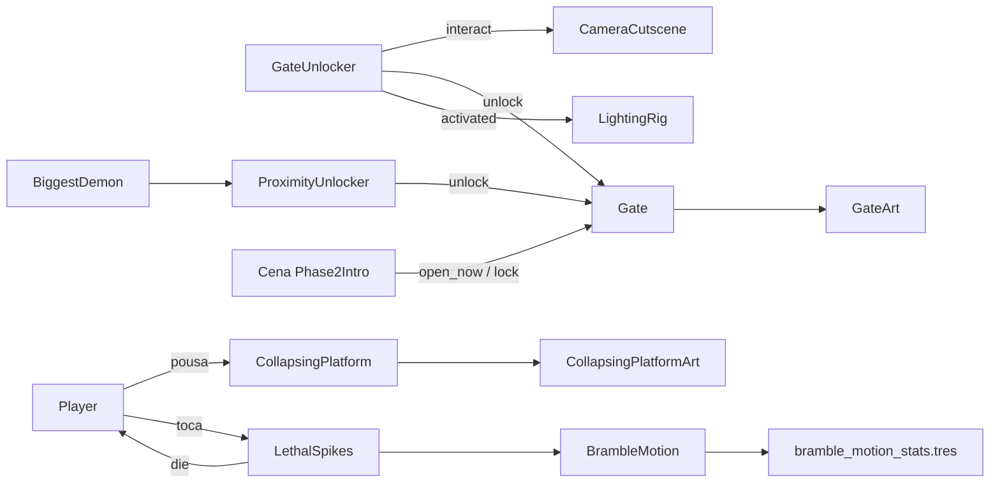

# Objetos: portões, plataformas e armadilhas

As peças que se põem nos níveis: portões e o que os abre, plataformas que desabam ou se movem, silvas letais e as armadilhas mais antigas. Descreve o `dev` no commit `cd14afe` (23/11/2026). Os caminhos são relativos a `Projeto/scenes/objects/`.

## O que faz no jogo

Os portões fecham passagens. Abrem quando a alma acende uma estátua (carregando em Interagir ao pé dela), quando o cão maior se aproxima ou numa cena de câmara. As plataformas que desabam racham e piscam quando a alma lhes pousa em cima, caem e voltam passados uns segundos. As silvas matam ao primeiro toque, e os cães não sofrem com elas. No blockout antigo do nível 1 há ainda plataformas que se movem em ciclo, uma rocha que cai, uma rampa que escorrega e armadilhas que só tiram uma parte da vida.

## Como se liga

**Portões.** O `Gate` é um `AnimatableBody2D` que desliza para cima ou para o lado quando recebe `unlock()`. Quem o chama: um `GateUnlocker` (a estátua, uma só vez, com uma cena de câmara opcional antes), um `ProximityUnlocker` (um raio à volta de quem o leva; hoje só o cão maior) ou uma cena de câmara, que o abre e fecha de imediato (`open_now()`, `lock()`). A arte da porta e das colunas está no `GateArt`; a coluna da frente desenha-se por cima da personagem e a de trás por baixo. Quando uma estátua acende, o `LightingRig` acende a luz dela.

**Silvas.** As `LethalSpikes` chamam `player.die()` ao primeiro toque. A versão que prende e mata devagar (`catches`) existe no código e está desligada (ADR 0067). O balanço das silvas, ao vento e quando alguém passa, vem do `BrambleMotion`, com valores partilhados por todas as faixas.

**Peças antigas.** `Hazard`, `FallingRock`, `CyclePlatform`, `PlatformCycle`, `Slide` e as cenas `spikes.tscn` e `half_life_trap.tscn` só se usam em `LustLevel_Phase3.tscn`, do blockout antigo. O `Hazard` não tira vida: emite `player_hit` com a fração de vida que tiraria, porque foi escrito antes de haver SP (comentário em `hazard.gd`). Atenção ao nome: `spikes.tscn` é um `Hazard` que não mata, diferente de `lethal_spikes.tscn`.

Quase todos os objetos são `@tool`: mudar o tamanho ou a arte no Inspector redesenha-os logo no editor.

## Ficheiros

### `gates/`

| Ficheiro | O que é | Quem o usa | Onde se afina |
|---|---|---|---|
| `gate.gd` + `gate.tscn` | `Gate` (`@tool`, `AnimatableBody2D`); sinais `unlocked`, `opened`, `locked`, `shut` | `level1.tscn`, `lust_phase_2.tscn`, construtores; `@export opens` do cão maior | `width_tiles` 2, `height_tiles` 4, `slide_way` (para cima por defeito), `slide_time` 0,8 s |
| `gate_art.gd` | `GateArt` (`@tool`): porta animada e colunas da frente e de trás | `gate.tscn`, `build_level1.gd` | Folha da porta (20 células: abrir 1 a 10, fechar 11 a 19), texturas das colunas, medidas da porta na célula |
| `gate_unlocker.gd` + `.tscn` | `GateUnlocker` (`@tool`): estátua que abre portões com Interagir, uma só vez; sinal `activated` | `level1.tscn`, `lust_phase_2.tscn`, construtores; ouvido pelo `LightingRig` | `gates`, `use_action` (`interact`), `cutscene`, `flame_frame_time` 0,11 s |
| `proximity_unlocker.gd` + `.tscn` | `ProximityUnlocker` (`@tool`, `Area2D`): abre portões quando a alma entra no raio, uma só vez; sinal `activated` | `biggest_demon.tscn` (`GateRing`) | `gates`, `reach` 288 px |

### `platforms/`

| Ficheiro | O que é | Quem o usa | Onde se afina |
|---|---|---|---|
| `collapsing_platform.gd` + `.tscn` | `CollapsingPlatform` (`@tool`): pisca, desaparece e volta; sinais `collapsing`, `collapsed`, `came_back` | `level1.tscn`, `lust_phase_2.tscn`, construtores, `LightingRig` | `width_tiles` 3, `collapse_time` 0,6 s, `blink_interval` 0,08 s, `come_back_time` 3 s |
| `collapsing_platform_art.gd` | `CollapsingPlatformArt` (`@tool`): laje que racha (7 quadros, 5 de racha) | `collapsing_platform.tscn` | `break_frame_time` 0,11 s, `fade_out_time` 0,2 s, `fade_in_time` 0,25 s, `max_tiles` 4 |
| `cycle_platform.gd` + `.tscn` | `CyclePlatform` (`AnimatableBody2D`): move-se ou inclina-se entre dois pontos | Só `LustLevel_Phase3.tscn` | `point_a`, `point_b` |
| `platform_cycle.gd` | `PlatformCycle`: um só relógio para uma travessia de 4 plataformas | Só `LustLevel_Phase3.tscn` | `travel_time` 3 s, `hold_time` 1 s, `wobble_*`, `flip_delay` 0,15 s |

### `traps/`

| Ficheiro | O que é | Quem o usa | Onde se afina |
|---|---|---|---|
| `lethal_spikes.gd` + `.tscn` | `LethalSpikes` (`@tool`, `Area2D`): silvas que matam ao toque; os demónios não sofrem | `level1.tscn`, `lust_phase_2.tscn`, protótipo de luz, construtores; lido pelo Asmodeus, `impact_feedback` e `LightingRig` | `width_tiles` 2, `teeth_per_tile` 2, `tooth_height` 40 px, `hit_height` 24 px, `brambles_per_tile` 1,5, `art`, `motion_stats`, `turned_z_index` 2, `catches` |
| `bramble_motion.gd` | Movimento das silvas sem cena: balançar, mexer, agitar (#263) | `lethal_spikes.gd` | `BrambleMotionStats` |
| `bramble_motion_stats.gd` + `.tres` | `BrambleMotionStats`: valores partilhados por todas as faixas | `lethal_spikes.gd` (`DEFAULT_MOTION`) | `frame_rate` 20, `sway_amplitude` 2 px, `stir_radius` 48 px, `thrash_radius` 144 px, entre outros. O `.tres` não muda nenhum |
| `hazard.gd` | `Hazard` (`Area2D`): avisa que tocou, de `rehit_interval` em `rehit_interval`; sinal `player_hit` | `spikes.tscn`, `half_life_trap.tscn`, `falling_rock.tscn`; ouvido pelo `impact_feedback` | `health_fraction` 0,25, `rehit_interval` 1 s, `hit_sound` |
| `spikes.tscn`, `half_life_trap.tscn` | `Hazard` com polígono provisório, que não mata | Só `LustLevel_Phase3.tscn` | Na cena |
| `falling_rock.gd` + `.tscn` | `FallingRock`: treme, cai, parte-se e volta; sinais `fell`, `broke` | Só `LustLevel_Phase3.tscn`; `impact_feedback` ouve `broke` | `warn_time` 0,4 s, `fall_gravity` 4000, `max_fall_speed` 1600 px/s, `respawn_time` 2,5 s, `trigger_width` 96 px |

O `Slide` (rampa que escorrega) está em `scenes/levels/slide.gd`, descrito em [05_niveis.md](05_niveis.md).

## Desligado por defeito

| O quê | Valor | Porquê |
|---|---|---|
| Silvas que prendem e matam devagar | `catches = false` em `lethal_spikes.gd` | Experimentado e posto de lado a 17/11; o código fica para comparar (ADR 0067). O `Snag` da personagem só entra com esta opção ligada |

Nenhum código do jogo ouve os sinais do `Gate` nem do `CollapsingPlatform`: estão lá para quem os quiser usar (som, câmara).

## Ver também

- README, [Portões, picos letais e plataformas que desabam](../../README.md#portões-picos-letais-e-plataformas-que-desabam).
- ADR 0067 (silvas), ADR 0074 (portão 4 da fase 3 e o rasto do cão maior).
- [05_niveis.md](05_niveis.md) para os construtores que os põem no nível; [07_camara.md](07_camara.md) para a cena de câmara que uma estátua pode tocar.
