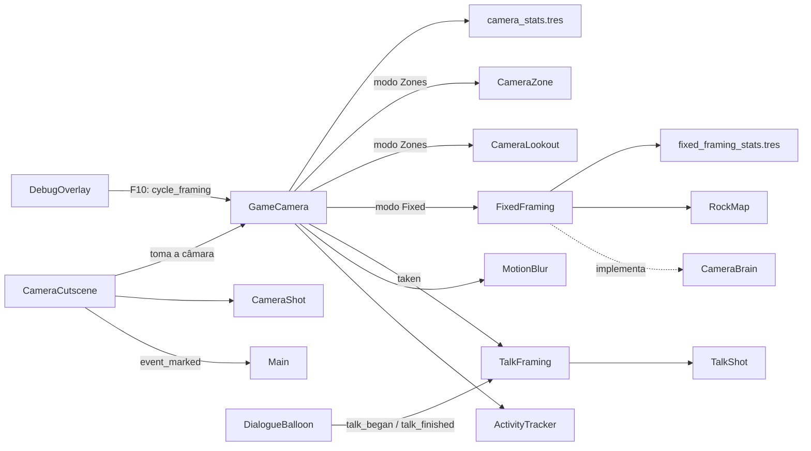

# Câmara

A câmara do jogo e os seus dois modos de enquadrar a alma, as zonas e os miradouros, as cenas de câmara, o enquadramento das falas, a desfocagem de movimento e o nó que adormece o que está fora do ecrã. Descreve o `dev` no commit `cd14afe` (23/11/2026). Os caminhos são relativos a `Projeto/scenes/others/`.

## O que faz no jogo

A câmara segue a alma e mostra o caminho à frente. Há dois modos. No modo `Fixed`, o do nível 1, o zoom não muda e a câmara anda devagar, com uma zona morta no meio, para não enjoar. No modo `Zones`, cada região do nível tem os seus limites e o seu zoom, e antes de uma descida a câmara afasta-se para mostrar onde a alma vai cair. Em certos momentos a câmara faz uma visita guiada (por exemplo, a mostrar o portão que uma estátua abriu) e depois volta. Nas conversas, aparecem barras pretas em cima e em baixo e a câmara enquadra quem fala.

## Como se liga

A cena `camera/game_camera.tscn` junta a câmara e os nós que trabalham com ela: `ActivityTracker`, `MotionBlur`, `CameraShake`, `ControllerRumble`, `ImpactFeedback`, `Fixed` e `TalkFraming`. Cada nível instancia esta cena.

**Modos.** O `@export start_framing` escolhe o modo pelo nome do nó: `Zones` é o modo próprio do `game_camera.gd` (o valor do script) e `Fixed` é o nó `FixedFraming`. O `level1.tscn` escolhe `Fixed`. Cada modo novo implementa a interface `CameraBrain` (`begin`, `advance`, `get_centre`, `get_zoom`), padrão Strategy (ADR 0075). Em depuração, F10 troca de modo.

**Fixed.** Zoom 1,4, zona morta, mola amortecida, limites dados pela rocha (`RockMap`) e eixo seguro nas chaminés. Os valores do script são os de #282; o `.tres` acalma-os (#284): seguir mais devagar, zona morta mais larga, alma mais perto do centro.

**Cenas de câmara.** Um `CameraCutscene` percorre os seus filhos `CameraShot` e devolve a câmara. Pode saltar-se, e um acontecimento do `GameState` impede que se repita. Quem a toca: a sua zona de disparo, ou uma estátua (`GateUnlocker`) antes de abrir o portão.

**Falas.** O balão avisa os nós do grupo `talk_watchers`. O `TalkFraming` põe as barras (12,8 % do ecrã), aproxima-se dos dois que falam em 1,4 s, inclina-se para quem fala e volta em 1,2 s. O cálculo do enquadramento está no `TalkShot`.

**Atividade.** O `ActivityTracker` desliga os cães e os sprites de fundo parados fora do ecrã e volta a ligá-los quando se aproximam (`wake_margin` 480 px, `sleep_margin` 960 px; cada membro é verificado uma vez em cada 6 frames de física). As cenas de câmara acordam o caminho antes de passar.

## Ficheiros

### `camera/`

| Ficheiro | O que é | Quem o usa | Onde se afina |
|---|---|---|---|
| `game_camera.gd` + `.tscn` | `GameCamera` (`@tool`, `Camera2D`, 805 linhas): segue, olha à frente e para baixo, zonas, miradouros, modos; sinal `taken` | Todos os níveis e salas; `level.gd`, `save_point.gd`, `asmodeus.gd`, ginásio | `camera_stats.tres`; `start_framing` (`Zones` no script, `Fixed` no `level1.tscn`) |
| `camera_stats.gd` + `.tres` | `CameraStats`: valores do modo `Zones` | `game_camera.tscn` | O `.tres` muda `window_down` 80, `edge_margin` 0,1, `follow_sharpness` 3, `zone_change_sharpness` 4, `zoom_sharpness` 1,7 e os do miradouro |
| `camera_brain.gd` | `CameraBrain` (`@abstract`): interface de um modo de enquadrar | `fixed_framing.gd`, `game_camera.gd` | — |
| `fixed_framing.gd` | `FixedFraming` (nó `Fixed`) | `game_camera.tscn` | `fixed_framing_stats.tres` |
| `fixed_framing_stats.gd` + `.tres` | `FixedFramingStats` | `game_camera.tscn` | Script: `zoom_level` 1,4, `below_centre` 0,25, `dead_zone_across` 28 px, `follow_sharpness` 8. O `.tres` muda `below_centre` para 0,12, `dead_zone_across` 96 px, `follow_sharpness` 6, `look_ahead` 0,03, `look_ahead_sharpness` 1,5 e `fall_below_centre` −0,3 |
| `camera_zone.gd` | `CameraZone` (`@tool`, `Area2D`): região com limites, zoom e pré-visualização no editor | `level1.tscn`, `lust_phase_2.tscn`, cadeia antiga, sala de teste, ginásio | `zoom`, `auto_zoom` (ligado), `limit_horizontally` e `fit_height` (por zona) |
| `camera_lookout.gd` | `CameraLookout` (`@tool`, `Area2D`): antes de uma descida, afasta a câmara até a alma aterrar | Cadeia antiga e `build_lust_phase_2.gd`; o `level1.tscn` não tem nenhum | Grupo `Lookouts` do `CameraStats` |
| `camera_cutscene.gd` | `CameraCutscene`: visita guiada; sinais `started`, `shot_reached`, `event_marked`, `finished` | `level1.tscn`; `main.gd`, `gate_unlocker.gd` | `skip_action` (`jump`), `motion_blur` (0 no script, 0,2 no nível 1), `replay_phase` (0 no script, 2 no nível 1), `event` |
| `camera_shot.gd` | `CameraShot` (`@tool`): um enquadramento da visita; sinal `arrived` | `level1.tscn` | `travel_time`, `hold_time`, `keep_zoom` |
| `talk_framing.gd` | `TalkFraming`: enquadramento das falas | `game_camera.tscn`; chamado pelo balão e pelo `asmodeus.gd` | `show_bars` (ligado), `bar_share` 0,128, `enter_time` 1,4 s, `return_time` 1,2 s, `max_zoom` 2, `lean_share` 0,1, `reduce_motion` |
| `talk_shot.gd` | `TalkShot` (`RefCounted`): contas do zoom e do centro da fala | `talk_framing.gd` | — |
| `motion_blur.gd` + `.gdshader` | `MotionBlur` (`CanvasLayer`): rasto no ecrã inteiro quando a câmara anda depressa | `game_camera.tscn` | Força dada pela cena de câmara |
| `camera_shake.gd`, `camera_shake_stats.gd` + `.tres`, `shake_trauma.gd` | Tremor do ecrã | `game_camera.tscn` | Ver [08_impactos.md](08_impactos.md) |

### `activity/`

| Ficheiro | O que é | Quem o usa | Onde se afina |
|---|---|---|---|
| `activity_tracker.gd` | `ActivityTracker`: adormece (`PROCESS_MODE_DISABLED`) o que está parado fora do ecrã | Nó do `game_camera.tscn`; entram com `join()` os cães, o cão maior e os `ParallaxSprite` | `wake_margin` 480 px, `sleep_margin` 960 px, `cycle_frames` 6, `enabled` |

## Desligado por defeito

| O quê | Valor | Porquê |
|---|---|---|
| Menos movimento nas falas | `reduce_motion = false` em `talk_framing.gd` | Só no Inspector, até o ecrã das opções o ter (comentário em `talk_framing.gd`) |
| Miradouros no nível 1 | Nenhum `CameraLookout` no `level1.tscn` | O nível 1 usa o modo `Fixed`; o `fixed_framing.gd` não usa miradouros |
| Desfocagem nas visitas guiadas | `motion_blur = 0` no script | O nível 1 liga-a a 0,2 |

As barras das falas estão ligadas (`show_bars`) e também só se mudam no Inspector.

## Ver também

- README, [Câmara](../../README.md#câmara) e [Decisões técnicas](../../README.md#decisões-técnicas). A secção do README ainda tem valores e medidas antigos da câmara: está na issue #239.
- ADR 0013 (câmara e physics interpolation), ADR 0060 (testes da câmara com os valores atuais), ADR 0075 (câmaras trocáveis e câmara fixa).
- [05_niveis.md](05_niveis.md) para o `RockMap`; [08_impactos.md](08_impactos.md) para o tremor; [12_depuracao.md](12_depuracao.md) para o F10.
