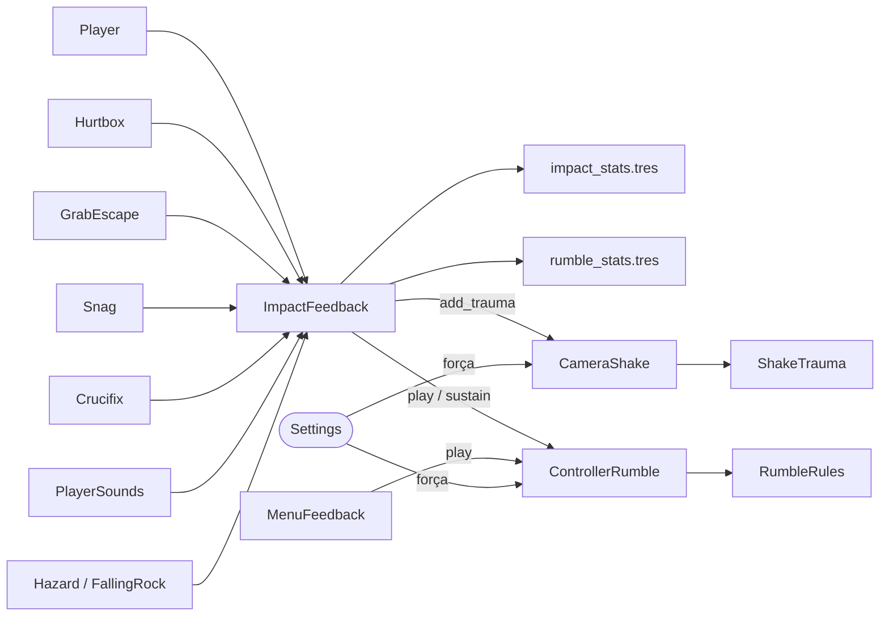

# Impactos: tremor do ecrã e vibração do comando

Como os momentos fortes do jogo (golpe, agarrão, morte, aterragem dura, crucifixo, rocha) se traduzem em tremor do ecrã e vibração do comando, e onde fica a paragem de impacto. Descreve o `dev` no commit `cd14afe` (23/11/2026). Os caminhos são relativos a `Projeto/scenes/others/`.

## O que faz no jogo

Quando um cão morde, quando a alma aterra de muito alto, quando ergue o crucifixo ou morre, o ecrã treme e o comando vibra, mais ou menos conforme o momento. Durante um agarrão ou com o crucifixo erguido, o comando vibra de forma contínua. O jogador regula a força do tremor e da vibração, ou desliga-os, no ecrã das opções. Na morte nas silvas, o jogo quase pára durante uma fração de segundo antes do clarão.

## Como se liga

Um só nó, o `ImpactFeedback`, ouve os sinais da personagem e das armadilhas e decide, numa lista, quanto tremor e que pulso de vibração cada momento dá (ADR 0062). O tremor e a vibração não sabem de onde vem o pedido.

**Tremor por trauma** (ADR 0061). Cada momento soma «trauma», entre 0 e 1, que decai com o tempo. O desvio da câmara é o trauma elevado a um expoente, com ruído, até `max_offset`. A opção do tremor multiplica o resultado.

**Vibração por momento** (ADR 0062). Cada momento tem um `RumblePulse` (motor fraco, motor forte, duração, desvanecer). Quando dois pulsos se sobrepõem, ganha o mais forte (`RumbleRules`). Os estados que duram, o agarrão e o crucifixo erguido, têm um `RumbleSustain`, que os pulsos abafam enquanto tocam. Vibra o último comando usado. Os menus usam o mesmo `ControllerRumble`.

**Paragem de impacto.** Não está aqui: só a morte nas silvas a tem, no `bramble_death.gd` (`hitstop` 0,1 s a escala 0,02, ver [03_personagem.md](03_personagem.md)).

**Builds exportadas.** Os 16 pulsos e os 2 sustentados do `rumble_stats.gd` são valores criados no próprio script (`RumblePulse.new(...)`), e o `.tres` não os grava. Quando o export convertia os recursos de texto para binário, estes pulsos saíam vazios no jogo exportado, e só o menu vibrava. O `project.godot` desliga essa conversão (`editor/export/convert_text_resources_to_binary=false`) para os pulsos sobreviverem ao export.

## Ficheiros

### `feedback/`

| Ficheiro | O que é | Quem o usa | Onde se afina |
|---|---|---|---|
| `impact_feedback.gd` | `ImpactFeedback`: liga cada momento ao tremor e à vibração | Nó do `game_camera.tscn` | `stats`, `rumble_stats` |
| `impact_stats.gd` + `.tres` | `ImpactStats`: trauma por momento | `game_camera.tscn` | `hit_trauma` 0,5; `grab_trauma` 0,2; `struggle_trauma` 0,45; `break_free_trauma` 0,9; `death_trauma` 1; `hard_landing_trauma` 0,45; `crucifix_raised_trauma` 0,35; `crucifix_lost_trauma` 0,5; `rock_trauma` 0,55 até `rock_reach` 900 px. O `.tres` não muda nenhum |
| `controller_rumble.gd` | `ControllerRumble`: `play()`, `sustain()`, `end_sustain()` no último comando usado | `game_camera.tscn`, `impact_feedback.gd`, `menu_feedback.gd`, `options_menu.gd` | `sustain_duck_share` 0,3; força e vibração contínua em `Settings` |
| `rumble_rules.gd` | `RumbleRules` (`RefCounted`): o pulso mais forte ganha; abafa o sustentado | `controller_rumble.gd` | — |
| `rumble_pulse.gd` | `RumblePulse` (`Resource`): um pulso (`weak`, `strong`, `duration`, `fade`) | `rumble_stats.gd`, `controller_rumble.gd`, `menu_feedback.gd` | — |
| `rumble_sustain.gd` | `RumbleSustain` (`Resource`): vibração que dura, com batida | `rumble_stats.gd`, `controller_rumble.gd` | — |
| `rumble_stats.gd` + `.tres` | `RumbleStats`: pulsos de salto, aterragem, cabeça no teto, parede, luta, golpe, agarrão, soltar, aterragem dura, crucifixo, morte, morte nas silvas, rocha; sustentados do agarrão e do crucifixo | `game_camera.tscn`, `options_menu.gd` (amostra) | No script (por exemplo `death` 0,7 / 1,0 / 0,6 s). O `.tres` não muda nenhum |

### Tremor (`camera/`)

| Ficheiro | O que é | Quem o usa | Onde se afina |
|---|---|---|---|
| `camera_shake.gd` | `CameraShake`: desvia a câmara pelo trauma; `add_trauma`, `raise_trauma` | `game_camera.tscn`, `impact_feedback.gd` | `stats`; opção do tremor em `Settings` |
| `camera_shake_stats.gd` + `.tres` | `CameraShakeStats` | `game_camera.tscn` | Script: `max_offset` 32 px, `decay` 2, `exponent` 2, `speed` 10. O `.tres` muda `max_offset` para 48 px e `exponent` para 1,5 (#284) |
| `shake_trauma.gd` | `ShakeTrauma` (`RefCounted`): decaimento, curva e ruído | `camera_shake.gd` | — |

## Desligado por defeito

| O quê | Valor | Porquê |
|---|---|---|
| Vibrar o último comando mesmo enquanto se usa o teclado ou o rato | `keeps_last_controller = false` em `controller_rumble.gd` | No jogo, com o teclado em uso, nenhum comando vibra; só a amostra do ecrã das opções o liga, para se sentir a força escolhida com o rato (`options_menu.gd`) |

Tremor e vibração estão no máximo por defeito (`Settings`, ver [02_servicos_globais.md](02_servicos_globais.md)).

## Ver também

- README, [Tremor do ecrã](../../README.md#tremor-do-ecrã) e [Vibração do comando](../../README.md#vibração-do-comando).
- ADR 0061 (tremor por trauma), ADR 0062 (vibração por momento).
- [15_configuracao.md](15_configuracao.md) para as definições do projeto.
