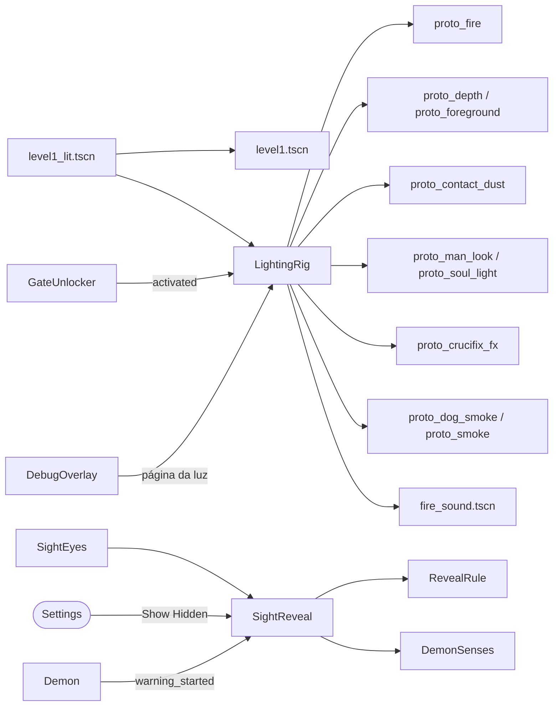

# Luz, linha de vista e arte do nível

A iluminação do nível 1 (o `LightingRig` e as suas peças), os shaders, a linha de vista que esconde os cães e as silvas que a alma não vê, o tileset, o fundo em camadas e as pedras da orla da rocha. Descreve o `dev` no commit `cd14afe` (23/11/2026). Os caminhos são relativos a `Projeto/scenes/`.

## O que faz no jogo

O nível 1 é escuro. A luz vem dos fogos, de uma luz larga e fraca à volta da alma e do brilho das faces da rocha. Os fogos têm fumo, faúlhas e uma rampa de cor; o pó levanta-se quando a alma aterra; o crucifixo lança estilhaços de luz. Os cães e as silvas só se desenham onde a alma os consegue ver: atrás de uma parede, desaparecem. Há uma opção de acessibilidade para os mostrar sempre. Ao fundo, desenhos em camadas deslizam a velocidades diferentes, para dar profundidade. Ao longo do contorno da rocha há tiras de pedra e cantos desenhados.

## Como se liga

**Luz** (ADR 0065, ADR 0068). O `lighting_rig.gd` nasceu como protótipo (#257) e o jogo usa-o tal como está, cercado: o `level1_lit.tscn` é o `level1.tscn` com o rig como último filho, e o `test_level1_lit.gd` guarda o aspeto aprovado. Tem dois modos. O A, híbrido, é o escolhido: cor escura do nível (`CanvasModulate`), luzes suaves sem sombras nas máscaras do mundo e do fundo, luzes mais pequenas nas da rocha, e uma luz larga e fraca na alma. O B, por propagação, espalha a luz pelos tiles (`light_propagation.gd`). As teclas do rig só funcionam na página da luz da depuração e nunca num jogo exportado (comentário no topo do `lighting_rig.gd`). As opções do rig são `static var`, por isso sobrevivem ao recomeço depois de uma morte.

**Linha de vista** (#253, ADR 0064). O `SightEyes` é o ponto dos olhos da alma (um `Marker2D` no `player.tscn`). Cada cão e cada faixa de silvas tem um `SightReveal`, que lança raios até eles e só os desenha enquanto a alma os vê, com entrada e saída suaves (`RevealRule`). As silvas lembram-se de que foram vistas (`remembers` ligado no `lethal_spikes.tscn`); os cães não. Um cão que vai atacar revela-se logo. A opção Show Hidden, em `Settings`, desenha tudo.

**Pedras da orla.** O `StoneRim` põe tiras e cantos de pedra ao longo do contorno da rocha. No `level1.tscn` não há pedras gravadas e `auto_build` está ligado: as pedras refazem-se a partir dos tiles cada vez que o nível abre, e uma edição à mão perde-se.

## Ficheiros

### Luz (`levels/prototypes/lighting/`)

| Ficheiro | O que é | Quem o usa | Onde se afina |
|---|---|---|---|
| `lighting_rig.gd` | Sem `class_name` (1727 linhas): luz do nível 1, modos A e B, máscara de visão, teclas da página da luz | `lust/level1_lit.tscn`, `lighting_level1.gd` | `static var` (modo `HYBRID`, `ambient` 0,35, `man_radius` 900 px) e constantes |
| `proto_fire.gd`, `proto_smoke.gd`, `proto_contact_dust.gd`, `proto_depth.gd`, `proto_foreground.gd`, `proto_man_look.gd`, `proto_soul_light.gd`, `proto_crucifix_fx.gd`, `proto_dog_smoke.gd`, `light_propagation.gd` | Peças do rig, sem `class_name`: fogos, fumo, pó das aterragens, cópia da rocha para profundidade, rochas da frente, olhar da alma, rasto da alma, estilhaços do crucifixo, cinza dos cães, luz do modo B | `lighting_rig.gd` (preload) ou umas às outras | Constantes de cada script |
| `background_fire_blur`, `light_composite`, `proto_fire_ramp`, `proto_mote`, `proto_puff` (+ `_unshaded`, `.gdshaderinc`), `proto_rim`, `proto_shard`, `proto_smoke_ash`, `proto_smoke_light`, `proto_smoke_stamp` (+ `proto_smoke.gdshaderinc`), `proto_soul_light`, `vision_mask`, `vision_polygon` (+ `vision_common.gdshaderinc`) | Shaders das peças do rig | Só o rig e as suas peças | — |
| `lighting_level1.gd` + `.tscn` | Sala de protótipo para F6: corre o `level1` com o rig e trata do recomeço | Só testes e a medida da luz | — |
| `lighting_proto.gd` + `.tscn` | Sala escura do protótipo (cães, olhos, fogos), «reescrita, nunca copiada» (ADR 0065) | Só testes | — |

### Shaders partilhados (`others/shaders/`, todos `canvas_item`)

| Ficheiro | O que faz | Quem o usa |
|---|---|---|
| `color_ramp.gdshader` | Mapa de cor: do cinzento para a rampa de cor do nível | `background_layer.gd`, `lust_ramp_material.tres`, `lighting_rig.gd` |
| `distance_haze.gdshader` | Tinge e suaviza as camadas do fundo para a cor da névoa | `level1.tscn`, `proto_foreground.gd` |
| `rim_fade.gdshader` | Escurece as pedras da orla dentro da rocha | `stone_rim.gd` |
| `sink.gdshader` | Afunda um desenho no chão, com clarão branco (ADR 0026) | `sinking_drawing.gd`, `lighting_rig.gd`, `proto_rim.gdshader` |
| `bramble_cut_piece.gdshader` | Pedaços da alma cortada pelas silvas (#263) | `bramble_death.gd` |
| `death_iris.gdshader` | Íris ondulada do recomeço (#263) | `death_iris.gd` |
| `god_rays.gdshader`, `menu_fire_glow`, `menu_firelight`, `menu_paint_fade`, `menu_smoke` | Raios, brilho do fogo, luz lateral, desvanecer da margem e fumo do menu | `menu_backdrop.tscn` |
| `screen_blur.gdshader` | Desfoca e escurece o ecrã atrás de uma pergunta | `main_menu.tscn` |
| `invert_outline.gdshader` | Ícones da roda das respostas, invertidos quando acesos | `dialogue_balloon.tscn` |
| `depth_fade.gdshader` | Escurece o cenário abaixo de uma altura | Nenhum ficheiro |

Os shaders da câmara (`motion_blur.gdshader`) e do relâmpago (`lightning_flash.gdshader`) vivem com os seus scripts, em [07_camara.md](07_camara.md) e [10_som.md](10_som.md).

### Linha de vista (`others/sight/`)

| Ficheiro | O que é | Quem o usa | Onde se afina |
|---|---|---|---|
| `sight_eyes.gd` | `SightEyes` (`Marker2D`): ponto dos olhos da alma e retângulo do ecrã | `player.tscn` (nó `Eyes`), `lighting_rig.gd` | `screen_margin` |
| `sight_reveal.gd` | `SightReveal`: desenha o alvo só enquanto a alma o vê | `demon.tscn`, `lethal_spikes.tscn`, peças do rig | `target`, `look_box`, `remembers`, `senses`; tempos de entrada e saída |
| `reveal_rule.gd` | `RevealRule` (`RefCounted`): regras de entrada, permanência e saída | `sight_reveal.gd` | — |

### Arte do nível

| Ficheiro | O que é | Quem o usa | Onde se afina |
|---|---|---|---|
| `others/tilesets/cave_placeholder_tiles.tres` | `TileSet` de 48 px: sólido, rampas, plataformas de sentido único (camada 9) | `level1.tscn`, `lust_phase_2.tscn`, cadeia antiga, protótipo, `collapsing_platform.tscn` | No editor de tilesets |
| `levels/stone_rim.gd` | `StoneRim` (`@tool`): tiras e cantos de pedra no contorno da rocha; botões Build e Bake | `level1.tscn` (`Art/StoneRim`), construtores, rig | `auto_build` (ligado), texturas, `corner_fit` 1,15 e `crowded_fit` 1,45 no nível 1 |
| `levels/parallax_sprite.gd` | `ParallaxSprite` (`Sprite2D`): desenho do fundo que desliza de lado | `level1.tscn` (`Backdrop`), `add_level1_phase3.gd` | `depth` 0,8, `min_x`, `max_x` |
| `levels/background/background_layer.gd` + `level_background.tscn` | `BackgroundLayer` (`Parallax2D`): camada do fundo recolorida pela rampa | Só `test_room_background.tscn` | `cover`, `picture`, `ramp`, `reverse_ramp` |

## Desligado por defeito

Interruptores do `lighting_rig.gd`. Todos ficam no código e voltam a ligar-se numa tecla da página da luz.

| O quê | Valor | Porquê (comentário no código) |
|---|---|---|
| Máscara de visão | `vision = VISION_OFF` | Ao jogar, as duas máscaras desenhavam a sombra de cada rocha como uma cunha de arestas retas (ADR 0065) |
| Rochas da frente | `foreground_on = false` | Não compensa por agora (16/11); Ctrl+F12 |
| Correção de cor | `grade_on = false` | Desligada desde 22/11; Ctrl+F1 |
| Contorno | `outline_on = false` | Desligado desde 22/11; Ctrl+F6 |
| Sombra da alma | `shadow_on = false` | A orla de pedra à frente do chão esconde os pés e a sombra (16/11); fica para chãos sem orla |
| Cinza nos cães | `dog_smoke_on = false` | Ainda não se lê bem (17/11); Ctrl+F10 |
| Desfocar o que não se vê | `unseen_blur_on = false` | O código não diz porquê |
| Fogos ao fundo | `BACKGROUND_FIRES_ON = false` (constante) | Até serem postos à mão: alguns ficavam encostados ao teto e liam-se como fogos do nível |

Na linha de vista, `remembers` está desligado no script e ligado nas silvas. Na camada do fundo, `reverse_ramp` está desligado.

## Ver também

- README, [Linha de vista](../../README.md#linha-de-vista), [Fundo em camadas](../../README.md#fundo-em-camadas) e [Decisões técnicas](../../README.md#decisões-técnicas).
- ADR 0064 (linha de vista por componente), ADR 0065 (iluminação global com luzes nativas), ADR 0068 (luz do protótipo no jogo, cercada).
- [12_depuracao.md](12_depuracao.md) para as teclas da página da luz; [16_assets_e_raiz.md](16_assets_e_raiz.md) para as imagens.
