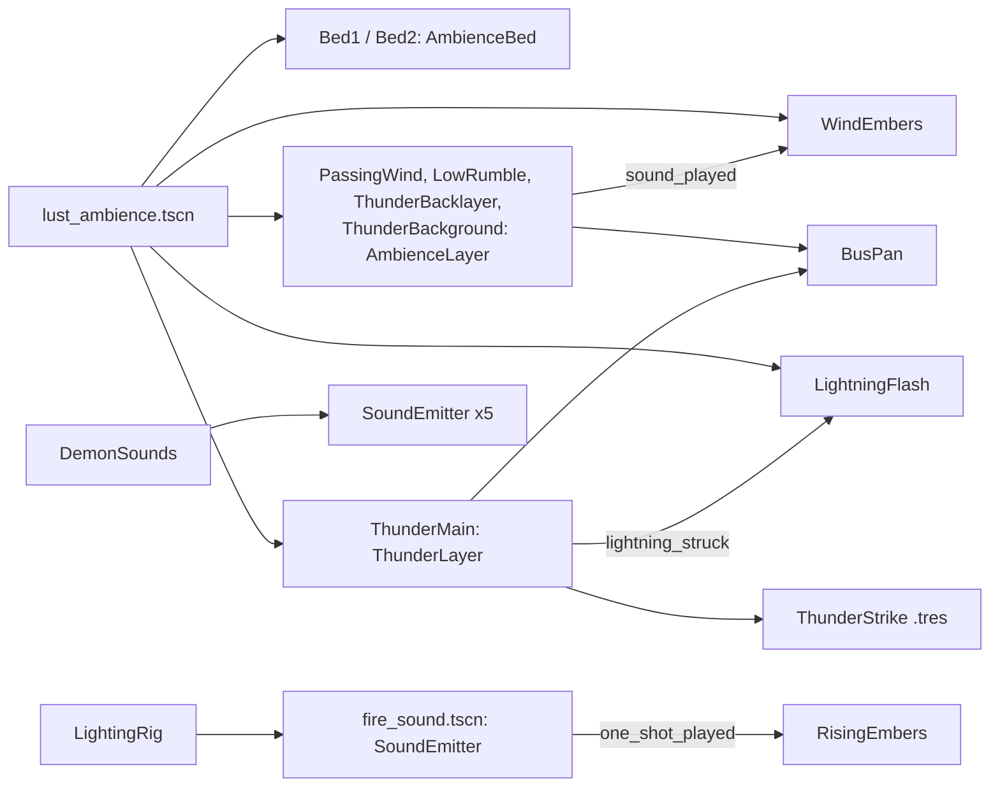

# Som

O ambiente sonoro do nível (bases, rajadas, trovões, fogo) e as partículas que reagem a ele, o emissor de som com distância, e quem mais faz som no jogo. A árvore dos buses de áudio está em [15_configuracao.md](15_configuracao.md). Descreve o `dev` no commit `cd14afe` (23/11/2026). Os caminhos são relativos a `Projeto/scenes/`.

## O que faz no jogo

O nível 1 tem um fundo contínuo de vento que sobe e desce de volume, rajadas que passam de um lado para o outro, um ronco grave de vez em quando e uma tempestade fora do ecrã: o relâmpago pinta o fundo de cor-de-rosa e o trovão chega 2 a 6 segundos depois. As rajadas levam brasas pelo ecrã; os estalos do fogo atiram faúlhas para cima. Os fogos e os cães soam mais alto quanto mais perto estão da alma e ouvem-se do lado em que estão. A alma tem som de passos, salto, aterragem, deslize na parede e de SP baixos.

## Como se liga

O ambiente do nível está montado na cena `levels/lust/lust_ambience.tscn`, instanciada no `level1.tscn` (nó `Ambience`). Cada peça toca no seu bus.

**Bases.** Cada `AmbienceBed` repete um ficheiro longo, cruzando dois leitores para não se ouvir o corte, e o volume deriva entre `quiet_db` e `loud_db`. No nível 1: `Bed1` entre −24,5 e −7 dB e `Bed2` entre −27,5 e −12,5 dB.

**Camadas.** Cada `AmbienceLayer` toca sons soltos a intervalos ao acaso, postos ou panoramizados à volta do ecrã. O `BusPan` muda o pan do primeiro `AudioEffectPanner` do bus. No nível 1: rajadas a cada 21 a 33 s, ronco a cada 11 a 19 s, e duas camadas de trovão distante.

**Trovão.** O `ThunderLayer` sorteia um relâmpago, acende o `LightningFlash` e toca o trovão 2 a 6 s depois, do mesmo lado. Cada trovão é um `ThunderStrike` (`strikes/thunder_1.tres`, `thunder_2.tres`), com o som e a curva do clarão.

**Som no mundo.** O `SoundEmitter` é um som com a sua própria queda com a distância até ao «ouvido» da alma (`near_distance` 150 px, `hearing_distance` 1000 px), com um ciclo contínuo e sons soltos. Usam-no os cães (5 emissores cada) e os fogos (`fire_sound.tscn`, no bus `Fire`). As bases, o emissor e os sons dos cães contam o tempo real (`delta / Engine.time_scale`), por isso não abrandam durante a paragem de impacto da morte; as camadas e o trovão contam o tempo do jogo.

**Quem mais faz som.**

| Origem | Script | Bus | Descrito em |
|---|---|---|---|
| Alma: salto, aterragem, deslize, SP baixos | `characters/player/player_sounds.gd` | `PlayerJump`, `PlayerLand`, `PlayerWallSlide`, `PlayerLowSP` | [03_personagem.md](03_personagem.md) |
| Passos | `characters/player/footsteps.gd` | `PlayerFootsteps` | [03_personagem.md](03_personagem.md) |
| Crucifixo | `characters/crucifix/crucifix_sounds.gd` | `CrucifixCue`, `CrucifixHold` | [03_personagem.md](03_personagem.md) |
| Cães | `characters/demon/demon_sounds.gd` | `DemonAlert`, `DemonLatch`, `DemonJump`, `DemonAttack`, `DemonCrucifixHit` | [04_demonios.md](04_demonios.md) |
| Menus | `screens/menu_feedback.gd` | `UI` | [01_fluxo_e_menus.md](01_fluxo_e_menus.md) |
| Música do menu | `screens/menu_music.gd` (nó `MenuMusic` do `main.tscn`) | `Music` | [01_fluxo_e_menus.md](01_fluxo_e_menus.md) |

Os sons do ambiente, do fogo, dos cães e dos menus variam por sorteio sem repetir o anterior (`AudioStreamRandomizer`, em `lust_ambience.tscn`, `fire_sound.tscn`, `demon.tscn` e `menu_feedback.tscn`).

## Ficheiros (`others/ambience/`)

| Ficheiro | O que é | Quem o usa | Onde se afina |
|---|---|---|---|
| `ambience_bed.gd` + `.tscn` | `AmbienceBed`: base contínua com volume a derivar | `lust_ambience.tscn` | `quiet_db` −12 e `loud_db` −4 no script (o nível muda-os), `crossfade`, `drift_rate` |
| `ambience_layer.gd` + `.tscn` | `AmbienceLayer` (`Node2D`): sons soltos à volta do ecrã; sinal `sound_played` | `lust_ambience.tscn`; `WindEmbers` | `min_gap` 8 s e `max_gap` 25 s no script (o nível muda-os), `horizontal_spread`, `vertical_spread`, `side_pan` |
| `bus_pan.gd` | `BusPan` (`RefCounted`): pan de um bus | `ambience_layer.gd`, `thunder_layer.gd` | — |
| `thunder_layer.gd` + `.tscn` | `ThunderLayer`: tempestade fora do ecrã; sinais `lightning_struck`, `thunder_played` | `lust_ambience.tscn`; `lightning_flash.gd` | `min_gap` 26 s, `max_gap` 38 s, `thunder_delay` 2 a 6 s, `avoid_repeats` |
| `thunder_strike.gd` | `ThunderStrike` (`Resource`): um trovão (som, curva do clarão, duração, força) | `thunder_layer.gd`, `lightning_flash.gd`, `strikes/*.tres` | — |
| `strikes/thunder_1.tres`, `thunder_2.tres` | Os dois trovões | `lust_ambience.tscn` | — |
| `lightning_flash.gd` + `.tscn` + `.gdshader` | `LightningFlash`: pinta o fundo do nível a cada relâmpago | `lust_ambience.tscn` | `colour`, `brightness`, `reach` |
| `wind_embers.gd` + `.tscn` | `WindEmbers` (`CanvasLayer`): brasas levadas por cada rajada | `lust_ambience.tscn` | Grupos `Gust`, `Air`, `Glow`; `in_backdrop` |
| `rising_embers.gd` + `.tscn` | `RisingEmbers` (`CanvasLayer`): faúlhas a cada estalo do fogo | `fire_sound.tscn`, `lighting_rig.gd` | Exports da cena |
| `ember_look.gd` | `EmberLook` (`RefCounted`): texturas e material das brasas | `rising_embers.gd`, `wind_embers.gd` | — |
| `sound_emitter.gd` + `.tscn` | `SoundEmitter` (`Node2D`): som no mundo com distância; sinal `one_shot_played` | `demon.tscn`, `demon_sounds.gd`, `fire_sound.tscn`, `lighting_rig.gd` | `near_distance` 150 px, `hearing_distance` 1000 px, `loop_volume_db`, `one_shot_volume_db`, `interval` |
| `fire_sound.tscn` | Instância do `SoundEmitter`: ciclo do fogo e 4 estalos no bus `Fire`, com `RisingEmbers` | `lighting_rig.gd` (`FIRE_SOUND`) | Na cena |

A sala de som para ouvir cada ficheiro no seu bus está em [12_depuracao.md](12_depuracao.md).

## Desligado por defeito

| O quê | Valor | Porquê |
|---|---|---|
| Nunca repetir o mesmo trovão duas vezes seguidas | `avoid_repeats = false` em `thunder_layer.gd` | O código não diz porquê |
| Brasas do vento atrás da rocha | `in_backdrop = false` em `wind_embers.gd` | O código não diz porquê; com ele desligado, as brasas passam à frente de tudo. Muda-se com o jogo a correr, no separador Remote |
| Bipes provisórios dos cães | `play_beeps = false` | Ver [04_demonios.md](04_demonios.md) |

## Ver também

- README, [Decisões técnicas](../../README.md#decisões-técnicas) (secções do som e dos buses).
- `docs/som_e_musica.md` (o plano do som e da música).
- ADR 0040 (alerta à vista e ao ouvido), ADR 0054 (música por camadas).
