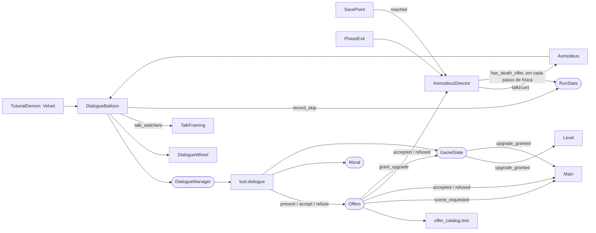

# Diálogo, ofertas e demónios que falam

O balão de diálogo e a roda das respostas, os ficheiros de falas, as tentações (ofertas) e o ritmo das ofertas depois das mortes, e os dois demónios que falam no nível 1: a Velvet e a Asmodeus, com o diretor que decide quando ela fala. O registo moral está em [02_servicos_globais.md](02_servicos_globais.md). Descreve o `dev` no commit `cd14afe` (23/11/2026). Os caminhos são relativos a `Projeto/`.

## O que faz no jogo

Quando um demónio fala, a alma fica parada, aparece uma caixa no topo do ecrã com o retrato de quem fala e a câmara enquadra os dois. As falas avançam com o salto. Quando há escolha, aparecem até quatro respostas por baixo da caixa; o jogador aponta uma com o stick ou com as teclas de movimento e confirma. Nenhuma resposta vem escolhida à partida, para um toque perdido nunca responder. Manter a tecla carregada salta as falas até à próxima pergunta, sem nunca responder pelo jogador.

No nível 1, a Velvet, um cão que nunca ataca, recebe a alma no tutorial. A Asmodeus aparece ao lado da alma no início das fases 2 e 3 e oferece um atalho para o fim do nível. Quando a alma morre muitas vezes, volta a oferecê-lo. No fim do nível oferece um dom. Aceitar ou recusar soma no registo moral, que o jogador nunca vê. O primeiro dom aceite custa o crucifixo.

## Como se liga

**Balão e roda.** Cada demónio que fala instancia o `dialogue_balloon.tscn` e chama `start(recurso, cue)`. O balão foi feito a partir do balão de exemplo do plugin Dialogue Manager 4.1.0 (ADR 0030), para o `addons/` ficar como veio. O balão pede cada fala ao recurso (`DialogueResource.get_next_dialogue_line`, `dialogue_balloon.gd:211`). Os demónios ficam à direita e a alma à esquerda. Um retrato mais alto do que a vinheta sai por cima dela; sem imagem, a vinheta mostra a cor e a inicial de quem fala. Enquanto fala, o balão esconde o grupo `hidden_during_dialogue` (a barra de SP) e avisa o grupo `talk_watchers` (o `TalkFraming` da câmara, ver [07_camara.md](07_camara.md)). Saltar falas manda a contagem ao `RunStats` (`record_skip`), para os números da partida, nunca para o registo moral. As respostas aparecem no `DialogueWheel`: 1 em cima à esquerda, 2 em cima à direita, 3 em baixo à esquerda, 4 em baixo à direita. A resposta apontada desenha-se invertida (`invert_outline.gdshader`). O rato não faz nada na roda. O nó `AnswerFeedback` (um `MenuFeedback` com `only_asked` ligado) dá o som e a vibração de apontar e confirmar.

**Ficheiros de falas.** O que cada personagem diz está nos `.dialogue` de `dialogue/`, divididos por cues (`~ nome`). As falas chamam os autoloads pelo nome global: `Offers` para as tentações, `Moral` para o tom de cada resposta (`record_tone`, 19 vezes no `lust.dialogue`), `GameState` para o nome e os acontecimentos, `RunStats` para os números ditos em voz alta (mortes, minutos).

**Ofertas.** Cada tentação é um ficheiro `OfferData` (quem oferece, o quê, o preço dito, o efeito, o peso moral) listado no `offer_catalog.tres`. Uma oferta nova é um ficheiro e as suas falas, sem código. A fala chama `Offers.present(&"id")` quando a oferta é feita e `Offers.accept` ou `Offers.refuse` com a resposta. Aceitar conta a tentação no `Moral` uma só vez e emite `accepted`. O efeito só se aplica quando o balão fecha, para um atalho nunca mudar de fase debaixo de um balão aberto. Recusar conta a recusa e o tempo que a alma ouviu (tempo real). Cada resposta acrescenta uma linha a `user://offers_log.csv`, para os playtests. Há dois efeitos:

- `GoToSceneEffect`: pede ao `Main` uma fase e um `ArrivalPoint` (`scene_requested`). O `Main` muda de fase com o mesmo fade de uma saída.
- `GrantUpgradeEffect`: dá um dom pelo `GameState.grant_upgrade`. O primeiro dom tira o crucifixo (`game_state.gd:58`). O `Level` retira-o da cena e o `Main` grava.

O `Main` também grava logo depois de cada resposta a uma oferta.

**Ofertas por mortes** (`DeathOfferPacer`). A partir da fase 2, cada morte soma 1 de pressão, mais 0,5 por cada morte anterior no mesmo sítio: a mesma zona e a mesma origem (por exemplo, a mesma faixa de silvas) ou, sem origem, a mesma causa (`run_stats.gd:71`, `RunRecord.spot_of`). Quando a pressão chega ao limiar, a zona dessa morte fica marcada e a Asmodeus oferece o atalho da próxima vez que a alma lá estiver. O primeiro limiar sorteia-se entre 4 e 7. Depois de cada oferta, a base do limiar passa a 0,7 da anterior, nunca abaixo de 1,5, e o limiar sorteia-se com 15 % de variação para cada lado dessa base (`death_offer_pacer.gd:56`), para o jogador nunca conseguir contar. Ninguém avisa a Asmodeus: o `AsmodeusDirector` pergunta ao `RunStats` em cada passo de física (`has_death_offer()`, `asmodeus_director.gd:100`). Aceitar ou recusar tira a marca dessa zona; depois de a alma aceitar o atalho, acabam as ofertas por mortes.

**Velvet** (`TutorialDemon`). Passeia 128 px para cada lado do sítio onde está, a 88 px/s, com pausas de 1,5 s. Quando a alma entra pela primeira vez na sua área, fala sozinha a partir da cue `velvet`. Depois, a tecla de interagir repete a partir de `velvet_again`. Ter falado com ela fica no `GameState` (acontecimento `velvet_met`), para um jogo gravado não repetir a primeira conversa nem contar duas vezes as respostas. Os sinais `talk_started` e `talk_ended` seguram a faixa dos avisos do tutorial.

**Asmodeus e o diretor.** A `Asmodeus` aparece ao lado da alma, no mesmo chão, à frente se houver espaço e atrás se não houver, longe das silvas e dos perigos, e fala. Depois volta para o seu sítio (`home`; no `level1.tscn`, a sala dela), onde fica à vista entre conversas (`_go_home`, `asmodeus_director.gd:145`). Enquanto fala, a alma e os cães ficam parados. Quem decide quando fala é o `AsmodeusDirector`, um nó do `level1.tscn`:

- No primeiro `SavePoint` de cada fase em `phase_cues`: `asmodeus_offer` na fase 2 e `asmodeus_second_offer` na fase 3. Espera que a alma pise o chão.
- Em cada zona marcada pelas mortes: `asmodeus_deaths`.
- Na saída do nível: `asmodeus_gift` e depois `stairs`. Só então a saída avança (`exit.lead_on()`, `asmodeus_director.gd:167`), com o acontecimento `lust_done` e o `ArrivalPoint` `asmodeus_tent` como sítio do Continue.

Uma conversa só conta como tida quando a alma responde à oferta (acontecimento `answered_<cue>` no `GameState`). Quem sair antes de responder volta a ouvi-la. O fim da conversa da fase 2 dispara a cena de câmara `Phase2Intro` (ligação no `level1.tscn`).

## Ficheiros

### Balão e roda (`scenes/screens/`)

| Ficheiro | O que é | Quem o usa | Onde se afina |
|---|---|---|---|
| `dialogue_balloon.gd` + `.tscn` | `DialogueBalloon` (`CanvasLayer`, camada 8, 463 linhas): caixa, retratos, roda, saltar falas; sinal `lines_skipped` | `asmodeus.tscn` e `tutorial_demon.tscn` (no `balloon_scene` dos scripts), `dialogue/lust_waking_preview.tscn` | `skip_hold_time` 0,6 s, `skip_bar_delay` 0,15 s, `portraits` (Asmodeus e Velvet na cena), `portrait_colors`, `pop_out_areas`; texto de 34 a 26 px no script, 36 a 28 px na cena; `lets_through` (pausa e teclas de depuração) |
| `dialogue_wheel.gd` | `DialogueWheel` (`Control`, nó `Balloon/Stage/Wheel`): até 4 respostas; sinais `response_selected`, `pointed` | `dialogue_balloon.tscn` | `aim_deadzone` 0,5, `aim_axis_share` 0,38, `aim_release_margin` 0,12 (histerese), letra de 26 a 18 px, 2 linhas no máximo |

O `menu_feedback.tscn` e o `invert_outline.gdshader`, que o balão usa, estão em [01_fluxo_e_menus.md](01_fluxo_e_menus.md) e [09_luz_visao_e_arte.md](09_luz_visao_e_arte.md).

### Falas (`dialogue/`)

| Ficheiro | O que é | Quem o usa |
|---|---|---|
| `lust.dialogue` (220 linhas) | Nível 1: cues `waking`, `name_empty`, `named`, `velvet`, `velvet_questions`, `velvet_argument`, `velvet_again`, `velvet_advance`, `velvet_burned`, `asmodeus_offer`, `asmodeus_second_offer`, `asmodeus_deaths`, `asmodeus_gift`, `stairs` | `asmodeus.tscn`, `tutorial_demon.tscn`, `lust_waking_preview.tscn` |
| `gluttony.dialogue` (161 linhas) | Nível 2 (Beelzebub, Crumb): 9 cues | Nenhuma cena; só testes |
| `greed.dialogue` (245 linhas) | Nível 3 (Mammon, Tally, Chip): 18 cues | Nenhuma cena; só testes |
| `lust_waking_preview.tscn` | Balão com `auto_start` a correr o `lust.dialogue` desde `waking`, para ver as falas com F6 | Só um teste |

Os três `.dialogue` são também os ficheiros de tradução do projeto (POT, no `project.godot`).

### Ofertas (`scenes/autoload/offers/`)

| Ficheiro | O que é | Quem o usa | Onde se afina |
|---|---|---|---|
| `offers.gd` | Autoload `Offers` (`GameOffers`, 174 linhas); sinais `presented`, `accepted`, `refused`, `scene_requested` | Os `.dialogue`, `main.gd`, `asmodeus_director.gd`, `debug_overlay.gd` | `default_log_path` (`user://offers_log.csv`) |
| `offer_catalog.gd` + `.tres` | `OfferCatalog` (`Resource`): a lista das 8 ofertas | `offers.gd`, `moral_record.gd` | Juntar ou tirar ofertas no `.tres` |
| `offer_data.gd` | `OfferData` (`Resource`): `id`, `offerer`, `what`, `cost`, `effect`, `moral_weight` (1 no script) | Os 8 `.tres` | Por oferta |
| `offer_effect.gd` | `OfferEffect` (`Resource`): base dos efeitos | Os dois efeitos | — |
| `go_to_scene_effect.gd` | `GoToSceneEffect`: atalho para outra fase | `lust_shortcut.tres` | `scene_path`, `arrival` |
| `grant_upgrade_effect.gd` | `GrantUpgradeEffect`: dá um dom | `charm.tres`, `stomach.tres`, `claim.tres` | `upgrade` |
| `death_offer_pacer.gd` | `DeathOfferPacer` (`RefCounted`): regras das ofertas por mortes, sem nós | `run_stats.gd`, `debug_overlay.gd` | — |
| `death_offer_stats.gd` + `.tres` | `DeathOfferStats` | `run_stats.gd` | `first_phase_with_offers` 2, `first_offer_min` 4, `first_offer_max` 7, `same_spot_bonus` 0,5, `gap_shrink` 0,7, `min_gap` 1,5, `gap_jitter` 0,15. O `.tres` não muda nenhum |

As 8 ofertas:

| Ficheiro | Quem oferece | Efeito | `moral_weight` | Feita em |
|---|---|---|---|---|
| `lust_shortcut.tres` | Asmodeus | Vai para `level1_lit.tscn`, em `asmodeus_tent` | 1 | `lust.dialogue` (3 cues) |
| `charm.tres` | Asmodeus | Dom `charm` | 2 | `lust.dialogue` (`asmodeus_gift`) |
| `gluttony_shortcut.tres` | Beelzebub | Nenhum | 1 | `gluttony.dialogue` |
| `stomach.tres` | Beelzebub | Dom `stomach` | 1 | `gluttony.dialogue` |
| `greed_toll_1.tres`, `_2`, `_3` | Mammon | Nenhum (portagens roubadas) | 0,4 cada | `greed.dialogue` |
| `claim.tres` | Mammon | Dom `claim` | 1 | `greed.dialogue` |

### Demónios que falam (`scenes/characters/demon/`)

| Ficheiro | O que é | Quem o usa | Onde se afina |
|---|---|---|---|
| `tutorial_demon.gd` + `.tscn` | `TutorialDemon` (`Node2D`): a Velvet; sinais `player_arrived`, `talk_started`, `talk_ended` | `level1.tscn` (`Tutorial/TutorialDemon`), `LustLevel_Phase1_Cave.tscn`, `build_level1.gd`, `tutorial_hints.gd` | `first_cue`, `again_cue`, `next_action` (`jump`), `talk_action` (`interact`), `walk_reach` 128 px, `walk_speed` 88 px/s, `walk_pause` 1,5 s, animação |
| `asmodeus.gd` + `.tscn` | `Asmodeus` (`Node2D`): aparece ao lado da alma e fala; sinais `talk_started(cue)`, `talk_ended(cue)` | `level1.tscn`; `asmodeus_director.gd`, `talk_framing.gd` | `appear_distance` 180 px no script e 300 px no `level1.tscn`, `min_appear_distance` 90, `distance_step` 30, `max_floor_step` 48, `body_size` 70 × 140, `danger_groups` e `danger_margin` 24, `stills` (os cães) |
| `asmodeus_director.gd` | `AsmodeusDirector` (`Node`): quando a Asmodeus fala | `level1.tscn` | `phase_cues`, `death_cue`, `ending_cues`, `exit`, `shortcut` (`lust_shortcut`), `done_event` (`lust_done`), `done_arrival` (`asmodeus_tent`), `home` |

## Desligado por defeito

| O quê | Valor | Porquê |
|---|---|---|
| Balão que arranca sozinho | `auto_start = false` em `dialogue_balloon.gd` | Os demónios chamam `start()`; só a pré-visualização o liga |
| Asmodeus que desliza a câmara até aos dois | `centres_camera = false` em `asmodeus.gd` | O `TalkFraming` mostra a conversa como uma cena; ligado, volta o deslize da câmara de antes da #284 |

Ainda sem uso no jogo, segundo uma procura no código:

- as cues `waking`, `name_empty` e `named` só correm na pré-visualização: o ecrã do nome ainda não existe;
- nenhuma cena chama `velvet_advance` nem `velvet_burned`;
- nenhuma cena usa o `gluttony.dialogue` nem o `greed.dialogue`;
- os dons `charm`, `stomach` e `claim` ainda não mudam nada além de o primeiro tirar o crucifixo.

Os registos em CSV estão ligados por defeito. Os testes esvaziam o caminho, para não escreverem no registo dos playtests.

## Ver também

- README, [Ofertas: tentações em dados](../../README.md#ofertas-tentações-em-dados), [Balão de diálogo: retrato e saltar falas](../../README.md#balão-de-diálogo-retrato-e-saltar-falas), [Ofertas por mortes: cada vez mais seguidas](../../README.md#ofertas-por-mortes-cada-vez-mais-seguidas) e [Registo moral: escondido, uma soma e dois limiares](../../README.md#registo-moral-escondido-uma-soma-e-dois-limiares).
- ADR 0030 (o diálogo usa o plugin Dialogue Manager 4.1.0).
- [02_servicos_globais.md](02_servicos_globais.md) para o `Moral`, o `GameState` e o `RunStats`; [07_camara.md](07_camara.md) para o `TalkFraming`; [12_depuracao.md](12_depuracao.md) para o F7 e o F8 (aceitar e recusar a última oferta).
