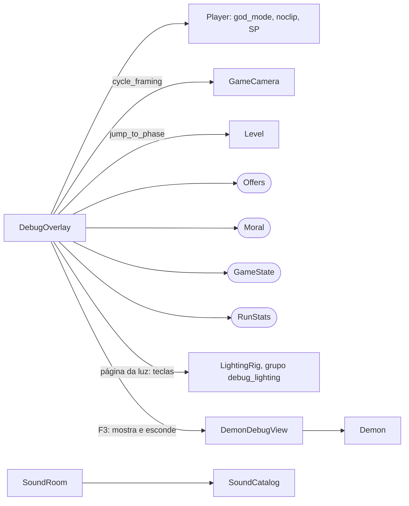

# Depuração

As ferramentas para afinar e testar o jogo enquanto se joga: o texto de depuração por páginas, as teclas de batota e de atalho, a vista da inteligência dos cães e a sala de som. Nada disto existe num jogo exportado. Descreve o `dev` no commit `cd14afe` (23/11/2026). Os caminhos são relativos a `Projeto/scenes/others/debug/`.

## O que faz no jogo

A correr a partir do editor, o F3 mostra no canto do ecrã os números da alma, da câmara e da partida, ou os ajustes da luz. Outras teclas tiram SP, tornam a alma invencível ou fazem-na voar através das paredes, aceitam ou recusam a última oferta, recomeçam a partida, trocam o modo da câmara ou saltam para uma fase. Por cima dos cães aparece o estado de cada um. A sala de som toca cada ficheiro de áudio no seu bus, para quem faz o som o ouvir no Godot sem precisar de quem programa. Num jogo exportado, nada disto aparece nem responde.

## Como se liga

**Só em depuração.** O `DebugOverlay` e o `DemonDebugView` libertam-se no `_ready()` quando o jogo não é uma build de depuração (`OS.is_debug_build()`). Num jogo exportado não aparecem, e as teclas de batota, a troca de câmara e as teclas da luz deixam de funcionar. O `LightingRig` não se liberta: só fica sem as teclas, que lhe chegam pelo overlay. O `DebugOverlay` corre com o jogo em pausa (modo de processo `Always` na cena).

**Páginas.** O F3 passa à página seguinte: escondida, números, luz e shaders, e escondida outra vez. A página escolhida mantém-se no recomeço do mesmo nível, por exemplo depois de uma morte. Na página da luz, o rig recebe primeiro todas as teclas menos o F3, incluindo o F1, o F2 e o F10. Uma tecla que o rig não usa segue para o jogo.

**Estado que sobrevive à morte.** O god mode, o noclip e o modo da câmara são `static var` do overlay. Ficam ligados na cópia seguinte do nível, depois de uma morte ou de um salto de fase, até se carregar outra vez. Um autoload existiria também num jogo exportado. Um `static var` do overlay fica sem efeito, porque fora da depuração o overlay se liberta antes de o ler.

## Teclas

As teclas são físicas e estão no Input Map (ações em [15_configuracao.md](15_configuracao.md)). O balão das falas deixa-as passar (`lets_through`).

| Tecla | Ação | O que faz |
|---|---|---|
| F3 | `toggle_debug_overlay` | Página seguinte; mostra e esconde também o `DemonDebugView` |
| F1 | `debug_god_mode` | God mode: golpes, silvas, fim do agarrão e morte sem efeito (#273). Funciona com o texto escondido e em pausa |
| F2 | `debug_noclip` | Noclip: voo através das paredes a `noclip_speed` (1200 px/s, `Player.DEFAULT_NOCLIP_SPEED`) |
| F4 | `debug_damage` | Tira `debug_damage` SP (10) |
| F7 | `debug_accept_offer` | Aceita a última oferta feita, ou a primeira ainda não aceite, como as falas fariam |
| F8 | `debug_refuse_offer` | Recusa essa oferta |
| F9 | `debug_reset_run` | Recomeça o estado da partida, com as ofertas e o registo moral |
| F10 | `debug_camera_next` | Troca a câmara para o modo seguinte (#282); também com Ctrl, fora da página da luz |
| 1, 2, 3 | `debug_phase_1` a `_3` | Só na página dos números: recomeça o nível nessa fase (`Level.jump_to_phase`). Nas outras páginas, ou num nível de uma só fase, a tecla segue para o jogo |
| F1 a F12, Ctrl+F1 a F12 | Teclas do rig | Só na página da luz: os interruptores do `lighting_rig.gd` (ver [09_luz_visao_e_arte.md](09_luz_visao_e_arte.md)) |

As teclas de depuração estão também no `RESERVED_KEYS` do `input_profiles.gd`, para o ecrã Controls não as dar a uma ação do jogo (ver [02_servicos_globais.md](02_servicos_globais.md)).

## Ficheiros

| Ficheiro | O que é | Quem o usa | Onde se afina |
|---|---|---|---|
| `debug_overlay.gd` + `.tscn` | `DebugOverlay` (`CanvasLayer`, 482 linhas): páginas, batotas, atalhos de ofertas, de fases e da câmara; etiqueta das batotas numa camada própria | `level1.tscn`, `lust_phase_2.tscn`, a cadeia antiga `LustLevel_*`, `gym.tscn`, `test_room.tscn`, `build_lust_phase_2.gd`; `lighting_rig.gd`, `demon_debug_view.gd` | `start_visible` (ligado: abre na página dos números), `debug_damage` 10 SP, `noclip_speed` 1200 px/s, `player`, `camera` |
| `demon_debug_view.gd` | `DemonDebugView` (`Node2D`, 162 linhas): por cima de cada cão, o estado e os segundos nele; o posto, a patrulha, onde viu a alma pela última vez, a linha de vista e o caminho de volta (ADR 0042) | `level1.tscn`, `lust_phase_2.tscn`, `gym.tscn`, `test_room.tscn`, `build_lust_phase_2.gd` | `overlay`, `demons`, `player`; cores e medidas em constantes |
| `sound_room.gd` + `.tscn` | `SoundRoom` (`Control`, 245 linhas): sala para ouvir cada som no seu bus; corre-se sozinha com F6 | Nenhuma cena: abre-se à mão | `audio_folder` (`res://assets/audio`), `bus_by_folder` (`music` → `Music`, `sfx` → `SFX`, `ambience` e `textures` → `Ambience`, `ui` → `UI`, …), `fallback_bus` (`SFX`), `random_pitch` 1,05, `max_polyphony` 4 |
| `sound_catalog.gd` | `SoundCatalog` (`RefCounted`, 159 linhas): lê os eventos de som pelos nomes dos ficheiros | `sound_room.gd` | Regra dos nomes: `footstep_1.wav` a `footstep_6.wav` são seis versões do evento `footstep` |

**Sala de som.** Com o rato, um clique toca um evento. Com o teclado ou o comando, as setas mudam de evento, Enter (A) toca, escrever uma letra filtra pela procura e Esc (B) pára tudo. As versões de um evento tocam ao acaso, com o tom a variar 5 % para cada lado. Um ficheiro novo com o nome certo aparece no arranque seguinte ou no botão Rescan, sem mudar código. Os sons tocam sem posição: no jogo, um som 2D no meio do ecrã ouve-se cerca de 6 dB mais baixo (comentário no `sound_room.gd`).

## Desligado por defeito

Nada nesta pasta está desligado por defeito. O overlay abre na página dos números (`start_visible` ligado), e todas as ferramentas desaparecem fora das builds de depuração.

## Ver também

- README, [Testes e medidas](../../README.md#testes-e-medidas) e a tabela do Input Map.
- ADR 0042 (cães que saltam degraus; o caminho de volta que o `DemonDebugView` desenha vem daí).
- [15_configuracao.md](15_configuracao.md) para o Input Map; [13_testes.md](13_testes.md) para o `test_debug_cheats` e a costura `_is_debug_build()`.
