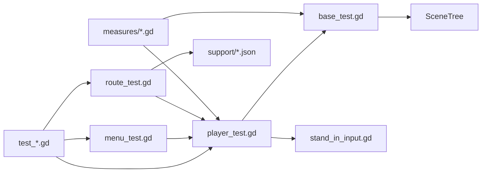

# Testes e medidas

Os 168 testes automáticos agrupados por sistema, o que cada grupo garante, como se correm, as 16 medidas de desempenho e de espaço, os ficheiros de apoio e as falhas conhecidas da última corrida completa. Descreve o `dev` no commit `cd14afe` (23/11/2026). Os caminhos são relativos a `Projeto/tests/`.

## O que faz no jogo

Os testes não fazem parte do jogo: são programas que abrem uma parte do jogo sem janela, jogam-na sozinhos e verificam se o resultado é o esperado. Por exemplo, se a alma salta à altura certa, se um cão ataca quando deve ou se uma gravação volta igual. Cada teste termina com o código 0 quando tudo passou e 1 quando alguma coisa falhou. Servem para uma mudança num sítio não estragar outro sem ninguém dar por isso. As medidas não verificam nada: imprimem números de custo por frame, tempos ou espaço no ecrã, para comparar antes e depois de uma mudança.

Na última corrida completa, a 22/11/2026, passaram 153 dos 168 testes. As 15 falhas estão listadas mais abaixo.

## Como se correm

Na Git Bash, a partir da raiz do repositório. Na PowerShell, o que o Godot escreve não aparece, e um teste parece limpo sem ter mostrado nada. `GODOT` é o caminho do executável de cada um.

| O quê | Comando |
|---|---|
| Um teste | `"$GODOT" --headless --fixed-fps 60 --path Projeto --script res://tests/test_jump_height.gd` |
| Todos | `for t in Projeto/tests/test_*.gd; do n=$(basename "$t"); "$GODOT" --headless --fixed-fps 60 --path Projeto --script "res://tests/$n" >/dev/null 2>&1 \|\| echo "FAIL $n"; done` |
| Smoke test (o jogo inteiro, só erros) | `"$GODOT" --headless --path Projeto --quit-after 3 2>&1 \| grep -Ei "error\|parse" \| head -20` |
| Uma medida | `"$GODOT" --headless --fixed-fps 60 --path Projeto --script res://tests/measures/measure_demon.gd` |

- O repositório não tem um script que corra a suite inteira; o ciclo da tabela faz o mesmo. A corrida de 22/11 levou cerca de 9 minutos.
- Depois de um clone, de um pull ou de uma troca de ramo com recursos novos ou movidos, é preciso abrir o projeto no editor e esperar pela importação antes de correr os testes.
- O veredicto é o código de saída. Quatro testes escrevem «FAIL» sem dois pontos (`test_fires_seated`, `test_level1_art`, `test_menu_music_fade`, `test_tutorial_hints`), por isso procurar «FAIL:» no texto não chega.
- Alguns testes escrevem linhas ERROR ou WARNING esperadas, de casos inválidos de propósito. O README lista-as por teste.

## Como se organiza

Não há framework de testes (ADR 0004). Cada teste é um script `extends SceneTree` que imprime «PASS: …» ou «FAIL: …» por caso. Quase todos herdam de um ficheiro de apoio, que trata do que é comum.

O `base_test.gd` é a base: antes de os autoloads arrancarem, diz ao `Settings` para guardar as opções em memória, com os valores por defeito, e desliga a gravação e os registos CSV das ofertas e das mortes. Assim um teste dá o mesmo resultado em qualquer computador e nunca muda as opções nem a gravação de quem joga.

Quatro testes e três medidas herdam diretamente de `SceneTree`: `test_gate_art`, `test_grab_prompt_over_rock`, `test_level1_art`, `test_unlocker_statue`, `measure_brambles`, `measure_lighting` e `measure_restart`, e também o launcher. Das outras 13 medidas, 7 herdam do `base_test.gd` e 6 do `player_test.gd` (`camera_space`, `crucifix_repel`, `demon`, `dog_trail`, `level1` e `sight_reveal`). O `menu_test.gd` e o `route_test.gd` herdam do `player_test.gd`. O `test_level1` e o `test_level1_phase3` herdam do `test_lust_phase_2.gd`.

## Testes por sistema

| Sistema | N.º | Testes (`test_` + nome) | O que garantem | Doc |
|---|---|---|---|---|
| Movimento da alma | 13 | `air_control`, `coyote_time`, `jump_buffer`, `jump_height`, `jump_signals`, `landed_signal`, `ledge_assist`, `one_way_platform`, `player_animation`, `player_input`, `player_movement_stats`, `wall_jump`, `wall_slide` | Salto, controlo no ar, coyote time, buffer, deslize e salto da parede, ajuda na beira e plataformas de sentido único seguem os valores do `.tres`; uma entrada simulada conduz a alma | [03](03_personagem.md) |
| Controlos e avisos | 8 | `controls`, `crucifix_menus`, `grab_prompt_glyph`, `grab_prompt_over_rock`, `input_map`, `input_profiles`, `last_device`, `prompt_band` | O Input Map por defeito cobre teclado e comando; perfis e remapeamento; último aparelho; ícones e avisos | [01](01_fluxo_e_menus.md), [02](02_servicos_globais.md), [05](05_niveis.md) |
| Crucifixo, SP e dano | 9 | `crucifix`, `crucifix_block`, `crucifix_warning`, `grab_escape`, `grab_rules`, `hit_boxes`, `knockback`, `soul_hud`, `soul_points` | Dano, cura e regeneração de SP; barra da alma; crucifixo; caixas de dano; empurrão; agarrão e fuga (ADR 0021) | [03](03_personagem.md) |
| Demónios e cães | 17 | `big_dog`, `biggest_dog`, `biggest_dog_threat`, `demon`, `demon_animation`, `demon_jump`, `demon_mark`, `demon_path`, `demon_target`, `demon_trail`, `dog_back_bite`, `dog_shafts`, `dog_trail`, `mixed_pack`, `sinking_drawing`, `stacked_bodies`, `wedged_dogs` | Perseguição e sentidos, saltos, caminho, alvo e rasto, mordida nas costas, matilhas, animação, cão grande e cão maior | [04](04_demonios.md) |
| Câmara | 15 | `camera_brains`, `camera_cutscene`, `camera_keeps_player_on_screen`, `camera_look_ahead`, `camera_lookout`, `camera_shake`, `camera_vertical`, `camera_window`, `camera_zones`, `camera_zoom`, `fixed_framing`, `game_camera`, `level1_fixed_camera`, `rock_map`, `talk_framing` | Seguir, olhar à frente e para baixo, zoom, zonas, miradouros, modos trocáveis, câmara fixa, mapa da rocha, tremor, cenas de câmara, falas; a alma sempre no ecrã | [07](07_camara.md) |
| Nível 1 | 8 | `level1`, `level1_escape_loop`, `level1_exit_gate`, `level1_phase3`, `level1_phase3_route`, `level1_route`, `phase2_save_entry`, `tutorial_hints` | O `level1.tscn` bate certo com os mapas de texto; rotas jogáveis com a alma real; entrada e gravação da fase 2; caminho de volta e portão da saída; avisos do tutorial | [05](05_niveis.md) |
| Cenas antigas, ginásio e fluxo do nível | 13 | `death_iris`, `gym`, `gym_dogs`, `gym_hint`, `gym_stations`, `level_restart`, `lust_phase1_zones`, `lust_phase2_3_zones`, `lust_phase3`, `lust_phase_2`, `lust_phase_2_route`, `phase_exit`, `tutorial_room` | Cadeia antiga `LustLevel_*` e `lust_phase_2.tscn`; estações do ginásio; morte e recomeço com a íris | [05](05_niveis.md) |
| Objetos, armadilhas e portões | 14 | `bramble_cut`, `bramble_death`, `bramble_motion`, `bramble_pull`, `collapsing_platform`, `collapsing_platform_art`, `gate`, `gate_art`, `gate_fronts`, `lethal_spikes`, `lethal_spikes_art`, `snag`, `traps`, `unlocker_statue` | Silvas e as suas mortes, plataformas que caem, portões e estátuas, armadilhas | [06](06_objetos.md), [03](03_personagem.md) |
| Luz, linha de vista e arte | 11 | `background_layer`, `dogs_behind_rock`, `drawn_over_the_rock`, `fires_seated`, `level1_art`, `level1_lit`, `reveal_rule`, `rising_embers`, `sight_reveal`, `statue_light`, `wind_embers` | O `level1_lit` guarda o aspeto aprovado (ADR 0068); ordem de desenho contra a rocha; linha de vista (#253); fundo e brasas | [09](09_luz_visao_e_arte.md), [10](10_som.md) |
| Atividade fora do ecrã | 3 | `activity_tracker`, `demon_activity`, `parallax_activity` | O que está parado fora do ecrã adormece e acorda | [07](07_camara.md) |
| Menus, opções e gravação | 9 | `main_flow`, `options`, `options_back_key`, `options_shoulder_tabs`, `pause`, `save_game`, `save_slots`, `save_slots_menu`, `settings` | Fluxo do menu, opções, pausa, gravação e os três slots | [01](01_fluxo_e_menus.md), [02](02_servicos_globais.md) |
| Diálogo | 7 | `dialogue_balloon_input`, `dialogue_calls`, `dialogue_compiles`, `dialogue_lines`, `dialogue_skip`, `dialogue_wheel`, `wheel_feedback` | Os `.dialogue` compilam; as chamadas aos autoloads existem; balão, saltar falas e roda | [11](11_dialogo_e_ofertas.md) |
| Ofertas, registo moral, números da partida e demónios que falam | 17 | `asmodeus`, `asmodeus_appears_in_the_open`, `asmodeus_deaths`, `death_offer_pacer`, `deaths_log`, `level_run_stats`, `lust_asmodeus`, `lust_offer_numbers`, `moral_dialogue`, `moral_record`, `number_words`, `offer_catalog`, `offer_shortcut`, `offers`, `offers_in_main`, `run_record`, `velvet_walk` | Ofertas e efeitos, ritmo das ofertas por mortes, registo moral, números da partida e registos CSV, Asmodeus e Velvet | [11](11_dialogo_e_ofertas.md), [02](02_servicos_globais.md) |
| Som e vibração | 16 | `ambience_bed`, `ambience_ducking`, `ambience_layer`, `controller_rumble`, `crucifix_sounds`, `demon_sounds`, `footsteps`, `low_sp_sound`, `menu_feedback`, `menu_music`, `menu_music_fade`, `player_sounds`, `rumble_moments`, `sound_emitter`, `sound_room`, `thunder` | Ambiente, emissores, sons da alma, dos cães e dos menus, música, vibração por momento | [10](10_som.md), [08](08_impactos.md) |
| Depuração | 6 | `debug_camera_switch`, `debug_cheats`, `debug_overlay`, `debug_phase_jump`, `demon_debug_view`, `lighting_debug_page` | Teclas, páginas, batotas; fora da depuração nada responde (costura `_is_debug_build()` no overlay) | [12](12_depuracao.md) |
| Projeto e recursos | 2 | `export_settings`, `resources_load` | Tudo em `res://` carrega sem apontar para a cache de importação; a definição de export que a vibração precisa está ligada | [15](15_configuracao.md) |

## Falhas conhecidas

Corrida completa de 22/11/2026, 19h13 a 19h22, na árvore igual a este commit: 153 de 168 passam. O motivo de cada falha vem da primeira linha FAIL do registo de cada teste.

| Teste | O que falha |
|---|---|
| `test_ambience_ducking` | Os 10 alertas no bus `Alerts` não baixam o ambiente entre 5 e 18 dB |
| `test_demon` | 4 casos da espera entre mordidas (o cão fica parado mais de 3 frames) e dos limites da matilha |
| `test_demon_sounds` | 3 casos: o golpe do crucifixo tem 3 ficheiros na cena e o teste espera 2 (dois casos); o som de agarrar depois do alerta chega com tempos que não batem com os esperados |
| `test_footsteps` | O `player.tscn` liga o Double Layer (o script tem-no desligado) e o teste espera-o desligado |
| `test_level1` | 8 casos: ordem dos portões, duas zonas com a mesma área (`ZoneP2RoomU` e `ZoneP2RoomU2`), chão sem zona, zonas que mostram outros caminhos |
| `test_level1_phase3` | Silvas e plataformas que caem não batem com o mapa de texto (179 contra 181, 20 contra 27) |
| `test_level1_phase3_route` | A alma morre a caminho do primeiro mecanismo da fase 3 |
| `test_level1_route` | 5 trechos da rota com saltos que não chegam |
| `test_lust_phase1_zones`, `test_lust_phase2_3_zones` | Cadeia antiga: miradouros que mostram outros caminhos, chão sem zona, a beira do ecrã a 5086,6 em vez de 5088 |
| `test_lust_phase3` | Cadeia antiga: a subida da chaminé até à rocha falha |
| `test_lust_phase_2_route` | 1 a 2 saltos por trecho que não chegam |
| `test_resources_load` | 1 recurso aponta para a cache de importação (a textura do `cave_placeholder_tiles.tres`) |
| `test_level1_art` | «0 sprites, 0 colliding nodes, 0 tile layers» |
| `test_biggest_dog_threat` | Instável: o cão maior não salta à alma na beira; passou na corrida anterior |

Os 13 testes das primeiras 12 linhas falharam também na corrida completa anterior, no mesmo dia às 18h55, com 167 testes. Nessa corrida falhou ainda o `test_prompt_band`, que passou nesta, e passou o `test_biggest_dog_threat`, que falhou nesta: os dois são de vigiar. Os `.json` das rotas (`*_route`) foram feitos com os números de movimento antigos, por isso as rotas falham depois de o movimento mudar.

## Medidas (`measures/`)

Não verificam nada; terminam com 1 só se a preparação falhar. Seis precisam de janela (corre-se sem `--headless`): `measure_brambles`, `measure_restart`, `measure_lighting`, `measure_joypads`, `shoot_asmodeus_spots` e o launcher.

| Medida | O que imprime |
|---|---|
| `measure_asmodeus_spots` | Onde a Asmodeus apareceria em cada chão do nível 1, por zona da câmara; escreve `user://asmodeus_spots.json` |
| `shoot_asmodeus_spots` | Capturas de ecrã da Asmodeus nesses sítios (janela) |
| `measure_brambles` | Custo do frame na faixa de silvas mais larga, parada e a mexer (janela) |
| `measure_camera_shake` | Custo do `CameraShake` em repouso e com o trauma no máximo |
| `measure_camera_space` | Por modo da câmara no nível 1: rocha lisa no ecrã, distância da alma ao centro, tempo da troca |
| `measure_controller_rumble` | Custo da vibração por frame, por evento e por pulso |
| `measure_crucifix_repel` | Custo do crucifixo com 10, 50 e 200 demónios simulados |
| `measure_demon` | Custo por frame de física com 10, 50 e 200 cães a perseguir, e com 50 em patrulha |
| `measure_dog_trail` | Custo do cão maior com Follows Trail ligado e desligado |
| `measure_joypads` | Lista os comandos, testa os motores e regista os botões (janela, precisa de comando) |
| `measure_level1` | Custo do frame em 5 sítios da rota do nível 1, com o `ActivityTracker` ligado e desligado |
| `measure_lighting` | Protótipo da luz (#257): modos, técnicas de linha de vista e shaders (janela) |
| `measure_movement` | Os números do movimento do README, lidos do `.tres` |
| `measure_restart` | Tempo de criar um nível 1 novo e frames à volta da troca (janela) |
| `measure_sight_reveal` | Custo da linha de vista no nível 1, ligada e desligada |
| `measure_soul_points` | Tempo para sair dos SP baixos e para encher depois de um golpe |

O launcher `launchers/launch_phase2_end.gd`, marcado como temporário, abre o jogo com a `lust_phase_2.tscn` e a alma perto da saída. Com `-- --auto`, anda sozinho e diz em que fase acabou.

## Apoio (`support/`)

| Ficheiro | O que faz |
|---|---|
| `base_test.gd` | Base de todos: opções em memória, sem gravação nem registos CSV |
| `player_test.gd` | Plataformas, uma alma com cópia própria dos Stats, entrada simulada, `report()` e `finish()` |
| `menu_test.gd` | Arranca o `main.tscn` e simula teclado, comando e rato, com `user://test_menus.cfg` próprio |
| `route_test.gd` | Repete uma rota de um `.json` com a alma real, sem cães |
| `level_camera_checks.gd` | Verificações da câmara partilhadas pelos testes dos níveis |
| `bus_route.gd` | Segue um bus até ao `Master` |
| `stand_in_input.gd`, `stand_in_senses.gd` | Entrada e sentidos simulados |
| `level1_route.json`, `level1_phase3_route.json`, `lust_phase_2_route.json` | Rotas das fases, feitas por ferramentas fora do repositório |

## Desligado por defeito

Não se aplica a esta pasta.

## Ver também

- README, [Testes e medidas](../../README.md#testes-e-medidas) (comandos por teste e as linhas ERROR esperadas).
- ADR 0004 (testes sem framework, por agora), ADR 0060 (os testes da câmara medem os valores atuais).
- [14_processos.md](14_processos.md) para quando se correm os testes no trabalho do grupo.
