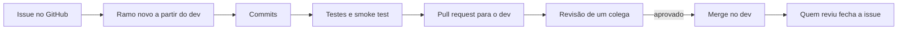

# Processos de trabalho

Como o grupo trabalha com o repositório: ramos e pull requests, issues e quadro, quando se correm os testes, como se faz uma build e os cuidados com o editor do Godot. Os comandos dos testes estão em [13_testes.md](13_testes.md). Descreve o `dev` no commit `cd14afe` (23/11/2026).

## Em resumo, para todos

Cada tarefa é uma issue no GitHub, feita num ramo próprio a partir do `dev`. Quando está pronta, abre-se um pull request para o `dev`, e um colega revê e aprova antes de juntar. O `dev` é o jogo de todos e deve abrir e correr sempre. Antes de pedir revisão, correm-se os testes. Ficheiros e recursos movem-se só dentro do editor do Godot, nunca no explorador do Windows.

## Ramos e pull requests

| Ramo | Para quê |
|---|---|
| `dev` | Ramo de integração e ramo por defeito do GitHub (`origin/HEAD` aponta para ele). Só recebe pull requests aprovados |
| `main` | Versões estáveis. A 23/11/2026 está no commit `c17779f`, de 3/11, com o `dev` 185 commits à frente |
| `hotfix`, `setup` | Ramos fixos do grupo |
| `feat/pj2d-<feature>` e afins | Um por tarefa, a partir do `dev` |

- **Pull request.** A base é o `dev`. O texto leva «Closes #N» para a issue fechar no merge, ou «Part of #N» quando a issue continua com trabalho por fazer.
- **Aprovação.** O `dev` exige a aprovação de um colega. Um push novo no ramo anula a aprovação, e é preciso aprovar outra vez.
- **Commits.** Mensagens curtas, em inglês e no imperativo (por exemplo `add main menu, pause and options`).
- **Versionado e não versionado.** Ver a secção [Git](../../README.md#git) do README: os `*.import` e `*.uid` versionam-se; `Projeto/.godot/`, `builds/` e `export/` não (`.gitignore`).

## Issues e quadro

- As tarefas são issues no GitHub, agrupadas em milestones por sprint (por exemplo «Sprint 16/11»).
- Cada issue tem os campos Start date, Target date e Effort, da organização. O responsável é quem fez a tarefa.
- O quadro do projeto mostra o Status: Backlog, In Progress, In Review e Done. Quem começa uma issue passa-a a In Progress. Quando o pull request fica pronto para revisão, passa-a a In Review e junta quem revê aos responsáveis. Quem revê fecha a issue depois do merge, e o quadro passa-a a Done sozinho.

## Antes de pedir revisão

1. Abrir o projeto no editor e esperar pela importação, se houve recursos novos ou movidos.
2. Correr a suite inteira e o smoke test ([13_testes.md](13_testes.md)). Os testes que falham devem ser os mesmos da lista de falhas conhecidas, e nenhum novo.
3. Atualizar o README quando muda uma decisão, uma tecla, uma camada ou um valor que lá está: é a documentação que os docentes leem.

## Builds

- O `export_presets.cfg` não está no repositório. Cada build sai de um preset local de quem a faz, e a pasta `builds/` fica fora do git.
- O `project.godot` desliga a conversão dos recursos de texto para binário no export (`editor/export/convert_text_resources_to_binary=false`). Sem isto, os pulsos de vibração criados no `rumble_stats.gd` saem vazios no jogo exportado ([08_impactos.md](08_impactos.md)).
- No Windows 11, o Controlo Inteligente de Aplicações pode bloquear um `.exe` acabado de gerar (erro 4551). O que já funcionou: o executável oficial do template, sem alterações, ao lado do `.pck` do projeto.
- O PCK distingue maiúsculas de minúsculas e o Windows não. Um caminho com as maiúsculas trocadas passa em todos os testes e parte no jogo exportado. Por isso, a cada build, convém jogar a build e não só correr os testes.

## Cuidados com o editor do Godot

| Cuidado | Porquê |
|---|---|
| Mover e renomear recursos só no painel FileSystem | O editor atualiza as referências e os UIDs; o explorador do sistema não |
| Nunca editar `*.import` nem `*.uid` à mão | São do editor e versionam-se como ele os escreve |
| Fechar o editor, ou recarregar a cena, depois de mudar um `.tscn` ou o `project.godot` fora dele | Ao gravar, o editor aberto reescreve o ficheiro com a versão que tem em memória |
| Depois de um pull ou de uma troca de ramo, abrir o editor e esperar pela importação | Recursos novos ou movidos e `class_name` novas só entram na cache (`Projeto/.godot/`) assim |
| Não correr o import pela linha de comando (`--import`, `-e`) na instalação do Steam | A 9/11/2026, um import sem janela reescreveu as definições do editor, que essa instalação guarda ao lado do executável |
| Gravar no editor as cenas que um script mudou | O editor dá `unique_id` aos nós novos na primeira gravação; até lá, quem gravar a cena a seguir leva essa mudança para o seu commit |

## Ver também

- README, [Git](../../README.md#git) e [Convenções de código](../../README.md#convenções-de-código).
- [13_testes.md](13_testes.md) para os comandos; [15_configuracao.md](15_configuracao.md) para as definições do projeto.
