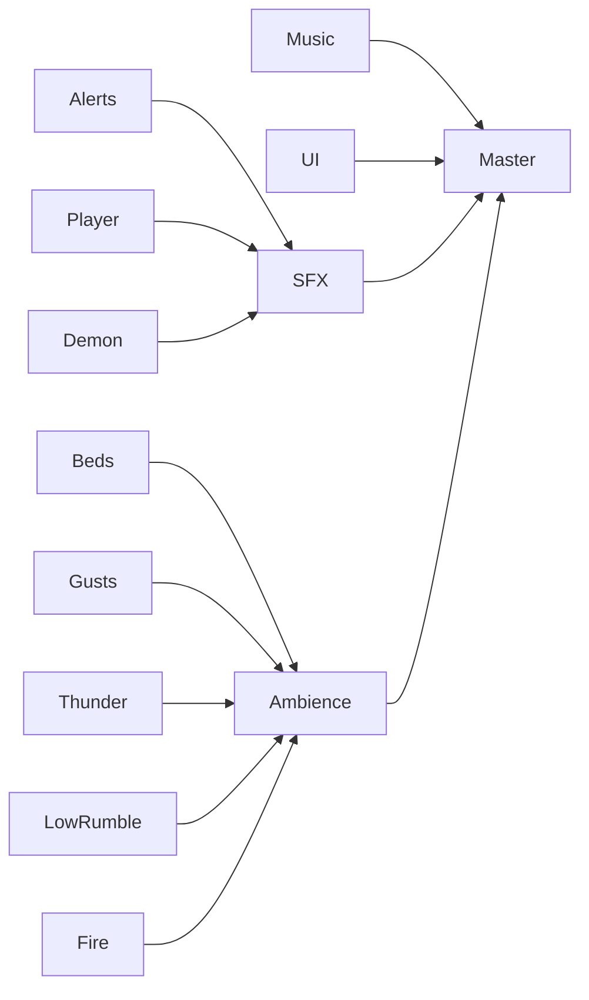

# Configuração do projeto

O que está configurado fora das cenas: as ações do Input Map, as camadas de colisão, a árvore dos buses de áudio, os ficheiros que o jogo escreve no computador de quem joga, as definições do `project.godot` que mudam o comportamento do jogo e o plugin. As tabelas das teclas e das camadas vivem no README; aqui ficam as contagens e o que o README não tem. Descreve o `dev` no commit `cd14afe` (23/11/2026). Os caminhos são relativos a `Projeto/`.

## O que faz no jogo

Estas definições decidem que teclas e botões fazem o quê, que objetos colidem com quais, por onde passa cada som até às colunas, onde ficam guardados as opções e o jogo gravado, e a resolução e o renderer. O jogador muda as teclas e os volumes no ecrã das opções; o resto só muda no editor.

## Input Map

23 ações no `project.godot`. As 21 do projeto usam teclas físicas (contam pela posição no teclado, por isso o WASD fica igual num teclado AZERTY). O `ui_accept` e o `ui_cancel` são as do Godot e guardam a tecla pelo carácter (Enter, Enter do teclado numérico e Espaço; Escape):

| Grupo | N.º | Ações |
|---|---|---|
| Jogo | 8 | `move_left`, `move_right`, `move_up`, `move_down`, `jump`, `crucifix`, `interact`, `pause` |
| Menus | 4 | `ui_accept` e `ui_cancel` (as do Godot, com o A e o B do comando acrescentados), `menu_previous_tab`, `menu_next_tab` |
| Depuração | 11 | `toggle_debug_overlay`, `debug_damage`, `debug_god_mode`, `debug_noclip`, `debug_accept_offer`, `debug_refuse_offer`, `debug_reset_run`, `debug_camera_next`, `debug_phase_1` a `_3` |

- As teclas e os botões de cada ação estão na tabela do README, secção «Input: ações nomeadas com teclas físicas» ([Decisões técnicas](../../README.md#decisões-técnicas)). O `test_input_map.gd` verifica que o perfil predefinido tem exatamente essas teclas.
- O que faz cada ação de depuração está em [12_depuracao.md](12_depuracao.md).
- Os perfis de controlos e o remapeamento são do `Settings` e do `InputProfiles` ([02_servicos_globais.md](02_servicos_globais.md)). As teclas reservadas (`RESERVED_KEYS` do `input_profiles.gd`: Escape, F1 a F4, F7 a F10 e a tecla Windows) nunca se dão a uma ação do jogo.

## Camadas de colisão

11 camadas com nome no `project.godot`: 1 `world`, 2 `player`, 3 `enemy`, 4 `player_hitbox`, 5 `enemy_hitbox`, 6 `player_hurtbox`, 7 `enemy_hurtbox`, 8 `interactable`, 9 `one_way_platform`, 10 `camera_bounds`, 11 `repellable`. O README explica quem está em cada uma e quem procura onde, na secção «Camadas de colisão» ([Decisões técnicas](../../README.md#decisões-técnicas)). No Inspector usa-se sempre o nome, nunca o número.

## Buses de áudio

O `default_bus_layout.tres` tem o `Master` e mais 29 buses. Cada som do jogo toca num bus folha; o volume de cada grupo regula-se no bus pai.

| Bus pai | Buses filhos | Quem toca neles |
|---|---|---|
| `Master` | `Music`, `SFX`, `Ambience`, `UI` | — |
| `SFX` | `Alerts`, `Player`, `Demon` | — |
| `Player` | `PlayerJump`, `PlayerLand`, `PlayerWallSlide`, `PlayerFootsteps` | Sons e passos da alma |
| `Demon` | `DemonLatch`, `DemonJump`, `DemonAttack`, `DemonCrucifixHit` | Sons dos cães |
| `Alerts` | `DemonAlert`, `CrucifixCue`, `CrucifixHold`, `PlayerLowSP` | Os avisos que o jogador tem de ouvir |
| `Ambience` | `Beds`, `Gusts`, `Thunder`, `LowRumble`, `Fire` | O ambiente do nível ([10_som.md](10_som.md)) |
| `Beds` | `Bed1`, `Bed2` | As duas bases contínuas |
| `Thunder` | `ThunderBacklayer` (−12 dB), `ThunderBackground`, `ThunderMain` | As três camadas de trovão |

- Todos a 0 dB menos o `Ambience` (−8,24 dB) e o `ThunderBacklayer` (−12 dB).
- **Ducking.** O `Ambience` tem dois compressores: um baixa o ambiente quando toca um aviso (sidechain `Alerts`, limiar −24,7 dB, mix 0,75) e outro, mais leve, quando toca um efeito (sidechain `SFX`, limiar −26 dB, mix 0,25). O `Beds` baixa as bases quando passa uma rajada (sidechain `Gusts`, limiar −27 dB, ratio 2).
- **Pan.** O `ThunderBackground` e o `ThunderMain` têm um `AudioEffectPanner`, que o `BusPan` move para o lado de cada trovão.
- **Opções.** O ecrã das opções tem um volume para `Master`, `Music`, `SFX` (com o nome Effects), `Ambience` e `UI` (com o nome Interface).

## Ficheiros no computador de quem joga (`user://`)

No Windows, `user://` é `%APPDATA%\Godot\app_userdata\P2D\`.

| Ficheiro | Quem o escreve | O que guarda |
|---|---|---|
| `settings.cfg` | `Settings` | Opções: volumes, ecrã, controlos, acessibilidade |
| `save.cfg`, `save_2.cfg`, `save_3.cfg` | `SaveFile`, pelos três slots (`SaveSlots`) | O jogo gravado de cada slot; o slot 1 usa o nome de antes dos slots |
| `save_run.cfg`, `save_2_run.cfg`, `save_3_run.cfg` | `SaveFile.write_run`, chamado pelo `main.gd` | Os números da partida de cada slot (`RunStats`), à parte, para uma morte contar sem reescrever a gravação |
| `offers_log.csv` | `Offers` | Uma linha por resposta a uma oferta, para os playtests |
| `deaths_log.csv` | `RunStats` | Uma linha por morte, para os playtests |

Os testes não escrevem nestes ficheiros: o `base_test.gd` guarda as opções em memória e desliga a gravação e os registos ([13_testes.md](13_testes.md)).

## Definições do `project.godot` que importam

| Definição | Valor | Porquê |
|---|---|---|
| `application/run/main_scene` | `res://main.tscn` | A cena que arranca o jogo ([01_fluxo_e_menus.md](01_fluxo_e_menus.md)) |
| `config/features` | `4.7`, `GL Compatibility` | Godot 4.7; só APIs desta versão |
| `rendering/renderer/rendering_method` (e `.mobile`) | `gl_compatibility` | Ver «Renderer: Compatibility em vez de Forward+» no README |
| `display/window/size/viewport_*` | 1920 × 1080 | Resolução de referência |
| `display/window/size/window_*_override` | 1280 × 720 | Janela de teste no editor |
| `display/window/stretch/mode` e `aspect` | `canvas_items`, `expand` | Escala a imagem e mostra mais mundo noutros formatos de ecrã |
| `physics/common/physics_interpolation` | ligado | Movimento suave a qualquer taxa de frames (ADR 0013) |
| `editor/export/convert_text_resources_to_binary` | desligado | Para os pulsos de vibração sobreviverem ao export ([08_impactos.md](08_impactos.md)) |
| `input_devices/joypads/ignore_joypad_on_unfocused_application` | ligado | O comando não mexe no jogo com a janela em segundo plano |
| `gui/theme/custom_font` | `res://themes/main_font.tres` | A letra de toda a interface |
| `internationalization/locale/translations_pot_files` | os três `.dialogue` | Ficheiros de onde sai o texto a traduzir |
| `[autoload]` | 7 autoloads | Ordem e papel em [02_servicos_globais.md](02_servicos_globais.md) |

A gravidade 2D é a predefinida do Godot (980) e não aparece no ficheiro.

## Plugin

Um só plugin ativo (`[editor_plugins]`): o Dialogue Manager 4.1.0, em `addons/dialogue_manager/` (licença MIT; ver os Créditos do README). O jogo só fala com ele no balão de diálogo e nos autoloads (ADR 0030, [11_dialogo_e_ofertas.md](11_dialogo_e_ofertas.md)). O `addons/` fica como veio.

## Desligado por defeito

| O quê | Valor | Porquê |
|---|---|---|
| Conversão dos recursos de texto para binário no export | `convert_text_resources_to_binary = false` | Com ela ligada, os pulsos de vibração criados no script saem vazios no jogo exportado |

## Ver também

- README, [Decisões técnicas](../../README.md#decisões-técnicas) (Input, Camadas de colisão, Renderer, Resolução, Physics interpolation) e [Créditos](../../README.md#créditos).
- ADR 0013 (câmara própria e physics interpolation), ADR 0063 (o jogo joga-se só com o teclado ou só com o comando).
