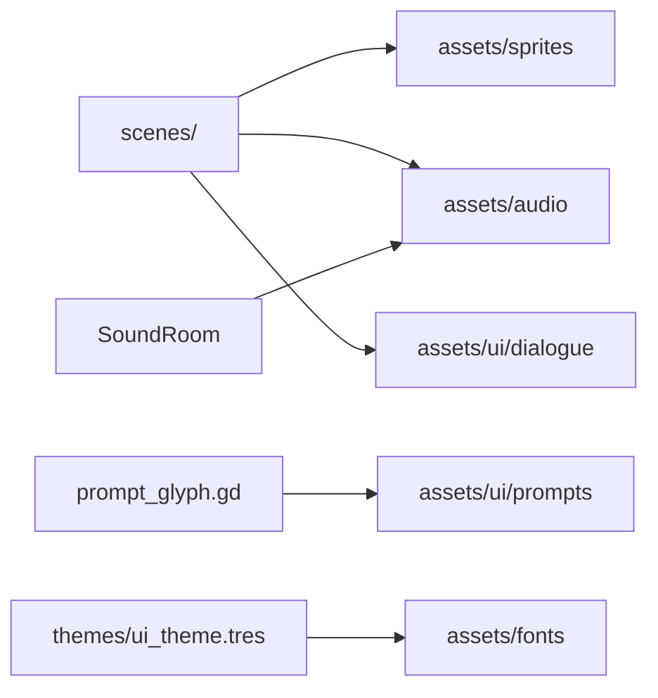

# Assets e ficheiros da raiz

O que está fora de `scenes/`: a pasta `assets/` com as imagens, os sons, as letras e os ícones das teclas, os ficheiros da raiz do projeto Godot, o plugin e os ficheiros da raiz do repositório. Descreve o `dev` no commit `cd14afe` (23/11/2026). Os caminhos são relativos à raiz do repositório; as contagens não incluem os `*.import` nem os `*.uid`.

## O que faz no jogo

Tudo o que o jogo mostra e toca sai de `Projeto/assets/`: as imagens da alma, dos cães e do nível, os sons e a música, as letras da interface e os ícones dos botões do comando. Os scripts e as cenas que os usam estão em `scenes/`. A origem e a licença de cada asset de fora estão nos Créditos do README.

## Como se liga

## A pasta `Projeto/assets/`

3060 ficheiros. Tamanhos medidos com `du -sh` a 23/11/2026.

| Pasta | Ficheiros | O que tem | Quem a usa |
|---|---|---|---|
| `audio/` (52 MB) | 67: 62 `.wav`, 5 `.ogg` | `ambience/` 13 (`thunder/` 6, `wind/low_rumble` e `wind/passing` 5, mais 2 soltos), `music/` 1 (`main_menu_theme.ogg`), `sfx/` 38 (30 soltos e `demons/` 8), `textures/fire/crackles` 5, `ui/` 10 | As cenas de som ([10_som.md](10_som.md)) e a sala de som ([12_depuracao.md](12_depuracao.md)), que lê a pasta inteira |
| `fonts/` (1,6 MB) | 3 `.ttf`, as 3 licenças OFL, 2 `.tres` e um `.gitkeep` | Tinos, Literata e Atkinson Hyperlegible Next | Ver «Letras», abaixo |
| `sprites/` (12 MB) | 68: 63 `.png`, 5 `.jpg` | `asmodeus` 1, `backgrounds` 4, `demon_lust` 6, `environment` 16, `fire` 4, `gates` 4, `hud` 12, `menu` 3, `player` 11, `ramps` 5, `traps` 1, `velvet` 1 | As cenas de cada sistema ([09_luz_visao_e_arte.md](09_luz_visao_e_arte.md)) |
| `ui/dialogue/` | 12: 8 `.png`, 4 `.tres` | Caixa das falas, ligações das respostas, máscara da vinheta, `next_arrow.tres` e, em `portraits/`, os retratos da alma, da Velvet e da Asmodeus | O balão de diálogo ([11_dialogo_e_ofertas.md](11_dialogo_e_ofertas.md)) |
| `ui/prompts/` (com `ui/dialogue/`, 15 MB) | 2904 | Input Prompts 1.5A, da Kenney (CC0, `Kenney-License.txt`): 7 famílias de aparelhos | `prompt_glyph.gd` (ver «Ícones das teclas») |

**Ícones das teclas.** O `prompt_glyph.gd` só usa 4 famílias (`Xbox Series`, `PlayStation Series`, `Nintendo Switch`, `Steam Deck`) e só a subpasta `Double` (`ICON_PATH`, linha 19). A família vem do `LastDevice` ([02_servicos_globais.md](02_servicos_globais.md)). No teclado, a tecla escreve-se como texto dentro da moldura `PromptKey` do tema, sem ícone do pacote. As subpastas `Default`, `Fonts` e `Vector` de cada família têm um `.gdignore` (21 no total), e o editor não as importa. As famílias `Keyboard & Mouse`, `Nintendo Switch 2` e `Steam Controller` e as folhas `*_sheet_*.png` são importadas, mas nenhum script ou cena as usa.

**Letras.** O `themes/main_font.tres` é uma `SystemFont` que pede a Times New Roman ou outra letra serifada do sistema e usa a Tinos quando não há nenhuma. É a letra de toda a interface (`gui/theme/custom_font`, [15_configuracao.md](15_configuracao.md)), a 40 px no `ui_theme.tres`. A Literata (`prompt_caption_font.tres`) é a letra da legenda dos avisos (`PromptCaption`), e a Atkinson Hyperlegible Next (`prompt_key_font.tres`) a do nome da tecla (`PromptKeyName`).

## A raiz do projeto Godot (`Projeto/`)

| Ficheiro ou pasta | O que é | Onde se explica |
|---|---|---|
| `project.godot` | Definições do projeto, Input Map, camadas, autoloads; nome `P2D` | [15_configuracao.md](15_configuracao.md) |
| `main.tscn` + `main.gd` (75 e 454 linhas) | A cena que arranca o jogo: menus, `LevelSlot` e lista dos níveis | [01_fluxo_e_menus.md](01_fluxo_e_menus.md) |
| `default_bus_layout.tres` | Os buses de áudio | [15_configuracao.md](15_configuracao.md) |
| `icon.svg` | Ícone do projeto (`config/icon`). Parece ser o que o Godot põe num projeto novo: tem a cor de fundo dele, `#363d52` | — |
| `scenes/` | As cenas e os scripts, por sistema (ADR 0050) | Ficheiros 01 a 12 desta pasta |
| `dialogue/` | `lust.dialogue`, `gluttony.dialogue`, `greed.dialogue` e `lust_waking_preview.tscn` | [11_dialogo_e_ofertas.md](11_dialogo_e_ofertas.md) |
| `themes/` | `ui_theme.tres` (cores, molduras, variações dos botões e dos avisos) e `main_font.tres` | [01_fluxo_e_menus.md](01_fluxo_e_menus.md) |
| `tests/` | 193 scripts: 168 testes, 16 medidas em `measures/`, 8 de apoio em `support/` e 1 em `launchers/` | [13_testes.md](13_testes.md) |
| `addons/dialogue_manager/` | O plugin Dialogue Manager 4.1.0 (MIT), o único da pasta. Fica como veio | [15_configuracao.md](15_configuracao.md) |

## A raiz do repositório

| Ficheiro ou pasta | O que é |
|---|---|
| `README.md` | A documentação que os docentes leem: como abrir, estrutura, decisões técnicas, tabelas, convenções, Git e Créditos |
| `LICENSE` | Licença MIT, «Copyright (c) 2026 P2D2627» |
| `.gitignore` | O que não se versiona: `.godot/`, `builds/`, `export/`, `.venv/` e outros ([14_processos.md](14_processos.md)) |
| `docs/nivel1_desenho.md` | O desenho do nível 1: fases, cães, medidas e a lista de verificação de cada sala |
| `docs/som_e_musica.md` | A direção sonora, a música adaptativa e as regras técnicas do som |
| `docs/referencias/` | 14 artigos em PDF citados no `nivel1_desenho.md`, com um `README.md` que dá a referência e o DOI |
| `docs/tecnico/` | Este documento técnico |
| `tools/accessibility/wcag_flashes.py` | Mede os frames gravados do jogo contra os limiares de clarões da WCAG 2.2 (clarão geral e clarão vermelho) |
| `tools/audio/make_menu_sounds.py` | Faz os sons dos menus (`assets/audio/ui/`) a partir das fontes CC0, já cortados e com o volume certo; as fontes não estão no repositório |

Os dois scripts de `tools/` são Python e têm um `requirements.txt` cada. O ambiente virtual (`.venv/`) cria-se na raiz e não se versiona.

## Desligado por defeito

Nada. O que existe sem uso (as três famílias de ícones e as folhas do pacote da Kenney, o `.gitkeep` das letras) está descrito acima.

## Ver também

- README, [Créditos](../../README.md#créditos) (origem e licença de cada asset de fora), [Estrutura](../../README.md#estrutura) e [Git](../../README.md#git).
- ADR 0050 (estrutura das pastas).
