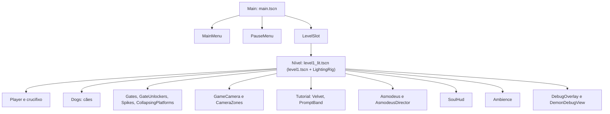

# Documento técnico do P2D

Como o jogo está feito por dentro, sistema a sistema, para todo o grupo, incluindo quem não programa. Descreve o `dev` no commit `cd14afe` (23/11/2026). Se o código e este documento não baterem certo, vale o código.

## Para que serve

O README da raiz explica as decisões e tem as tabelas de referência (teclas, camadas, convenções). Este documento junta o resto: que ficheiros fazem cada parte do jogo, como se ligam, onde se afina cada valor e o que está desligado por defeito. Serve para encontrar onde mexer, para rever um pull request de outra área e para preparar a defesa.

## Como ler

- Cada ficheiro começa por **O que faz no jogo**, em poucas linhas e sem código, para todos. Quem não programa pode ler só essas secções, pela ordem da tabela.
- Depois vêm **Como se liga** (um diagrama dos nós, dos autoloads e dos sinais), **Ficheiros** (o que é cada ficheiro, quem o usa e onde se afina), **Desligado por defeito** e **Ver também**.
- Nomes de ficheiros, nós, classes e parâmetros ficam em inglês, como no código. Os caminhos de cada ficheiro são relativos à pasta dita no resumo do topo.
- Os números vêm do código ou das medidas, com o ficheiro de onde saem. Os ADR citam-se pelo número, como no README.
- «Onde se afina» dá o nome da propriedade no Inspector. Com o jogo a correr a partir do editor, também se muda no separador Remote, mas só tem efeito se o código voltar a ler o valor depois do arranque.

Para quem vai programar pela primeira vez no projeto: a secção [Estrutura](../../README.md#estrutura) do README (as regras das pastas), depois o [00_arquitetura.md](00_arquitetura.md), o 01, o 02 e o 05, e a seguir o sistema em que se vai mexer.

## Mapa geral

O `Main` fica sempre carregado e troca o nível dentro do `LevelSlot`; os menus só emitem sinais. Cada nível é uma cena com raiz `Level`, que junta a alma, os cães, os objetos, a câmara e o resto. Os nomes do diagrama são os nós da cena `level1.tscn`.

Por cima de tudo correm sete autoloads, por esta ordem: `Settings`, `DialogueManager` (do plugin), `Moral`, `GameState`, `Offers`, `RunStats` e `LastDevice`. Guardam o que tem de sobreviver à troca de nível: opções, falas, registo moral, progresso, tentações, números da partida e o último aparelho usado ([02_servicos_globais.md](02_servicos_globais.md)).

## Sistemas

| Ficheiro | O que cobre | Onde vive no projeto |
|---|---|---|
| [00_arquitetura.md](00_arquitetura.md) | Os padrões numa página, seis fluxos de ponta a ponta, as decisões com a alternativa rejeitada e os limites conhecidos | Todo o projeto |
| [01_fluxo_e_menus.md](01_fluxo_e_menus.md) | Arranque, menus, pausa, troca de nível e de fase, gravação | `main.tscn`, `scenes/screens/` |
| [02_servicos_globais.md](02_servicos_globais.md) | Os sete autoloads e as classes de apoio | `scenes/autoload/` |
| [03_personagem.md](03_personagem.md) | A alma: movimento, estados, pontos de alma, agarrões, crucifixo, componentes | `scenes/characters/` |
| [04_demonios.md](04_demonios.md) | Os cães: a máquina de 16 estados, os tipos de cão, animação e voz | `scenes/characters/demon/` |
| [05_niveis.md](05_niveis.md) | A raiz `Level`, morte e recomeço, fases, pontos de gravação, tutorial, nível 1, construtores | `scenes/levels/` |
| [06_objetos.md](06_objetos.md) | Portões, plataformas, silvas e armadilhas | `scenes/objects/` |
| [07_camara.md](07_camara.md) | A câmara, os dois modos de enquadrar, zonas, cenas de câmara | `scenes/others/` |
| [08_impactos.md](08_impactos.md) | Tremor do ecrã e vibração do comando | `scenes/others/` |
| [09_luz_visao_e_arte.md](09_luz_visao_e_arte.md) | Luz, shaders, linha de vista, tileset, fundo e arte do nível | `scenes/` |
| [10_som.md](10_som.md) | Ambiente sonoro, emissor de som, quem mais faz som | `scenes/` |
| [11_dialogo_e_ofertas.md](11_dialogo_e_ofertas.md) | Balão e roda das respostas, falas, ofertas, Velvet e Asmodeus | `scenes/`, `dialogue/` |
| [12_depuracao.md](12_depuracao.md) | Texto de depuração, batotas, vista dos cães, sala de som | `scenes/others/debug/` |
| [13_testes.md](13_testes.md) | Os 168 testes por sistema, as 16 medidas, como se correm, falhas conhecidas | `tests/` |
| [14_processos.md](14_processos.md) | Ramos, pull requests, issues e quadro, builds, cuidados com o editor | O repositório |
| [15_configuracao.md](15_configuracao.md) | Input Map, camadas, buses de áudio, ficheiros `user://`, `project.godot`, plugin | `project.godot`, `default_bus_layout.tres` |
| [16_assets_e_raiz.md](16_assets_e_raiz.md) | A pasta `assets/`, a raiz do projeto Godot e a do repositório | `assets/`, raiz |

Os caminhos desta tabela são relativos a `Projeto/`.

## Ver também

- README, [Estrutura](../../README.md#estrutura), [Testes e medidas](../../README.md#testes-e-medidas), [A personagem por dentro](../../README.md#a-personagem-por-dentro), [Decisões técnicas](../../README.md#decisões-técnicas), [Convenções de código](../../README.md#convenções-de-código) e [Git](../../README.md#git).
- ADR 0050 (estrutura das pastas).
